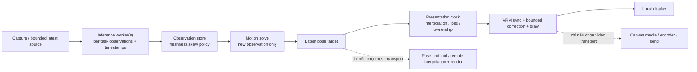

# VeilTalk — Avatar Video Call Performance Audit

Ngày khảo sát: **17/11/2026**, theo múi giờ người dùng Asia/Bangkok. Repository: `C:\project\veiltalk`. HEAD tham chiếu: `a759fa5d409a4e263da8dc61c06708f8acc96ae2`.

**Đối tượng là working tree hiện tại, có rất nhiều thay đổi chưa commit**, không phải riêng HEAD. Số dòng bên dưới tham chiếu working tree lúc khảo sát. Không sửa, hoàn tác hoặc định dạng lại những thay đổi có sẵn. Báo cáo này không triển khai tối ưu hay thay đổi business logic.

Quy ước:

- **Confirmed**: xác nhận một cấu hình/cơ chế/hành vi từ source, asset hoặc kiểm thử nêu rõ; **không đồng nghĩa đã chứng minh mức ảnh hưởng FPS trên thiết bị**.
- **Suspected**: cơ chế có thật nhưng vai trò gây giảm FPS/chi phí thực tế cần profiling.
- **Not verified**: chưa có môi trường hoặc dữ liệu để kiểm tra. Không điền số benchmark giả.

Hash frontend/src (Vite algorithm): `6cb838649de6cbcedffac5bc478c90e9079f1d9226de64e5055385277321a47b`.

## 1. Executive Summary

**Có nguyên nhân cấu hình rõ ràng cho việc ưu tiên camera 30 FPS, nhưng chưa đủ dữ liệu để chỉ đích danh thành phần gây mức giảm 30 → 10–15 FPS.** Ba phát hiện quyết định phạm vi điều tra:

1. `CameraController.start` yêu cầu `frameRate: { ideal: 30 }`, kích thước lý tưởng 1280×720 hoặc 640×480, `audio: false`. Đây là **mục tiêu cấu hình**, không phải `max: 30` và không chứng minh cảm biến chỉ hỗ trợ 30 FPS.
2. Luồng thực thi hiện có là **webcam local → MediaPipe → motion processor → Three.js/VRM → canvas + video preview**. `/calls/new` và `/calls/incoming` vẫn là placeholder. Có server signaling, nhưng chưa tìm thấy frontend tạo `RTCPeerConnection`, capture canvas thành media track, encode/send video, nhận video hoặc truyền pose qua data channel. Không thể quy mức giảm quan sát cho encoder/network của một luồng chưa được nối trong snapshot này.
3. Face và Pose chạy **đồng bộ trên main thread**; Hand chạy worker tùy cấu hình nhưng pipeline **join cùng frame và chờ Hand trước khi publish**. Renderer độc lập bằng rAF nhưng vẫn chia sẻ main thread/GPU với inference. Mỗi draw có target còn làm retarget, VRM update, collision, fingertip correction, face-contact refinement và diagnostic geometry. Đây là các ứng viên cần cô lập trước.

Mức nghiêm trọng: **cao đối với trải nghiệm realtime mà người dùng mô tả**; khả năng tái hiện 10–15 FPS trên thiết bị: **Not verified**. Nếu đó là tracking publish Hz thì chuyển động có thể cập nhật 10–15 lần/giây ngay cả khi canvas draw nhanh hơn. Nếu là renderer FPS thì phải kiểm tra cả main-thread contention và GPU. Cần tên metric/trang/thiết bị để phân biệt.

Ưu tiên thực hiện tiếp: đo ba baseline camera-only, tracking-only và tracking + mapping + renderer; bổ sung hai phép tách mapping-only và renderer có pose cố định. Chỉ tối ưu sau khi xác định nhánh chiếm thời gian. Không lấy 60 FPS camera làm tiêu chí mặc định.

**Đã thực hiện:** đọc các entry/lifecycle, theo các nhánh capture–worker–mapping–render–diagnostics, kiểm tra asset GLB/VRM, rà soát signaling và ranh giới backend; chạy kiểm thử liên quan và production build. **Chưa thực hiện:** benchmark webcam, GPU trace, đo CPU/memory thiết bị mục tiêu hoặc cuộc gọi hai đầu. Browser runtime báo `No browser is available`; danh sách browser kết nối trả `[]`. Không khởi chạy camera giả để thay thế số đo phần cứng thật.

## 2. Source Code Inventory

### 2.1. Các entry và file điều phối đã kiểm tra

Đường dẫn trong bảng tính từ repository root. Phụ lục A liệt kê riêng từng module trong ba thư mục tracking/motion/renderer, entry hoặc contract của module; các module offline không được xem là chi phí realtime.

| File | Vai trò / vị trí quan trọng |
|---|---|
| `frontend/package.json`; `frontend/package-lock.json` | Stack và dependency thực tế; React 19, TypeScript, Vite, Three.js, three-vrm, MediaPipe Tasks Vision. ONNX tồn tại trong dependency nhưng không chứng minh được dùng cho webcam. |
| `frontend/src/main.tsx:11–17` | React StrictMode; có thể chạy lại effect khi mount ở DEV, không chứng minh có hai loop tồn tại lâu dài. |
| `frontend/src/App.tsx:39–54,609–632` | Route production preview, DEV harness; call/record vẫn placeholder. |
| `frontend/src/components/avatar/AvatarCanvas.tsx:13–33` | Sở hữu canvas, ResizeObserver, renderer start/dispose; effect `[]`, options/callback qua ref. |
| `frontend/src/components/avatar/AvatarMotionPreview.tsx:14–92` | Preview local production; processor qua ref, full-rate 720p, applyPose trực tiếp; không truyền dữ liệu realtime lên server. |
| `frontend/src/components/avatar/AvatarPreviewScreen.tsx:89–229,231–267,314–329` | Preview onboarding/edit, customization, cùng tracking profile; gửi metrics khi stop/finish, không gửi video. |
| `frontend/src/components/avatar/avatarMotionPreview.css`; `avatarPreviewScreen.css` cùng thư mục | Kích thước canvas và video picture-in-picture; CSS size ảnh hưởng drawing buffer qua ResizeObserver. |
| `frontend/src/components/dev/TrackingDevHarness.tsx:45–107,109–177,206–220` | Camera-only thực sự, tracking theo task; setFrame mỗi publish, overlay tùy chọn. |
| `frontend/src/components/dev/AvatarRendererDevHarness.tsx:89–166,189–258,320–353` | Mapping/apply trực tiếp; stop renderer, replay, diagnostics timer 400ms; full-rate/GPU/Full/720p. |
| `frontend/src/components/dev/TrackingPerformancePanel.tsx:5–108` | Định nghĩa thời gian, phân biệt Hz/FPS, reset/export JSON. |
| `frontend/src/components/dev/CameraCadencePanel.tsx:19–79` | rVFC subscription riêng, 500ms UI, reset/export cadence. |
| `frontend/src/components/dev/videoCadence.ts:1–23` | FPS presented và callback trên rolling 10s; không phải sensor FPS. |
| `frontend/src/components/dev/MotionReplayPanel.tsx`; `devAvatarModels.ts` | Replay/benchmark synthetic và chọn model; cần tắt khi đo webcam. |
| `frontend/src/components/dev/FacialDevHarness.tsx`; `avatar-renderer/avatarDiagnostics.ts` | Công cụ kiểm tra facial/helper; không mặc định chạy trên preview production. |
| `frontend/src/components/dev/trackingDevHarness.css`; `avatarRendererDevHarness.css` cùng thư mục | Ẩn webcam dùng display:none; kích thước stage khác production. Không coi hidden-video run tương đương visible-video run. |
| `frontend/src/components/avatar/LocalVrmThumbnail.tsx:61–211` | Renderer khác cho trang chọn model; chủ động throttle khoảng 80/50ms, pause ngoài viewport/hidden; không phải call renderer. |
| `frontend/src/components/avatar/AvatarColorLab.tsx:108–227` | Renderer khác ở trang chỉnh màu, dùng preview asset và giới hạn 50ms; không dùng camera. |
| `frontend/src/lib/avatar/localAvatarCatalog.ts:9–23`; `avatarMaterialManifest.ts`; `avatarAuraTint.ts` | URL model chính so với preview, material/customization; không reload model theo mỗi tracking frame. |
| `frontend/src/lib/avatar/avatarViewportControls.ts`; `avatar-preview/avatarPreviewMotionController.ts` | Điều khiển camera orbit và chuyển động demo; phân biệt với motion đo từ người thật. |
| `frontend/src/lib/audio-lipsync/audioQualificationController.ts`; `audioQualification.worker.ts`; `audioModelQualification.ts` | Workflow qualification audio riêng; không thấy được import vào webcam preview/tracking đang khảo sát. |
| `frontend/src/lib/api/endpoints/avatars.ts`; `metrics.ts`; `videos.ts`; `client.ts`; `types.ts` | Model/profile/portrait, telemetry và upload video lưu trữ; không phải realtime encoder. |
| `frontend/src/lib/ws/messagingWS.ts:21–29,140–219`; `components/connected/ConnectedLayout.tsx`; `ConversationScreen.tsx` | Messaging socket và UI chat; nhận biết CALL_INCOMING không đồng nghĩa đã có media pipeline. |
| `signaling/src/server.js:6,136–212,239–336`; `index.js`; `callNotifyClient.js` | Relay call offer/answer/ICE và lifecycle; thông báo backend ngoài luồng frame. |
| `backend/src/main/java/com/veiltalk/call/CallNotifyService.java:26–40` và các controller/request cùng package | Phát thông báo cuộc gọi; không inference/render/encode. |
| `backend/src/main/java/com/veiltalk/metrics/MetricsService.java:25–40`; `MetricsClientRequest.java` | Ghi log metrics do client báo; không tự đo FPS video. |
| `backend/src/main/java/com/veiltalk/avatar/AvatarService.java`; `AvatarController.java`; `backend/src/main/resources/avatar-models.json` | Phục vụ catalog/profile/portrait; không nằm trong render loop browser. |
| `backend/src/main/java/com/veiltalk/video/VideoService.java`; `VideoController.java` | Multipart upload/library; đã kiểm tra ranh giới với video call, không coi đây là live stream. |
| `frontend/vite.config.ts`; `frontend/nginx.conf`; `frontend/Dockerfile`; `ops/nginx/veiltalk.conf.template:19–21` | Build/dev headers và deployment; DEV/preview có COOP/COEP, reverse proxy cũng có; nginx frontend trực tiếp không khai báo hai header này. |
| `docs/camera-cadence-comparison.md`; `docs/tracking-phase-b-verification.md` | Hướng dẫn đo có sẵn; một số controls/preset mô tả đã cũ so với code. |
| `docs/12_CURRENT_IMPLEMENTATION_STATUS.md`; `docs/10_PERFORMANCE.md` | Chỉ dùng làm bối cảnh, ưu tiên source khi khác tài liệu. |
| `frontend/scripts/audit-motion-rigs.mjs`; `docs/motion-review/rig-audit-and-synthetic-benchmark.json` | Kết quả synthetic/raw rest graph cũ, không phải bằng chứng webcam/renderer hiện tại. Không nhập số của chúng vào benchmark đợt này. |
| `frontend/public/mediapipe/models/*.task`; `frontend/public/mediapipe/wasm/*`; `frontend/public/models/avatars/*.vrm` | Runtime self-host và asset thật; GLB metadata được kiểm tra trực tiếp, xem mục 5.7. |

### 2.2. Phạm vi tìm kiếm và độ sâu

- Tìm toàn bộ `frontend/src`, `signaling/src`, `backend/src/main` cho capture, rAF/rVFC, MediaPipe, avatar/tracking, WebRTC/encode/decode, media track và signaling.
- Đọc trực tiếp các nhánh nóng và lifecycle được trích dẫn ở mục 3–5; theo import tới solver/filter/contact, kiểm tra các vòng lặp, cache, timestamp, tài nguyên và callback.
- Phụ lục A là inventory tĩnh toàn bộ module TS không phải test trong ba thư mục lõi, gồm cả type/config, helper và tooling offline. Liệt kê file không có nghĩa mọi nhánh trong file đã được thực thi hoặc đã profile.
- Tests được đọc/đối chiếu theo các nhóm scheduler, duplicate/busy, worker transport/fallback, instrumentation, renderer loop/model lifecycle, motion/contact/rig. Kết quả chạy ở mục 10. Không xem mocked tests là benchmark phần cứng.

## 3. Architecture & Data Flow

### 3.1. Công nghệ được chứng minh từ source

Ứng dụng frontend **web React/TypeScript**, không tìm thấy implementation camera native Android/iOS trong luồng hiện tại. Camera dùng browser `getUserMedia`, video DOM, `requestVideoFrameCallback` (fallback rAF). Nhận diện dùng **MediaPipe FaceLandmarker, HandLandmarker, PoseLandmarker**, chạy VIDEO mode, asset local. Render dùng **Three.js WebGLRenderer + @pixiv/three-vrm 3.5.5**, model VRM/GLTFLoader.

Face: 1 face, blendshapes và facial transformation matrix. Hand: tối đa 2 tay. Pose: 1 người, mặc định **Full**, không xuất segmentation mask. Có đầu/cổ, mắt/lông mày/miệng/gaze, thân/vai, cánh tay/cổ tay/ngón tay và contact/collision; không thấy retarget đầy đủ chân/bàn chân được nối vào renderer này. Audio qualification không nằm trong webcam pipeline; không gán thêm lip-sync microphone khi `audio:false`.

### 3.2. Pipeline hiện tại

```mermaid
flowchart TD
  subgraph Browser["Browser: local preview đang triển khai"]
    CAP["getUserMedia: ideal 1280x720, ideal 30 FPS, audio false"]
    VID["HTMLVideoElement / video.srcObject"]
    PIP["Video preview / compositor"]
    RVFC["rVFC mediaTime; fallback rAF + currentTime"]
    GUARD["generation + processingToken + timestamp guard\nbusy/duplicate: bỏ ngay, không xếp queue"]
    SNAP["await createImageBitmap(video)\nawait createImageBitmap(snapshot)"]
    FP["Main JS thread:\nFace.detectForVideo rồi Pose.detectForVideo"]
    WK["Hand worker:\nprevious Pose hint -> ROI 512x512 hoặc full frame\n1 trong 2 detector normal/sensitive -> result\nđóng bitmap"]
    JOIN["await Hand; kiểm tra cùng mẫu và tuổi <=150ms\nquá cũ: loại Hand; vẫn có Face/Pose"]
    RAW["mapRawTrackingFrame\nFace/Pose/Hand + sampledAt + candidates"]
    MOTION["AvatarMotionProcessor.process (main thread)\nfilter/calibration -> face/upper body/arms/wrist/fingers/contact"]
    TARGET["AvatarRenderer.applyPose\nchỉ thay latest target"]
    RAF["rAF độc lập, main thread\napplyTarget -> VRM -> collision/fingertip\n-> VRM update(0) -> face refine/measure -> render"]
    GL["WebGL GPU: skin/morph/materials -> canvas -> compositor"]
    OBS["Cadence subscription riêng + metrics/DEV UI"]
    CAP --> VID
    VID --> PIP
    VID --> RVFC --> GUARD --> SNAP
    SNAP --> FP
    SNAP -->|"transfer bản bitmap thứ hai"| WK
    FP --> JOIN
    WK --> JOIN
    JOIN --> RAW --> MOTION --> TARGET
    TARGET -.latest target.-> RAF --> GL
    VID --> OBS
    RAW --> OBS
    RAF --> OBS
  end
  subgraph Control["Control plane riêng, chưa nối media client"]
    PH["/calls/new và /calls/incoming: placeholder"]
    SIG["Node ws signaling: OFFER / ANSWER / ICE / END"]
    BACK["Spring: call notification / messaging"]
    SIG --> BACK
    PH -.chưa có frontend media integration.-> SIG
  end
```



Sơ đồ là đường **parallelHands=true** mà các preview đang chọn. Khi worker không hoạt động hoặc cấu hình `parallelHands=false`: không dùng nhánh snapshot-worker này, `source=video`; **Face → Hand (ROI tùy chọn) → Pose** chạy tuần tự trên main thread. Cần ghi `handExecution` và `handWorkerFallback` trong mọi benchmark.

Không có cạnh canvas → encode/send trong pipeline hiện tại. Vẽ video và avatar đồng thời có thêm chi phí compositor; không thấy code upload camera vào texture Avatar, readPixels/toDataURL video mỗi frame hoặc tự encode frame trong đường preview.

### 3.3. Từng công đoạn, môi trường, cách chứng minh

| Công đoạn / file:function / dòng | Thực thi và chức năng | Bottleneck cần xem | Phép đo và tối ưu gắn với code |
|---|---|---|---|
| `tracking/cameraController.ts:17–38` — `CameraController.start` | getUserMedia/play bất đồng bộ; browser/OS sở hữu capture và chuyển pixel format; main JS chỉ điều phối | Constraint, driver/ánh sáng/format thật chưa biết | settings + capabilities + cadence camera-only; benchmark request khác trên cùng device, không tự nâng 60 |
| `tracking/trackingPipeline.ts:190–244` — `scheduleNext/processFrame` | rVFC/rAF callback trên main; guard đồng bộ; timestamp media và performance tách riêng | Callback bị trễ, drop khi bận; callbackAhead chỉ đăng ký sớm | callback Hz, presented Hz, busy/duplicate; giữ guard, không thêm queue FIFO |
| `trackingPipeline.ts:268–290` | Hai createImageBitmap await để giữ source bất biến chung; postMessage transfer bản thứ hai | Capture/clone chuẩn bị, GPU upload/đồng bộ chưa biết | captureVideoBitmapMs, captureHandBitmapMs, framePreparationMs; thử transport khác chỉ khi giữ timestamp và ownership |
| `mediaPipeRuntime.ts:144–211`; `trackingPipeline.ts:292–345` | Khởi tạo async; detectForVideo Face rồi Pose **sync** trên main, GPU delegate yêu cầu bởi profile | Blocking JS và cạnh tranh GPU; Full-rate chạy mọi frame được nhận xử lý | faceInferenceMs, poseInferenceMs, mainThreadInferenceMs, CPU trace; worker toàn bộ hoặc giảm cadence có kiểm chứng |
| `handTrackingWorker.ts:66–102`; `handTracking.worker.ts:65–94` | Worker bền; 1 pending; chọn ROI/confidence; detect sync trong worker, trả landmarks structured clone; ImageBitmap transferable | Hand inference, ROI draw, message scheduling; không phải inference async trên main | pure handsInferenceMs, workerTotalMs, workerWaitMs; so GPU/CPU có ghi delegate thật |
| `poseGuidedHandInput.ts:25–95` | Hint Pose mẫu trước ≤120ms; crop/pad vào canvas 512², map về nguồn | ROI fallback full-frame, resize canvas mỗi lần, clone landmarks | byInputMode + prep/mapping/coverage; tái dùng canvas không resize nếu size không đổi |
| `trackingPipeline.ts:346–389` | await worker rồi join; Hand đúng timestamp và tuổi ≤150ms mới nhận; raw mapping sync main | Nhánh chậm nhất trì hoãn tất cả publish; Hand reject do tuổi không phải mất camera | trackingPublishMs, acceptedHandFps, stale drops; thay contract trước nếu tách publisher |
| `rawTrackingMapper.ts:32–179` | Copy landmarks/results sang typed schema; giữ not-sampled và raw candidates | Cấp phát và map Hand hai lần | mapRawTrackingFrameMs + allocation profile; chia sẻ immutable arrays có kiểm thử aliasing |
| `avatarMotionProcessor.ts:783–1241` | process sync main; lần lượt facial, upper body, arm solve, temporal, wrist, fingers, bimanual/contact | Solver/face-surface lookup/diagnostic object, phụ thuộc tracking publish | motionProcessMs; sample profiler + timer theo substage, cache invariant, spatial index nếu cần |
| `AvatarMotionPreview.tsx:44–55` / `AvatarPreviewScreen.tsx:140–153` | onFrame gọi process và applyPose trực tiếp qua ref | Main-thread work, không set React state pose từng frame ở production | onFrameMs; phân biệt với DEV harness; giữ ref/direct path |
| `avatarRenderer.ts:321` — `applyPose` | Đồng bộ, chỉ giữ target theo sequence; không draw/bone update ngay | Chỉ số applyMs không đánh giá được retarget/render | Đặt thời gian ở draw/applyTarget/VRM/collision; không tối ưu applyPose trước |
| `avatarRenderer.ts:559–601,646–870` — `draw` và helper | rAF main thread; update normalized/raw skeleton, morph/gaze, nhiều contact passes, submit WebGL | CPU matrices/VRM/IK, GPU material/skin/morph/overdraw | Draw CPU duration + interval + GPU timer + info.render; chia chi phí update và submit |
| `AvatarCanvas.tsx:20–31`; `avatarRenderer.ts:452` | ResizeObserver thay drawing buffer theo CSS size × DPR ≤1.5 | Pixel fill, resize thật; không evidence resize mỗi frame | Ghi CSS/buffer size/DPR, A/B pixelRatioLimit=1 |
| `videoCadence.ts`; `rendererMetrics.ts`; DEV panels | rVFC/rAF ticks, timers 400/500ms, snapshot sort/clone | Diagnostic/UI overhead và phạm vi metric sai | Trace React/layout/GC; DEV vs production cùng model/canvas |
| `App.tsx:621–622`; `signaling/src/server.js:239–336` | Call UI placeholder; server relay JSON async control plane | Không có encode/send/decode để đo trong frontend hiện tại | Test 8 N/A; không suy từ signaling load test ra video FPS |

Ở bảng trên, đường dẫn `tracking/*` và `avatar-*/*` viết ngắn tương ứng `frontend/src/lib/…`.

### 3.4. Quan hệ giữa các vòng lặp

- Capture browser, tracking callback và renderer là ba nhịp khác nhau. Renderer không gọi inference từ draw; tracking không trực tiếp gọi WebGL render.
- `callbackAhead=true` được chọn tại `avatarTrackingConfig.ts:4–8`. Chỉ callback tiếp theo được đăng ký trước khi process hoàn tất. `processingToken` bảo đảm tối đa một processFrame đang chạy; callbacks lúc bận bị bỏ, không lưu metadata/frame cũ.
- Hand có tối đa một request; timeout detect 350ms, init 30s. Worker lỗi → terminate → load Hand trên main; không âm thầm coi fallback là benchmark worker thành công.
- `applyPose` là latest-target một slot ở biên renderer, **không phải latest-frame inference độc lập**. Join cùng frame là quyết định bảo toàn đồng bộ Hand/Pose của contract hiện có.
- Tần suất `AvatarMotionProcessor.process` bằng callback publish tracking, không bằng render cadence. Ownership temporal có thể làm upper body/arms dùng alpha=1 ở render; smoothing không bảo đảm mọi joint được nội suy giữa hai packet.

## 4. FPS Investigation

### 4.1. Tại sao quan sát 30 FPS trước khi render?

**Confirmed từ code:** `cameraController.ts:21–25` ưu tiên 30 FPS. Không có `max`/`exact` FPS, không có yêu cầu 60; không có deviceId/facingMode/exposure/pixelFormat hoặc lựa chọn codec USB. Cấu hình “720p”/“480p” cũng chỉ là ideal; phải xem actual settings/videoWidth/videoHeight. Không thấy cấu hình camera riêng Windows/Android/iOS; khác biệt do browser/OS/hardware.

`ideal` là giá trị mục tiêu trong cơ chế constraints, nên 30 không phải trần cứng được chứng minh. Xem [Media Capture and Streams — constraints](https://www.w3.org/TR/mediacapture-streams/#constrainable-interface). Không kết luận camera kém, lỗi driver hoặc pipeline tối đa 30 nếu chưa có capabilities và baseline.

**Not verified:** camera được chọn, sensor format, FPS thực, màn hình Hz, ánh sáng, chế độ tiết kiệm điện và browser. `getSettings().frameRate` chỉ khai báo setting của track; nó không cung cấp số timestamp sensor liên tiếp. Capabilities cũng không bảo đảm mọi tổ hợp resolution/FPS đều hỗ trợ.

Cách phân biệt:

1. Chạy camera-only bằng `/dev/tracking`, cùng độ phân giải, overlay OFF, không renderer/inference. Ghi settings/capabilities/constraints và cadence độc lập.
2. Nếu settings≈30 và presented≈30 ở camera-only: phù hợp với request hiện tại; **chưa biết** thiết bị có thể cao hơn.
3. Trên đúng track/device đó, thử constraint mục tiêu khác nếu capabilities cho phép, kiểm tra settings sau applyConstraints và cadence. Nếu cần xác minh một tổ hợp, thử exact trong phép đo riêng và ghi OverconstrainedError; phục hồi constraints gốc.
4. Nếu advertised max cao nhưng exact mode thất bại/cadence thấp, kiểm tra tổ hợp độ phân giải, exposure/ánh sáng, driver và browser; không suy hardware FPS chỉ từ max.
5. Nếu camera-only presented≈30 còn pipelineFrameFps≈15 khi inference ON, đây là tốc độ nhận xử lý, chưa phải camera giảm xuống 15.

### 4.2. Ý nghĩa từng con số FPS hiện có

| Metric / nơi hiển thị | Thực sự đo gì | Không chứng minh điều gì |
|---|---|---|
| `camera.settings.frameRate`; TrackingDevHarness “Camera khai báo” | Setting của video track | Không phải FPS sensor đo được |
| `cadence.presentedFps`; CameraCadencePanel | Delta metadata.presentedFrames / khoảng thời gian nhận callbacks, rolling 10s | Không phải sensor exposure/capture; phụ thuộc presentation/browser |
| `cadence.callbackFps` | Callback rVFC riêng được JS nhận | Không bằng tổng frame khi main bận |
| `metrics.videoCallbackFps` | Callback của subscription pipeline; default callback-ahead; fallback rAF không ghi nhánh metric này như rVFC | Không phải độc lập với scheduling/inference |
| `metrics.cameraFps` = `pipelineFrameFps` | Tick ở `processFrame:243` **sau guard**, chỉ frame được nhận xử lý | Tên legacy gây nhầm; không phải mọi camera frame |
| `pipelineFps` = `trackingPublishFps` | RawTrackingFrame đã map, trước onFrame | Không bao gồm hoàn tất motion/draw/encode |
| `faceSampleFps/poseSampleFps/handSampleFps` | Tần suất detect trả kết quả; kể cả empty detections | Không phải số frame có mặt/tay thành công |
| `observations.acceptedHandFps` | Hand observation mới, đúng tuổi/frame được pipeline nhận; có thể empty | Không phải recall/hand identity accuracy |
| `avatarApplyFps` | applyPose nhận target qua onFrame | Không phải cập nhật bone hoặc canvas draw |
| `rendererMetrics.fps`; DEV “Render” | Tần suất draw callback hoàn tất/submit, rolling ticks khi draw | Không đo presentation scan-out và không mặc định bằng nhịp pose mới |
| `renderFramesWithoutNewTarget` | Draw với cùng sequence trước đó | Có thể là smoothing bình thường, không tự xem là frame lỗi |
| `AvatarPreviewScreen.reportPreviewMetrics:263` — telemetry `fps` | `avatarApplyFps ?? pipelineFps` | Backend log `fps` **không phải renderer hay encode FPS** |
| Encode/send/receive/decode FPS | **Chưa có producer/getStats implementation** trong frontend | Không thể gán số đo hiện tại cho WebRTC |

rVFC gắn với frame đưa vào composition theo [đặc tả rVFC](https://wicg.github.io/video-rvfc/), không cấp trực tiếp FPS cảm biến. Hai subscriptions diagnostic/pipeline đọc cùng video, không phải hai camera stream.

### 4.3. Vì sao có thể còn 10–15 khi bật Avatar?

**Confirmed về cơ chế tăng tải:** tích hợp Avatar bật thêm processor, retarget/skinning/morph/VRM/contact/draw, dùng chung main thread và GPU với inference. Renderer độc lập không bảo đảm CPU/GPU độc lập.

Ước lượng đường găng về cấu trúc, **không phải benchmark**:

```text
parallelHands:
  prep(bitmap video + bitmap copy)
  + nhánh chậm hơn giữa [Face rồi Pose] và [Hand worker + dispatch/delivery]
  + raw mapping + motion processing + onFrame/diagnostics
  + chờ cơ hội nhận frame tiếp theo / contention với render và browser

main-thread Hand fallback:
  preparation + Face + Hand/ROI + Pose + raw mapping + motion + diagnostics
```

Không cộng `workerRoundTripMs + faceInferenceMs + poseInferenceMs` thành tổng: round-trip chồng lấp main inference và có cả thời gian message/continuation chờ main thread.

10–15 lượt/giây tương ứng khoảng 100–66.7ms giữa các lượt theo toán học; **không suy ra** “Pose tốn 80ms” hay “GPU mất 100ms” khi chưa có trace. Chờ vsync/rVFC có thể tạo bậc tốc độ theo cadence camera; nhìn 15 FPS không đủ xác định một cap 15 trong code.

Phân nhánh kết luận:

- Publish giảm, renderer vẫn nhanh: motion target thưa; đo inference/join/mapping, ownership alpha=1 có thể làm chuyển động giật.
- Renderer giảm, publish gần giữ nguyên: đo draw CPU, VRM/contact/FK và GPU/render size/model.
- Cả presented, publish, renderer cùng giảm: main-thread hoặc GPU contention có khả năng; camera-only control + trace mới phân biệt được camera starvation/presentation delay.
- Renderer độc lập neutral nhanh nhưng renderer có fixed target chậm: chú ý nhánh `if(target && model)` bật contact và VRM update thứ hai; chưa thể quy cho geometry đơn thuần.
- Chỉ DEV chậm hơn production: kiểm tra setFrame, panel JSX/JSON/clone/layout, helper/recording và StrictMode mount; không mặc định DEV là nguyên nhân duy nhất.

## 5. Code-Level Findings

### 5.1. Bảng tổng hợp

Mức độ là rủi ro nếu đang nằm trên đường găng; không phải số ms đã đo. **P0 đo trước; P1 thay đổi nhỏ sau baseline; P2 tối ưu có kiểm chứng; P3 refactor lớn.**

| ID | Mức độ | File / Dòng code | Vấn đề | Bằng chứng | Hướng giải quyết | Ưu tiên |
|---|---|---|---|---|---|---|
| F01 | Cao về chẩn đoán | `cameraController.ts:21–25` | Request ưu tiên 30; chưa kiểm tra device capability | **Confirmed cấu hình**, hardware ceiling **Not verified** | Camera-only + settings/capabilities/constraints/cadence | P0 |
| F02 | Cao | `trackingPipeline.ts:292–345` | Face/Pose sync trên main; full-rate | **Confirmed cơ chế**, gây 10–15 **Suspected** | Profile tasks riêng, cadence/worker sau đo | P0/P2 |
| F03 | Cao về kiến trúc latency | `trackingPipeline.ts:268–287,346–378` | Hai bitmap + join Hand; chậm một nhánh giữ cả publish | **Confirmed**; copy ms/GPU cost **Not verified** | Đo prep/wait; contract observation độc lập nếu cần | P0/P3 |
| F04 | Cao | `avatarRenderer.ts:565–596`; dependency VRM `update` | Khi có target gọi VRM update(dt), rồi update(0) mỗi draw | **Confirmed**, chi phí/ảnh hưởng FPS **Suspected** | Tách sync humanoid/expression khỏi physics/material bằng API đúng, test thứ tự | P2 |
| F05 | Cao, phụ thuộc cử chỉ | `avatarRenderer.ts:715–870`; `finalFaceContactRefinement.ts:34–86`; `indexFaceRefinement.ts:7–33` | Nhiều FK toàn cây, CPU collision/IK và final refinement trong draw | **Confirmed call path**, mức chi phí **Suspected** | Timer từng pass; sync subtree/dirty theo dependency; không tắt an toàn tùy tiện | P0/P2 |
| F06 | Trung bình | `avatarRenderer.ts:794–838` | Tạo fingertip baseline/body trước early return sâu; measureFinalContact chạy cả production có target | **Confirmed**; mức GC/FPS **Suspected** | Early guard khi không có intent; diagnostics opt-in/throttle độc lập | P1/P2 |
| F07 | Trung bình–cao, theo model | `devAvatarModels.ts:12–24`; model `reference-avatar-2.vrm`; `modelCapability.ts:15–25` | Default có 99 GLB primitives; estimate chỉ đếm Mesh, không runtime draw calls | **Confirmed asset/estimate**, GPU bottleneck **Not verified** | renderer.info.render + GPU trace; model optimize/merge có kiểm tra morph/rig | P0/P2 |
| F08 | Trung bình | `avatarRenderer.ts:249–251,452` | Buffer theo CSS × DPR tối đa 1.5; chưa adaptive | **Confirmed**, fill-bound **Suspected** | A/B DPR=1 cùng CSS/model; ghi buffer pixels | P1 nếu GPU bound |
| F09 | Trung bình | `TrackingDevHarness.tsx:64,85–107`; `AvatarRendererDevHarness.tsx:158–166` | DEV setFrame mỗi publish, overlay 2D tùy chọn, periodic snapshot clone/JSX | **Confirmed**, tác động **Suspected** | Overlay/helpers/recording OFF; trace commit/layout; refs + UI throttle | P0/P1 |
| F10 | Cao về chẩn đoán | `trackingMetrics.ts:201–243,256–302`; `rendererMetrics.ts:13–31` | cameraFps là accepted input; draw duration là CPU wall/submission; cửa sổ/reset khác nhau | **Confirmed** | Đặt tên/phạm vi metric đúng, ghi interval/P50/GPU timer riêng | P0/P1 |
| F11 | Trung bình về latency | `avatarRenderer.ts:599–601`; `rendererMetrics.ts:18–19` | poseAge dùng sample mới nhất (max); không lộ part cũ nhất, không đo sensor-to-display | **Confirmed** | Tuổi theo part + sequence được draw và acknowledgement presentation | P1 |
| F12 | Thấp–trung bình | `poseGuidedHandInput.ts:55–66`; `rawTrackingMapper.ts:81–118` | Resize canvas 512² mỗi input; map/copy Hand hai lần | **Confirmed**, tổng chi phí **Suspected** | Không gán size nếu không đổi, chia sẻ immutable mapped arrays | P1 sau allocation trace |
| F13 | Trung bình | `contactRuntime.ts:303–403,429–447`; `avatarFaceSurface.ts:29–59` | Contact lookup có quét triangle và nhiều lần map anchor/observation | **Confirmed** khi điều kiện đúng, cost **Suspected** | CPU profile theo contact state; cache/spatial index/invariant | P2 |
| F14 | Cao về phạm vi | `App.tsx:620–622`; `signaling/src/server.js:6,239–336` | Chưa có end-to-end call media frontend | **Confirmed trong source khảo sát** | Test 8 N/A; bổ sung media metrics khi xây call, không đổ lỗi network hiện tại | P0 |
| F15 | Thấp–trung bình, idle | `AvatarPreviewScreen.tsx:247–252`; `AvatarMotionPreview.tsx:78`; `avatarRenderer.ts:319,565–596` | Stop camera không clear renderer target/stop loop; tiếp tục xử lý pose cuối | **Confirmed** control flow; hao tài nguyên thực **Suspected** | Idle policy riêng sau stop; không gọi đây là memory leak | P2 |
| F16 | Trung bình, portability | `avatarTrackingConfig.ts:4–8`; `mediaPipeRuntime.ts:147–159` | Profile hard-code GPU; AUTO fallback chỉ khi request AUTO | **Confirmed**, GPU tốt hơn CPU **Not verified** | Benchmark delegate riêng; lỗi/fallback phải hiển thị đúng; capability policy | P2 |

Các file trong bảng F01–F16 nếu chỉ ghi basename nằm trong `frontend/src/lib/tracking`, `frontend/src/lib/avatar-renderer`, `frontend/src/lib/avatar-motion` hoặc `frontend/src/components/dev` như inventory/phụ lục.

### 5.2. Capture và scheduling: những điều đã làm đúng

`processFrame:224–237` loại busy, timestamp không hợp lệ và frame trùng/đảo thứ tự trước inference. Không có queue ảnh tăng vô hạn hoặc nhiều inference frame đồng thời trong pipeline chính. Không đề xuất thêm FIFO.

`callbackAhead` đã ON trong profile hiện tại; không đưa “bật callback-ahead” thành quick win mới. `boundedPose`, `cachedPoseHint`, `handRoiRecovery` vẫn OFF trừ khi caller yêu cầu; code chứa scheduler thử nghiệm không có nghĩa chúng đã hoạt động.

`fullRate` khiến `handIntervalMs/poseIntervalMs≈66.7` **không có tác dụng giảm cadence**; các interval chỉ dùng profile staggered khi boundedPose không ghi đè lịch Pose. Face luôn chạy trên frame được nhận khi task bật.

Pixel format: browser quyết định; không thấy yêu cầu NV12/YUY2/MJPEG/RGBA ở CameraController. ImageBitmap/canvas và MediaPipe có thể thêm upload/convert nội bộ, **không thể đếm chính xác physical memory copies từ JS source**. Hai lời gọi createImageBitmap được xác nhận; “hai lần memcpy CPU toàn ảnh” chưa được xác nhận.

### 5.3. Inference/worker và join

`MediaPipeRuntime` khởi tạo task một lần, có initPromise coalescing, giữ qua stop/start, close khi dispose. GPU/CPU ở đây là delegate đã chọn, không phải số đo mức sử dụng accelerator. Profile preview yêu cầu GPU rõ ràng; chỉ lựa chọn AUTO mới thử GPU rồi CPU (`mediaPipeRuntime.ts:144–163`).

Worker tạo normal và sensitive detector bền khi adaptive bật (`handTracking.worker.ts:40–62`); **chỉ một detector chạy mỗi request**, không chạy gấp đôi inference mọi frame. Cái thứ hai có chi phí khởi tạo/resident memory chưa đo. Worker warm-up trước nhận camera; không đồng nhất startup stall với steady-state FPS.

Source bitmap dùng chung để Face/Pose và Hand đọc cùng ảnh. Transfer snapshot gốc trước Face/Pose sẽ detach đầu vào main; transfer sau Face/Pose sẽ mất overlap. Vì vậy không xóa bản bitmap thứ hai như một “copy thừa” trước khi thay ownership/transport.

`await workerJob` giữ toàn pipeline bận; busy callback bị drop trong thời gian này. Hand quá 150ms bị loại nhưng Face/Pose vẫn map/publish. Timeout 350ms tạo fallback Hand main thread và có thể làm chi phí tăng; phải xem trường fallback thay vì suy worker luôn hoạt động.

### 5.4. Mapping: có nhiều bước hình học thật, chưa biết bước nào chiếm ưu thế

`AvatarMotionProcessor.process:783–878` kiểm tra geometry/timestamp, condition Pose, facial/upper body, hand matching, reconstruct wrist, depth/endpoint và arm solve. Solver chỉ chạy arm geometry mới khi `isNewSample`; không đúng nếu nói toàn bộ solver chạy lại trên mọi render frame.

`processUpperBody:649–780` làm neutral calibration, head/neck distribution, torso/lean/shoulder, temporal và life motion. `processFacialExpressions:1829–1895` có xử lý duplicate/reversed riêng. Các conditioner cũng cache theo sampledAt (`handLandmarkConditioning.ts:17–28`; `poseDepthConditioning.ts:24–55`).

Ngón liên tục (`2013–2029`), bimanual và contact (`1212–1238`) chạy trên nhịp processor. Profile chung bật constraint, wrist/hand, continuous fingers, bimanual, body-depth, contact và **FACE_CONTACT_COMBINED + indexTip**. “Research” trong tên không có nghĩa tính năng chỉ DEV: preview production nhập cùng profile.

`ContactRuntime.faceSurface:269–272` có cache surface giữa hai tay cho cùng input, nên không đề xuất cache này như việc chưa tồn tại. Tuy vậy `mapAvatarFaceSurface` quét triangles để tìm anchor, và `locateHumanFaceSurface` quét canonical triangles; contactRuntime có preliminary/final observation và nhiều lần map anchor theo state. Cần đo cử chỉ gần mặt/slide riêng, không dùng mỗi cảnh đứng yên để kết luận chi phí contact.

Không có bằng chứng bài toán bị O(số frame đã chạy) không giới hạn. Hand matching thử các assignment nhưng model giới hạn hai tay; không thể gọi đây là combinatorial bottleneck lớn nếu chưa đo.

### 5.5. Rendering: phân biệt pose submission, update và draw

`applyPose:321` chỉ giữ packet mới nhất. `avatarApplyMs` nhỏ không chứng minh render rẻ. Chi phí thật nằm ở `draw`:

1. `applyTarget:646–713`: retarget expressions, gaze, absolute rest × delta, quaternions và smoothing.
2. `vrm.update(dt):569`.
3. Raw shoulder translation.
4. `applySelfCollision:580` và `applyFingertipContact:581`.
5. `vrm.update(0):582`, raw shoulder translation lại.
6. Raw morph, optional final face refinement, final geometry measurement.
7. `webgl.render:597`.

Đã đọc implementation dependency local `frontend/node_modules/@pixiv/three-vrm/lib/three-vrm.module.js:3126–3133,3195–3208`: `VRM.update` gọi humanoid, lookAt, expression manager, node constraints, spring-bone manager và material.update nếu có. **update(0) vẫn đi qua các hệ thống này**, không chỉ transfer humanoid; không kết luận nó làm physics tiến thêm thời gian hay được xóa an toàn. Thay bằng selective update phải bảo toàn morph, raw shoulder, constraints, lookAt và thứ tự correction.

Collision arm tối đa 4 iteration/arm (`avatarCollisionCorrection.ts:28`); inter-arm caller truyền 3 iteration; các pass có early return khi không collision/không đủ evidence. Bounded loop không có nghĩa miễn phí hoặc vô hạn. `applyCorrectedArm` cập nhật ma trận toàn root nhiều lần; final refiner có `sync` gồm hai root updates + humanoid update. Index refinement thử ±step cho các joint và sync đo lại. Chi phí phụ thuộc active contact và model tree.

`measureFinalContact:808–838` chạy mỗi draw có target/model/profile, tạo collider/arm geometry và diagnostics ngay cả ngoài DEV. `applyFingertipContact:794–803` dựng baseline cho ngón trước khi hàm sâu có thể từ chối intent không tồn tại. Đây là hai ứng viên giảm overhead rủi ro tương đối thấp nếu tách đúng dữ liệu diagnostic khỏi dữ liệu dùng để điều khiển.

Profile `processorArmTemporal=true` và packet V2 cho upper body khiến `alpha=1` với joint do processor sở hữu (`705`). Renderer cadence có thể nhanh mà arms/head vẫn theo bậc packet; không thêm smoothing lần hai tùy tiện vì có comment/contract chống double-smoothing và contact ownership.

### 5.6. Lifecycle, UI và những giả thuyết không được xác nhận

| Giả thuyết | Kết quả kiểm tra |
|---|---|
| Nhiều render loop chồng nhau trên cùng AvatarCanvas | **Không có bằng chứng**: effect mount một lần, AnimationFrameLoop.start idempotent, stop cancel; có tests. StrictMode mount lại không đủ để gắn nhãn leak. |
| UI rerender làm renderer/model tạo lại mỗi tracking frame | **Không có bằng chứng ở production preview**: refs + memoized tracking options; renderer effect `[]`; loadModel theo renderer/model URL/customization effect. |
| Model/texture load lại mỗi draw | **Không thấy** trong draw. LoadAsync ở model loader, có generation và dispose stale load; initialization cost cần đo riêng. AvatarMotionPreview có thể load default rồi avatar profile sau API nếu URL đổi, không phải per-frame reload. |
| Không có cleanup | **Sai với source hiện tại**: pipeline dispose close runtime, terminate worker, stop camera, cancel callback; AvatarCanvas disconnect observer/dispose renderer; model dispose geometry/skeleton/material/texture. |
| Không thể có leak | **Chưa kiểm chứng**: cleanup hiện diện không chứng minh mọi exceptional path/resource library đều sạch; cần soak/swap test heap/GPU. |
| Shader hậu kỳ, shadow map hoặc antialias nặng trong AvatarRenderer | **Không thấy thiết lập postprocessing/shadowMap; antialias:false**. `contactShadowEnabled` là contact observation flag, không phải shadow map GPU. VRM có shader/material riêng cần capture runtime. |
| Cùng camera bị mở hai lần để vẽ con người và Avatar | **Không thấy**: một video.srcObject trong preview. Hai rVFC subscriptions là hai observer, không phải hai capture. |
| Canvas readback/PNG encode mọi frame | **Không thấy**: capturePortrait dùng render target/read pixels 512² khi finish, DEV evidence/recording có trigger riêng; loại khỏi steady-state baseline. |
| Thumbnail chỉ đạt 12–20 FPS là call bị cap | **Sai phạm vi**: LocalVrmThumbnail và ColorLab chủ động throttle cho trang khác; call/AvatarRenderer không dùng limit này. |

Stop camera không stop renderer/clear target; canvas vẫn xử lý packet cuối cho đến stop renderer/unmount/load khác. Đây là vấn đề idle-resource policy cần đo, **không tự gắn nhãn memory leak**.

DEV TrackingDevHarness setFrame mỗi publish, overlay nếu ON vẽ nhiều point + reset canvas size. Avatar harness chủ yếu refs trong onFrame, nhưng timer 400ms clone nhiều snapshots và render panel lớn; snapshot tracking mỗi ≥500ms sort distributions. React 19 có batching, không đếm mỗi setState là một commit độc lập. Hiding details panel không mặc định ngừng mọi biểu thức JSX/snapshot đã chạy.

### 5.7. Static asset inspection — số thật từ file, không phải runtime benchmark

Đọc trực tiếp JSON chunk của 10 file VRM/GLB hiện có. Đếm triangle của primitive TRIANGLES bằng accessor index.count/3 (hoặc POSITION.count/3 nếu không index); không load texture, không chạy WebGL. MB bên dưới là bytes/1,000,000 làm tròn.

| File trong `frontend/public/models/avatars/` | MB file | Nodes | GLB primitives | Triangles (static) | Materials | Images | Max morph targets/primitive | Spring groups/springs metadata |
|---|---:|---:|---:|---:|---:|---:|---:|---:|
| reference-avatar-2.vrm | 22.53 | 225 | 99 | 91,874 | 15 | 27 | 56 | 32 |
| reference-avatar-3.vrm | 17.37 | 147 | 15 | 35,191 | 15 | 26 | 57 | 23 |
| reference-avatar-4.vrm | 64.67 | 637 | 17 | 114,203 | 17 | 20 | 80 | 2 |
| reference-avatar-5.vrm | 7.88 | 143 | 20 | 31,798 | 12 | 8 | 49 | 3 |
| reference-avatar-6.vrm | 17.28 | 240 | 18 | 45,677 | 18 | 28 | 57 | 51 |
| reference-avatar-7.vrm | 16.38 | 205 | 15 | 47,015 | 15 | 8 | 27 | 12 |
| reference-avatar-8.vrm | 18.61 | 424 | 18 | 39,368 | 18 | 9 | 56 | 15 |
| reference-avatar-9.vrm | 11.13 | 335 | 15 | 33,387 | 15 | 6 | 21 | 7 |
| reference-avatar-10.vrm | 30.10 | 558 | 31 | 33,206 | 31 | 11 | 59 | 3 |
| reference-avatar-11.vrm | 28.33 | 117 | 7 | 32,847 | 7 | 13 | 57 | 11 |

Default DEV và fallback AvatarMotionPreview là model 2. URL saved profile có thể khác. Preview onboarding dùng model full `url`; ColorLab dùng `previewUrl`. Không so màn ColorLab với full-motion preview mà cho rằng chỉ khác tracking.

Các count này **không phải** số draw calls thực, triangles sau outline/culling, số active morph hoặc VRAM MB. `inspectModel.drawCallsEstimate` chỉ tăng 1 mỗi Mesh; multipass/outline/material groups có thể khác. Thu `renderer.webgl.info.render.calls/triangles` sau draw (theo [WebGLRenderer.info](https://threejs.org/docs/pages/WebGLRenderer.html#info)) và GPU capture mới biết chi phí submit/render. `modelLoader.load` không gọi combineSkeletons/combineMorphs/removeUnnecessaryVertices; chỉ xem xét chúng sau khi xác minh compatibility, không tự merge model trong audit.

### 5.8. Những khoảng trống của instrumentation hiện có

- `TrackingMetricsCollector` có avg/P50/P95/max/count cho timing, buffer tối đa 600; FPS rolling 10s. Counter/longtask từ Start/Reset. Những cửa sổ này không đồng nhất; không lấy trung bình nhiều snapshot P95 thành P95 toàn run.
- `inferenceTimeMs.hands` legacy ở worker có cả preparation/mapping; dùng `timings.handsInferenceMs` cho detect thuần. `workerTotalMs` kết thúc trước response transfer và bitmap close. Không trừ đồng hồ worker khỏi main để bịa queue latency.
- `totalProcessFrameMs` bao gồm motion và onMetrics handler/cleanup nhưng không bao gồm paint/commit React xảy ra sau callback; sample hiện tại chỉ xuất hiện trong snapshot tick tiếp theo.
- `rendererMetrics.frameTimeAverageMs/P95Ms` là wall time của **draw body**, không phải khoảng cách giữa frame, GPU elapsed hoặc tổng sensor-to-display. Inference blocking xảy ra **trước** rAF sẽ làm gap lớn nhưng draw duration vẫn thấp.
- Renderer metrics không reset cùng tracking measurement; durations 600 mẫu, maxGap/stale counter tích lũy. snapshot không cập nhật ticks theo now khi loop đã stop nên FPS cũ vẫn có thể hiện; không dùng đó để chứng minh renderer đang chạy.
- `mainThreadBlockedMs` cộng **toàn bộ duration longtask**, không phải chỉ phần vượt 50ms, không phải CPU utilization %. Fallback không có Long Tasks API chỉ nhìn `mainThreadInferenceMs≥50`, bỏ sót motion/render/UI longtasks.
- `poseAgeMs` lấy max sampledAt của các part — tuổi của part mới nhất; part cũ hơn có thể bị che. `processedTimestampMs` đặt đầu processor, không phải kết thúc.
- Drop counter chỉ gồm busy/duplicate callback được JS nhận, stale Hand và worker errors. Browser/sensor/encoder drops, tất cả callbacks bị lỡ, queue occupancy theo thời gian, CPU/GPU%, heap/GC chưa được đo đầy đủ.
- RequestMeasurementReset xảy ra frame mới kế tiếp; camera cadence reset tức thì. Không gọi hai phép đo là cùng boundary chính xác.

## 6. Bottleneck Analysis

Xếp hạng **thứ tự điều tra**, không xếp hạng ms đã đo:

| Hạng | Ứng viên | Độ tin cậy về cơ chế / tác động FPS | Dấu hiệu xác nhận trên thiết bị | Phép loại trừ |
|---:|---|---|---|---|
| 1 | Face + Pose sync main; full-rate; GPU dùng chung render | Cơ chế cao; tác động **Suspected** | Tracking-only đã chậm, main inference chiếm nhiều thời gian; trace rAF chờ JS | Face-only/Pose-only/Hands-only cùng config, rồi tracking-only all |
| 2 | Draw CPU: VRM hai pass, collision/FK/final measurement/refinement | Cơ chế cao; tác động **Suspected** | Test 4 nhanh hơn Test 6; fixed target bật draw chậm, CPU stack tập trung VRM/FK/contact | Render neutral vs fixed packet vs active face/fingertip contact |
| 3 | GPU model/render pixels/inference contention | Asset + cấu hình cao; tác động **Not verified/Suspected** | GPU timer/capture tăng, DPR giảm giúp, draw CPU thấp nhưng gaps cao hoặc GPU process bận | Cùng model/DPR Test 5 vs 6; A/B GPU/CPU worker riêng |
| 4 | Hand join + bitmap prep + delivery | Cơ chế cao; tác động **Suspected** | capture* hoặc workerWait lớn, busy/stale drops tăng; nhánh Face/Pose xong sớm | Capture-only và all-tasks main/worker với cùng ảnh/logic kiểm soát |
| 5 | Motion/contact mapping, triangle lookups, allocation | Cơ chế cao; tác động **Suspected** | Test 3 → 4 giảm; motionProcessMs/GC tăng khi gần mặt/slide | Replay mapping-only cùng recording, timers substage |
| 6 | DEV diagnostics/overlay/UI | Cơ chế cao; tác động **Suspected** | Trace React/layout/JSON/clone; production cùng config tốt hơn | Overlay/helpers OFF; harness tối giản cùng build conditions |
| — | Camera hard max 30, driver/exposure | **Not verified** | Camera-only + mode/capability trace | Request khác có kiểm soát, không inference |
| — | Encoder/network/remote decode | **Không có frontend media implementation để kiểm tra** | Cần code media client và hai peer thật | Không dùng signaling latency thay video metrics |

Kiến trúc đã tránh backlog ảnh không giới hạn, trùng frame và React pose-state production. Điểm thiết kế cần cải thiện là **cùng thread cho inference + solver + render update**, **join cùng frame**, và **simulation/correction/measurement trộn trong draw**. Các repeated root update, canvas resize và duplicate landmark mapping là ứng viên triển khai; không cần viết lại toàn hệ thống để đo/sửa chúng.

## 7. Benchmark Matrix

### 7.1. Trạng thái dữ liệu

**Không có số đo webcam/render realtime mới trong audit này.** Các con số 30 và 10–15 là quan sát do người dùng cung cấp, chưa biết metric và điều kiện. Static asset counts mục 5.7 là dữ liệu file, test duration mục 10 là thời gian test runner; cả hai không thay thế FPS benchmark.

| Test | Kịch bản điều chỉnh theo code thực | Thực hiện hiện tại / phần cần harness riêng | Đo ưu tiên | Kết quả đợt này |
|---|---|---|---|---|
| 1 | Camera preview thuần | `/dev/tracking` Tasks=Camera only; CameraController trực tiếp, không init runtime/capture bitmap/inference | Settings/caps, presented/callback, CPU/GPU baseline | **Not verified** |
| 2a | Camera + callback/frame guard không detector | Cần harness nhỏ với tasks=false và onFrame no-op; **không phải chế độ camera-only hiện tại** | Callback/drop/empty raw mapping | **Not verified** |
| 2b | Camera + snapshot/clone/transfer tối giản | Cần capture-only worker no-op; tasks=false không tự đi qua nhánh bitmap vì Hand không bật | Hai capture, transfer RTT, memory/GC | **Not verified** |
| 3 | Camera + tracking, không motion/renderer | `/dev/tracking` All three/GPU/full-rate/720p/Full/overlay OFF; dùng cùng worker/ROI flags | Per-task inference, publish, prep/wait, cadence | **Not verified** |
| 3F/3H/3P | Tách từng model | Task selector có sẵn; cấu hình resolver/model giữ nguyên, ghi rõ task subsets khác tải | Task cost và GPU/CPU/delegate | **Not verified** |
| 4 | Camera + tracking + mapping, renderer stop | `/dev/avatar-renderer` tải model/rig xong, Stop renderer, Start tracking; applyPose vẫn nhận target, không có draw | motionProcessMs, publish, acceptedHandFps | **Not verified** |
| 5a | Avatar render neutral, không camera/tracking, chưa có target | Reload model khi tracking OFF và renderer ON; xác minh target=null | Geometry/shader/VRM một update, renderer intervals/GPU | **Not verified** |
| 5b | Avatar render một fixed packet hợp lệ, không tracking | Cần fixture/harness target cố định; giữ contact intent/state rõ ràng; đừng dùng Stop camera để giả neutral | CPU update/collision vs GPU render | **Not verified** |
| 5c | Render prerecorded pose, không inference | Replay có sẵn nhưng gồm **mapping**. Muốn renderer-only phải replay packet trực tiếp, không gọi processor | Packet age/gap, update/GPU cost | **Not verified** |
| 6 | Camera + tracking + mapping + renderer, human preview không composition | Cần harness giữ video source hoạt động nhưng tách hiển thị có kiểm soát; CSS display:none có thể đổi browser presentation behavior | Difference GPU/compositor và các stage | **Not verified** |
| 7 | Full local pipeline + human preview visible | `/dev/avatar-renderer` baseline hiện có; `/avatar/preview` hoặc `/avatar/motion` cho production | Cadence/publish/renderer + pose quality/latency | **Not verified** |
| 8 | Full local + call realtime hai đầu | **N/A với source hiện tại**; call routes placeholder. Khi có media client, tách 8-video và 8-pose-data | Encode/send/receive/decode/render remote + network stats | **Chưa triển khai** |

Test 4 vẫn giữ GPU memory model resident, nhằm tách chi phí thực thi draw, không tách memory footprint model. Harness stop renderer sẽ đánh dấu export “renderer stopped” không valid cho benchmark full-pipeline; đây là **ablation có chủ đích**, không che cờ invalid. Test 5a không bao phủ nhánh target/collision, nên cần 5b.

Code UI hiện chỉ hỗ trợ all/single task, pose Full/Lite, renderer stop và một số controls; preset/delegate experiment phức tạp trong `tracking-phase-b-verification.md` không còn đầy đủ trong UI. Không hướng dẫn chọn control đã xóa. Các Test 2/5b/6 chuyên biệt là **harness đề xuất, chưa được thêm**; không sửa app trong audit này.

### 7.2. Quy trình đo có thể chạy ngay

1. Từ `C:\project\veiltalk\frontend` chạy `npm.cmd run dev -- --host 127.0.0.1`; dùng port Vite thực tế. Chỉ mở **một trang camera**, dừng trước khi chuyển route.
2. Ghi CPU, GPU/driver, RAM, webcam/model, OS/browser version, display Hz, nguồn điện, thermal/power mode, window/CSS size, DPR/drawing-buffer pixels; cùng ánh sáng, khoảng cách và cử chỉ.
3. Chạy Test 1 → 3 → 7 với camera config tương đương. Giữ Full-rate, GPU main/worker, Pose Full, 720p, poseGuided/adaptive/parallel ON, callbackAhead ON. Xác nhận runtimeConfig và handExecution thật.
4. Overlay/helpers/frozen/simulatedLoss/recording/replay OFF. Warm-up 20–30s hoặc lâu hơn nếu timing/nhiệt chưa ổn định, rồi Reset camera measurement; chờ pipeline Measurement ID tăng.
5. Đo ít nhất 30s đứng yên; lượt riêng 60s chuyển động/che tay/gần mặt/giao hai tay. Chọn scenario trước reset. Export cadence JSON và tracking-performance JSON **trước Stop**. Lưu raw trace riêng.
6. Lặp ít nhất 3 cặp A/B và B/A; không chỉ chọn lượt tốt nhất. Không thay nhiều biến cùng lúc; 720p→480p là thử nghiệm riêng có kiểm tra chất lượng, không trộn baseline.
7. Với Stop renderer/Test 4, lưu trạng thái ablation và bỏ render FPS cũ; so publish/motion với Test 7, cùng model/rig resident. Export invalidReasons nguyên vẹn.
8. Mỗi lượt ghi chất lượng tracking, Hand identity/reacquire, jitter, contact penetration và cảm giác trễ; detector-label coverage không phải ground-truth recall.

Các filename export hiện có: `camera-cadence-<mode>-<scenario>-<timestamp>.json` và `tracking-performance-<scenario>-<timestamp>.json`. sourceHash do Vite tính tại startup/build, **không tự cập nhật provenance cho mọi HMR edit**; restart trước bộ so sánh mới.

### 7.3. Probe đọc camera, không thay đổi app

Chạy trong DevTools trên trang có video đang live:

```javascript
const video = [...document.querySelectorAll("video")]
  .find(v => v.srcObject instanceof MediaStream);
const track = video?.srcObject.getVideoTracks()[0];
console.log({
  settings: track?.getSettings(),
  constraints: track?.getConstraints(),
  capabilities: track?.getCapabilities?.(),
  dimensions: [video?.videoWidth, video?.videoHeight],
  supportedConstraints: navigator.mediaDevices.getSupportedConstraints(),
  visibility: document.visibilityState,
  dpr: devicePixelRatio
});
```

Không export deviceId/groupId hoặc ảnh camera nếu không cần; lưu cấu hình kỹ thuật đủ so sánh. Thử mode FPS khác là thí nghiệm chủ động **trên cùng track**, giữ các constraints còn lại và restore sau thử. Không thêm `getUserMedia` lần hai bên cạnh stream đang đo.

### 7.4. Profiling cần thu

| Đại lượng | Công cụ / cách thu | Giới hạn và nơi instrument nếu thiếu |
|---|---|---|
| ms/frame avg/P50/P95/max | Existing tracking timings + Performance trace | Thêm timer optional quanh substage mapping/render; không console.log mỗi frame |
| Renderer cadence | Delta giữa rAF/draw start; lưu raw interval buffer | Collector hiện giữ body duration và max gap, thiếu P50/P95 interval; phải đo thêm |
| Main blocking | Browser Performance Main/Frames/Bottom-up, Long Tasks | Bật JS samples; đo trace ngắn sau lượt không DevTools để biết observer overhead |
| CPU usage | Browser Task Manager/process counters + OS monitor | Tổng cả renderer/browser/GPU/helper worker; không lấy blockedMs chia thời gian thành CPU% |
| GPU usage/time | OS GPU engine counters; WebGL GPU capture/Spector.js; EXT_disjoint_timer_query_webgl2 nếu hỗ trợ | Query async, kiểm tra disjoint; không `gl.finish`/readPixels mỗi frame; capture vài frame riêng vì có overhead |
| Calls/triangles/programs | `renderer.webgl.info.render` và `info.memory` sau draw | Chỉ resource counts, không tự suy VRAM bytes; cần diagnostic hook nếu rendererRef không exposed |
| Memory/GC | Performance Memory/Allocation Sampling; heap snapshot trước/sau soak/GC checkpoint | Heap không bao phủ mọi texture/WASM/GPU/native buffer; theo dõi browser/GPU process thêm |
| Frame drops | busy/duplicate + stale Hand, presentedFrames delta so callback count | Callback bị lỡ ≠ sensor drop; thêm VideoPlaybackQuality nếu hỗ trợ, ghi rõ scope local/remote |
| Backlog | pending flag/token occupancy + current frame age; capture time đến publish/draw | Source cap một in-flight; không có số queue depth đo sẵn; worker delivery delay cần trace |
| End-to-end latency | Sequence/source timestamps qua submit→draw; external high-speed camera/đồng hồ reference nếu cần sensor-to-display | Current apply timestamp chỉ là target admission; không đủ cho latency toàn tuyến |
| Debug/Release | DEV harness và production preview cùng asset/config/CSS, rồi harness tối giản build riêng nếu cần | DEV routes bị tree-shake ở production; không mở `/dev/*` dưới vite preview rồi so như cùng test |
| Encode/network khi đã có call | RTCPeerConnection.getStats, browser WebRTC internals | Hiện N/A; tương lai ghi delta framesEncoded/framesSent/framesDecoded/framesDropped, encodeTime/frame, decodeTime/frame, qualityLimitationReason, RTT/loss/bitrate/jitter |

Mẫu bảng kết quả, để trống cho tới khi đo:

| Run / Test / build / config hash | Capture setting / presented Hz | Publish / accepted Hand Hz | Motion avg/P50/P95 ms | Draw body / gap P50/P95 ms | GPU ms | CPU% / heap / GC | Busy / duplicate / stale drops | Chất lượng |
|---|---|---|---|---|---|---|---|---|
| Chưa thu | — | — | — | — | — | — | — | — |

## 8. Optimization Roadmap

Mọi lợi ích dưới đây là định tính, không hứa FPS. Không có thay đổi nào trong mục này đã được triển khai bởi audit.

### 8.1. Nhóm 1 — Quick Wins

| Việc / nguyên nhân | File và cách sửa đề xuất | Lợi ích kỳ vọng | Rủi ro / độ khó | Cách xác nhận |
|---|---|---|---|---|
| Q1 Đặt đúng tên/phạm vi metric (F01/F10/F11) | trackingMetrics/rendererMetrics/panels/PreviewScreen; hiển thị accepted-input, target-admit, draw-body, draw-gap; tuổi từng part, build/config | Tránh tối ưu sai stage; có baseline review được | Thấp, dễ; version schema telemetry để không phá consumer | Unit invariants, cùng run export scope/reset đúng; không đánh đồng FPS |
| Q2 Tránh canvas reset không cần (F12) | poseGuidedHandInput:56 chỉ gán width/height nếu khác 512; giữ fill black/context state theo contract | Giảm reset/allocation prep nếu profile chứng minh có cost | Thấp, dễ; canvas state sau reset khác nên phải khởi tạo style rõ | ROI output pixel/coordinate equivalence + workerRoiPreparationMs |
| Q3 Early guard fingertip + throttle measurement (F06) | avatarRenderer:794–838; kiểm tra intent/eligibility trước baseline, measure diagnostic theo opt-in/cadence riêng; giữ correction/clearance control | Bớt CPU object/FK khi không có contact; giảm production diagnostics | Thấp–vừa; kiểm tra không ai dùng diagnostic để điều khiển hoặc export synchronous | Same packet final transforms/contact; body P95/gap/GC trước-sau |
| Q4 UI diagnostics nhẹ hơn (F09) | TrackingDevHarness refs + UI snapshot cadence, overlay OFF baseline; AvatarHarness timer/panels lazy khi cần | Giảm DEV overhead và nhiễu đo | Thấp–vừa; ảnh hưởng quan sát, không đổi tracking | React trace/commit/layout, tracking-only vs preview tối giản |
| Q5 DPR limit=1 thử nghiệm (F08) | AvatarRendererOptions.pixelRatioLimit đã có; giữ CSS size/camera aspect | Ít pixels/fill/composition nếu GPU bound | Dễ, rủi ro giảm sắc nét; **chỉ chọn nếu đo có lợi** | GPU time, renderer intervals, perceptual quality cùng thiết bị |
| Q6 Tái dùng mapped Hand arrays (F12) | rawTrackingMapper map candidate một lần rồi dùng cho labeled hand khi mapping source tương ứng | Giảm small allocations | Vừa; mutable alias có thể làm hỏng recording/raw contract | Immutability tests + allocation sampling + mapRawTrackingFrameMs |

Giữ callbackAhead/duplicate guard và bounded pending hiện có. Không coi giảm camera FPS là mặc định; mục tiêu đầu là render/latency ổn định với source cadence thực tế.

### 8.2. Nhóm 2 — Tối ưu pipeline sau khi biết bottleneck

| Việc / nguyên nhân | File / cách sửa | Lợi ích kỳ vọng | Rủi ro / độ khó | Cách đo |
|---|---|---|---|---|
| P1 Tách selective VRM sync khỏi full update lần hai (F04) | avatarRenderer.draw + dependency API; giữ physics/material progression đúng một lần, humanoid/expression/raw shoulder đúng thứ tự sau correction | Bớt full subsystem traversal mỗi draw | Vừa–khó; có thể lệch morph/gaze/spring/constraints, không đơn giản xóa update(0) | CPU substage và fixed packet Test5b; visual/morph/shoulder/spring regression |
| P2 Giảm root matrix/FK work lặp (F05) | applySelfCollision/applyCorrectedArm/refineFinalFaceContact; cache rest constants, dirty ancestor/subtree, cache probe/bone-name lookup | Giảm CPU số node traversal/allocation | Khó vừa; ma trận stale làm sai collision/clearance | So final raw/normalized FK trên recording, near-face/fingertip và CPU P95 |
| P3 Điều phối tracking theo tải (F02) | trackingPipeline + trackingScheduler; benchmark Full/Lite, full-rate/staggered/boundedPose riêng; Face cadence riêng nếu cần | Giảm inference utilization và main blocking | Vừa; tuổi/skew/accuracy, Lite arm z và contact quality có thể kém | Test3/4/7, source age P95, motion accuracy/reacquire/identity |
| P4 Cache/spatial index contact (F13) | avatarFaceSurface.map, humanFaceContactSurface.locate, ContactRuntime map anchors | Giảm scan/cấp phát trong slide/near-face | Vừa–khó; phải giữ frontmost/cost tie/fallback và UV continuity | Golden geometry/contact tests + mapping substage + near-face recordings |
| P5 Model render optimization (F07) | Asset build pipeline, modelLoader preprocessing hoặc phiên bản LOD theo capability; giảm primitive/material/texture hợp lý, không đổi rig semantic | Giảm draw-submit/GPU/memory nếu model-bound | Vừa–khó; mất morph/outline/texture/chất lượng/giấy phép nếu xử lý sai | info.render/capture, visual multi-model, memory/GC, load và frame time riêng |
| P6 So delegate có kiểm soát (F16) | avatarTrackingConfig + worker selection, capability policy có fallback rõ | Tránh GPU contention hoặc CPU overload tùy thiết bị | Vừa; không có lựa chọn luôn thắng; fallback main khác CPU worker | Cùng config, CPU/GPU worker + main task choice, ghi execution/delegate thật |
| P7 Idle policy (F15) | Preview stopCamera/toggleCamera và renderer target lifecycle | Giảm tài nguyên sau camera stop/route hidden | Vừa; cần quyết định giữ pose, animate idle hay pause theo UX | CPU/GPU idle, restart không stale state/loop |

### 8.3. Nhóm 3 — Tối ưu kiến trúc dài hạn

| Việc | Nguyên nhân / file ảnh hưởng / hướng làm | Lợi ích kỳ vọng | Rủi ro và độ khó | Phép xác nhận |
|---|---|---|---|---|
| A1 Worker sở hữu toàn inference | Face/Pose còn main; refactor trackingPipeline/mediaPipeRuntime/hand worker protocol thành source-frame worker Face/Pose/Hand với max một frame và bounded transfer | Main có thời gian UI/render; có thể giảm bitmap copy nếu một worker sở hữu source cho các detector | Cao: worker GPU compatibility, transfer/ROI history/timestamps, shared GPU vẫn có thể bận | Test3→7 main-task gaps, inference throughput, capture copies, freshness/accuracy |
| A2 Observation contract bất đồng bộ | Join Hand/Pose giữ cả publish; thêm per-source sourceFrameId, acquiredAt, sampledAt, age/sequence; không dán Hand cũ vào frame mới dưới cờ sampledThisFrame | Publish Face/Pose/Hand độc lập có freshness policy, tránh head-of-line blocking | Cao: sửa rawTrackingTypes/mapper, processor matching/calibration/contact và recording/replay consumers | Stale/reversed/mismatch tests, skew/identity/latency và multi-task visual trials |
| A3 Observation solve tách presentation | processor cadence đang bằng tracking publish; render sở hữu correction và diagnostics | Solve khi có observation mới; presentation interpolation/hold/release theo render clock, ownership joint rõ | Cao: double smoothing/contact latency, không nội suy bằng sửa timestamp observation | Draw sequence/pose age, jitter/step/latency, contact regression |
| A4 Thiết kế call media sau local baseline | App call placeholders; cần chọn canvas video hay pose-data + audio theo yêu cầu sản phẩm/hardware | Tách capture/track/update/draw/encode-send metrics; remote render được đo độc lập | Cao, là tính năng mới; không nằm trong audit implementation | Hai peer Test8, stats codec/latency/bandwidth/remote render, reconnect/fallback |

Không yêu cầu offscreen renderer/SharedArrayBuffer/native camera ngay từ đầu. Chỉ xem xét OffscreenCanvas render worker khi đã chứng minh main-thread draw là giới hạn và browser/three-vrm phù hợp; việc chuyển thread không tự giảm GPU time.

## 9. Refactor Recommendations

### 9.1. Đánh giá kiến trúc hiện tại

**Hợp lý cho prototype/local avatar preview**, với lifecycle tách component/processor/renderer, model-independent pose, camera duplicate/busy guard, một in-flight, persistent tasks/worker, latest render target và diagnostics khá tốt.

**Chưa đủ bằng chứng sẵn sàng cho video call realtime production**: media client chưa triển khai; local inference còn block main; join cùng frame chặt; renderer trộn presentation với nhiều pass simulation/correction/measurement. Cấu hình Full/GPU/720p và all features ON áp chung cho các máy chưa có device benchmark.

Không cần refactor toàn bộ. Sau P0 benchmark, có thể giữ nguyên API production, làm Q2/Q3/P1/P2 trên nhánh nhỏ và đo lại. Chỉ A1/A2 nếu nhánh tracking/join thực sự giới hạn.

### 9.2. Contract nên giữ

1. **Capture**: source frame ID và media timestamp; một owner đóng bitmap; tối đa một in-flight hoặc latest slot hữu hạn.
2. **Observation**: timestamps riêng cho Face/Pose/Hand, semantics tracked/lost/not-sampled, freshness/skew rõ; không giả timestamp mới cho observation cũ.
3. **Motion solve**: xử lý observation mới đúng một lần; calibration/matching/contact không phụ thuộc số lần draw.
4. **Presentation**: pose target + render clock; interpolation có ownership; không cộng smoothing lần hai.
5. **Rendering**: transfer normalized→raw/expressions đúng thứ tự, physics time progression rõ; correction và validation riêng, diagnostic đọc có cadence.
6. **Call**: control plane signaling tách media; canvas-video và pose-data là hai pipeline khác, cần đo riêng nếu triển khai cả hai.

Kiến trúc đề xuất chỉ mô tả đích, **chưa được hiện thực**:



## 10. Validation Plan

### 10.1. Đã chạy trong môi trường khảo sát

| Kiểm tra | Lệnh / kết quả | Giá trị bằng chứng |
|---|---|---|
| Tracking + camera/diagnostic + renderer lifecycle cơ bản | `npm.cmd test -- src/lib/tracking src/lib/avatar-renderer/animationFrameLoop.test.ts src/lib/avatar-renderer/modelLoader.test.ts src/lib/avatar-renderer/renderSmoothing.test.ts src/components/dev/cameraCadencePanel.test.tsx src/components/dev/videoCadence.test.ts src/components/dev/trackingCameraMode.test.tsx src/components/dev/trackingDiagnostics.test.tsx` → **22 files, 126 tests PASS** | Synthetic scheduling/worker/instrumentation/lifecycle contracts; không webcam/GPU |
| Motion + renderer math/contact/model | `npm.cmd test -- src/lib/avatar-motion src/lib/avatar-renderer` → **116 files, 956 tests PASS** | Solver/rig/contact/facial/correction regressions; có một phần overlap với lệnh trên, **không cộng thành số test unique** |
| Production build | `npm.cmd run build` → **PASS**; Vite cảnh báo chunk >500kB | Compile/bundle thành công, không xác nhận runtime FPS; chunk warning liên quan tải/parse, không đủ để kết luận steady-state bottleneck |
| Browser connection | Browser runtime selection thất bại `No browser is available`; discovery `[]` | Chưa có UI/camera profiling; không có sensor/GPU/CPU% benchmark mới |
| Asset inspection | Đọc GLB JSON chunk 10 model, kết quả mục 5.7 | Static metadata thực, không draw-call/GPU benchmark |

Node hiện có `v24.18.0`; build dùng Vite `8.1.5`. Trên PowerShell, wrapper `npm.ps1` bị ExecutionPolicy chặn nên dùng `npm.cmd`; không đổi policy hệ thống. Không cài dependency hoặc cập nhật lockfile. Build tạo/cập nhật output ignored `frontend/dist`; không dùng output đó như source audit.

### 10.2. Gate trước/sau từng thay đổi

- Giữ thiết bị, browser, build, model hash, CSS/buffer size, camera actual settings, delegate/worker execution và motion scenario bằng nhau. Nếu chủ đích đổi một trong các biến này, ghi thành experimental factor.
- So avg/P50/P95 **stage time và frame gaps**, drop counts/rate, per-part age/skew, CPU/GPU/GC và quality. Đo cùng cửa sổ hoặc giữ raw events đủ tái tính; không so cumulative counter với rolling FPS mà thiếu duration.
- Chấp nhận tối ưu khi giảm công đoạn mục tiêu hoặc tài nguyên một cách lặp lại, không chỉ có một số FPS cao hơn; không tăng latency/old samples/hand loss hoặc làm sai pose/contact.
- Nếu cam thực tế ~30 và đủ chất lượng, tracking có thể thấp hơn nếu render presentation mượt và tuổi mẫu hợp lý. Chọn target renderer theo refresh rate/thiết bị và ngân sách sản phẩm, không yêu cầu camera 60 mặc định. Ngân sách lý thuyết 30Hz≈33.3ms, 60Hz≈16.7ms chỉ là deadline tham chiếu, không benchmark.
- Sau Q2/Q6: đối chiếu raw image/landmark mapping và immutability. Sau P1/P2: đối chiếu final normalized/raw FK, expressions, shoulder translation, spring/constraints, near-face/fingertip/contact clearance. Sau cadence/worker: kiểm tra source IDs/sequence/stale drop/matching/calibration/reacquire.
- Soak 5–10 phút và nhiều lần start/stop/model swap/route unmount; xem heap sau các GC checkpoints và GPU resource counts có plateau. Camera indicator tắt khi stop, không loop/worker sống sau dispose. Plateau không chứng minh tất cả memory đã giải phóng, nhưng tăng đều là dấu hiệu phải điều tra.
- Đo DEV và production như mục 7; controls DEV không có trong production. Chỉ thêm harness profiling riêng khi làm vòng đo kế tiếp, với flag mặc định OFF và cleanup đầy đủ.

### 10.3. Vị trí instrumentation đề xuất, chưa thay source

| Nơi | Nội dung nên bổ sung nếu profiling trace chưa đủ |
|---|---|
| `avatarRenderer.draw` | Raw draw-start interval + timing applyTarget/VRM1/collision/fingertip/VRM2/refinement/measurement/WebGL submit, counters sync/root update; đồng bộ renderer measurement reset |
| `AvatarMotionProcessor.process` | Timing facial/upper body/hand match/arm solve/fingers/contact; số anchor/triangle lookup theo state, không log landmarks |
| `trackingPipeline` | Count accepted/finished/drop theo run; capture acquire/finish và worker dispatch/response/main resume markers; in-flight age |
| `RendererMetricsCollector` | Per-part sampledAt age, applied sequence→first-draw latency; stale FPS khi stop, P50/P95 intervals tách CPU duration |
| Call media module tương lai | Stats theo peer/track/direction/codec, sequence nếu pose transport; tách camera/canvas/source track/send/remote decode |

Không thêm instrumentation trong audit vì các collector hiện có đủ bắt đầu Test 1/3/4/7, và không có browser để xác minh probe mới không gây overhead/lỗi. Mọi metric chưa có đều được ghi rõ là đề xuất.

## 11. Final Conclusion

### 11.1. Trả lời trực tiếp năm câu hỏi

**Câu 1 — Vì sao chưa render chỉ thấy 30 FPS?** Camera đang được request **ideal 30 FPS**. Đây là lý do cấu hình có bằng chứng, không đủ kết luận giới hạn tự nhiên hay lỗi triển khai. Nếu con số lấy từ `cameraFps` legacy thì thực tế là accepted pipeline input; nếu từ track settings thì là khai báo; nếu từ cadence panel thì là presented estimate. Phải dùng camera-only + capabilities/actual settings/cadence để quyết định thiết bị/API có mode cao hơn không.

**Câu 2 — Chính xác thành phần nào gây 10–15?** **Chưa thể xác định chính xác trên thiết bị từ source đơn thuần.** Các chi phí đã xác nhận tồn tại là Face/Pose sync trên main, Hand join + bitmap prep, processor và renderer gồm hai VRM passes + collision/FK/refinement/measurement. Xếp thứ tự điều tra ở mục 6. Không có số đo để gán tỷ lệ trách nhiệm cho từng thành phần. Encoder/network không phải nguyên nhân có bằng chứng trong frontend hiện tại vì chưa nối media call.

**Câu 3 — Pipeline có hợp lý cho realtime Avatar không?** Có nền tảng tốt cho local preview, lifecycle và bounded work. Còn ràng buộc main thread/join/draw work cần đo và tách nếu quá ngân sách; chưa phải pipeline video call hoàn chỉnh. Không kết luận phải viết lại toàn bộ.

**Câu 4 — Ưu tiên file/function nào?** Đo `trackingPipeline.processFrame` và `AvatarRenderer.draw` trước; tách thời gian `applyTarget`/VRM/collision/refinement/measurement; xem `AvatarMotionProcessor.process` nếu Test 3→4 giảm. Quick wins rủi ro tương đối thấp: canvas-size guard, fingertip early guard, tách diagnostic cadence, đúng metric; DPR chỉ khi chứng minh GPU/fill bound. Không bắt đầu bằng tối ưu `applyPose` vì nó chỉ đặt target.

**Câu 5 — Lộ trình phù hợp?** Baseline camera/track/map/render → cô lập CPU/GPU/join → sửa nhỏ có A/B/quality gates → selective VRM/FK/model/cadence theo bottleneck → inference worker/observation contract/presentation clock nếu cần → xây và đo call transport hai đầu. Đích là frame gaps ổn định, source age/latency thấp, chuyển động đúng và tài nguyên phù hợp, không một con số FPS chung che các công đoạn.

### 11.2. Ranh giới của kết luận

**Confirmed:** ưu tiên camera 30; all-task full-rate/Full/GPU trong preview; Face/Pose sync main; một in-flight/no FIFO; Hand worker bounded/join/freshness; renderer rAF latest target; hai full VRM update khi có target; contact/FK/diagnostic code thật; resource cleanup; call media chưa được nối; metrics có các phạm vi khác nhau.

**Suspected:** main-thread/GPU contention là cơ chế gây suy giảm quan sát; contact/VRM/mapping/model/DPR/DEV diagnostics chiếm tỷ trọng đáng kể; stale Hand tăng khi quá tải. Cần Test matrix và trace để xác nhận.

**Not verified:** FPS sensor/track thực, capability camera >30 ở mode mục tiêu, FPS renderer độc lập/đầy đủ, ms từng stage trên phần cứng, CPU/GPU%, memory leak/GC pressure thật, độ trễ sensor-to-display, chất lượng Full/Lite/cadence và encode/network/decode cuộc gọi.

**File source/config/instrumentation thay đổi bởi audit: không có.** Artifact yêu cầu: `docs/performance/AVATAR_VIDEO_CALL_PERFORMANCE_AUDIT.md`. Thư mục tạo nếu chưa tồn tại; các thay đổi working tree có trước được giữ nguyên.

## Phụ lục A — Inventory từng module lõi

Danh sách được trích trực tiếp từ source không phải test trong `frontend/src/lib/tracking`, `avatar-motion` và `avatar-renderer`. “Entry/contract” là tên exported class/function/type/config giúp xác định trách nhiệm file; không phải tuyên bố mọi helper đều được gọi trong production. File offline/replay/fixture/benchmark/evaluation được gắn nhãn riêng. Các dependency kiểu type-only cũng có thể xuất hiện trong inventory.

| File | Entry / contract | Import scope |
|---|---|---|
| [frontend/src/lib/tracking/avatarTrackingConfig.ts](../../frontend/src/lib/tracking/avatarTrackingConfig.ts) | `AVATAR_TRACKING_CONFIG` | Preview dependency; may be type/load/conditional only |
| [frontend/src/lib/tracking/cameraController.ts](../../frontend/src/lib/tracking/cameraController.ts) | `CameraPermissionError`, `CameraUnavailableError`, `CameraController` | Preview dependency; may be type/load/conditional only |
| [frontend/src/lib/tracking/handRoiPolicy.ts](../../frontend/src/lib/tracking/handRoiPolicy.ts) | `describeHandHint`, `handRegionCoverage`, `HandRoiRecovery` | Preview dependency; may be type/load/conditional only |
| [frontend/src/lib/tracking/handTracking.worker.ts](../../frontend/src/lib/tracking/handTracking.worker.ts) | Runtime/config module | Worker runtime instantiated via URL |
| [frontend/src/lib/tracking/handTrackingWorker.ts](../../frontend/src/lib/tracking/handTrackingWorker.ts) | `HandTrackingWorker` | Preview dependency; may be type/load/conditional only |
| [frontend/src/lib/tracking/handWorkerProtocol.ts](../../frontend/src/lib/tracking/handWorkerProtocol.ts) | `HandWorkerExperiments`, `HandWorkerTiming`, `HandWorkerRequest`, `HandWorkerResponse`, `HandWorkerSample` | Preview dependency; may be type/load/conditional only |
| [frontend/src/lib/tracking/mediaPipeRuntime.ts](../../frontend/src/lib/tracking/mediaPipeRuntime.ts) | `MediaPipeRuntime` | Preview dependency; may be type/load/conditional only |
| [frontend/src/lib/tracking/poseGuidedHandInput.ts](../../frontend/src/lib/tracking/poseGuidedHandInput.ts) | `HandSensitivitySelector`, `planPoseGuidedHandInput`, `drawHandInput`, `mapHandResultFromInput` | Preview dependency; may be type/load/conditional only |
| [frontend/src/lib/tracking/rawTrackingMapper.ts](../../frontend/src/lib/tracking/rawTrackingMapper.ts) | `mapRawTrackingFrame` | Preview dependency; may be type/load/conditional only |
| [frontend/src/lib/tracking/rawTrackingTypes.ts](../../frontend/src/lib/tracking/rawTrackingTypes.ts) | `TrackingSampleState`, `OverallTrackingState`, `RawNormalizedLandmarkV1`, `RawWorldLandmarkV1`, `RawMatrixV1` | Preview dependency; may be type/load/conditional only |
| [frontend/src/lib/tracking/trackingMetrics.ts](../../frontend/src/lib/tracking/trackingMetrics.ts) | `TrackingMetricsCollector` | Preview dependency; may be type/load/conditional only |
| [frontend/src/lib/tracking/trackingObservations.ts](../../frontend/src/lib/tracking/trackingObservations.ts) | `TrackingObservationCollector` | Preview dependency; may be type/load/conditional only |
| [frontend/src/lib/tracking/trackingPipeline.ts](../../frontend/src/lib/tracking/trackingPipeline.ts) | `TrackingPipeline` | Preview dependency; may be type/load/conditional only |
| [frontend/src/lib/tracking/trackingScheduler.ts](../../frontend/src/lib/tracking/trackingScheduler.ts) | `resolveTrackingExperiments`, `BoundedPoseScheduler` | Preview dependency; may be type/load/conditional only |
| [frontend/src/lib/tracking/useTracking.ts](../../frontend/src/lib/tracking/useTracking.ts) | `useTracking` | Preview dependency; may be type/load/conditional only |
| [frontend/src/lib/avatar-motion/adaptiveBodyProfile.ts](../../frontend/src/lib/avatar-motion/adaptiveBodyProfile.ts) | `updateRobustMeasurement` | Preview dependency; may be type/load/conditional only |
| [frontend/src/lib/avatar-motion/armDepthFusion.ts](../../frontend/src/lib/avatar-motion/armDepthFusion.ts) | `ArmDepthFusion` | Preview dependency; may be type/load/conditional only |
| [frontend/src/lib/avatar-motion/armDofConstraints.ts](../../frontend/src/lib/avatar-motion/armDofConstraints.ts) | `constrainElbowFlexion`, `constrainArmDof` | Preview dependency; may be type/load/conditional only |
| [frontend/src/lib/avatar-motion/armFrameSolver.ts](../../frontend/src/lib/avatar-motion/armFrameSolver.ts) | `solveAnatomicalArmFrames` | Preview dependency; may be type/load/conditional only |
| [frontend/src/lib/avatar-motion/armObservability.ts](../../frontend/src/lib/avatar-motion/armObservability.ts) | `classifyArmObservability` | Preview dependency; may be type/load/conditional only |
| [frontend/src/lib/avatar-motion/armObservation.ts](../../frontend/src/lib/avatar-motion/armObservation.ts) | `buildArmObservations` | Outside the two preview import graphs; DEV/offline/legacy |
| [frontend/src/lib/avatar-motion/armSolutionManifold.ts](../../frontend/src/lib/avatar-motion/armSolutionManifold.ts) | `buildElbowSolutionCircle`, `projectElbowToCircle`, `parallelTransportDirection` | Outside the two preview import graphs; DEV/offline/legacy |
| [frontend/src/lib/avatar-motion/armTemporalState.ts](../../frontend/src/lib/avatar-motion/armTemporalState.ts) | `updateSegmentTemporalOutput`, `updateArmTemporalOutput` | Preview dependency; may be type/load/conditional only |
| [frontend/src/lib/avatar-motion/avatarCollisionCorrection.ts](../../frontend/src/lib/avatar-motion/avatarCollisionCorrection.ts) | `correctAvatarArmCollision` | Preview dependency; may be type/load/conditional only |
| [frontend/src/lib/avatar-motion/avatarCollisionDiagnostics.ts](../../frontend/src/lib/avatar-motion/avatarCollisionDiagnostics.ts) | `formatAvatarCollisionContact`, `formatAvatarCollisionDiagnostics` | Outside the two preview import graphs; DEV/offline/legacy |
| [frontend/src/lib/avatar-motion/avatarCollisionProfile.ts](../../frontend/src/lib/avatar-motion/avatarCollisionProfile.ts) | `buildAvatarCollisionProfile`, `poseAvatarCollisionProfile` | Preview dependency; may be type/load/conditional only |
| [frontend/src/lib/avatar-motion/avatarCollisionQuery.ts](../../frontend/src/lib/avatar-motion/avatarCollisionQuery.ts) | `queryAvatarArmBodyCollisions` | Preview dependency; may be type/load/conditional only |
| [frontend/src/lib/avatar-motion/avatarCollisionTypes.ts](../../frontend/src/lib/avatar-motion/avatarCollisionTypes.ts) | `AvatarCollisionBodyPart`, `AvatarCollisionArmPart`, `CollisionContact`, `AvatarCollisionPose`, `AvatarCollisionCorrectionBudget` | Preview dependency; may be type/load/conditional only |
| [frontend/src/lib/avatar-motion/avatarContactRig.ts](../../frontend/src/lib/avatar-motion/avatarContactRig.ts) | `buildAvatarContactRig` | Preview dependency; may be type/load/conditional only |
| [frontend/src/lib/avatar-motion/avatarFaceSurface.ts](../../frontend/src/lib/avatar-motion/avatarFaceSurface.ts) | `validateAvatarFaceSurface`, `mapAvatarFaceSurface` | Preview dependency; may be type/load/conditional only |
| [frontend/src/lib/avatar-motion/avatarInterArmCollision.ts](../../frontend/src/lib/avatar-motion/avatarInterArmCollision.ts) | `queryAvatarInterArmCollisions`, `correctAvatarInterArmCollision` | Preview dependency; may be type/load/conditional only |
| [frontend/src/lib/avatar-motion/avatarMotionDiagnostics.ts](../../frontend/src/lib/avatar-motion/avatarMotionDiagnostics.ts) | `ArmSide`, `PoleSource`, `MotionSampleDisposition`, `TorsoBasisSource`, `ElbowSource` | Preview dependency; may be type/load/conditional only |
| [frontend/src/lib/avatar-motion/avatarMotionProcessor.ts](../../frontend/src/lib/avatar-motion/avatarMotionProcessor.ts) | `AvatarMotionProcessor` | Preview dependency; may be type/load/conditional only |
| [frontend/src/lib/avatar-motion/avatarPoseTypes.ts](../../frontend/src/lib/avatar-motion/avatarPoseTypes.ts) | `fingerSegmentsOf`, `fingerJointName`, `isFingerJointName` | Preview dependency; may be type/load/conditional only |
| [frontend/src/lib/avatar-motion/bimanualContactRuntime.ts](../../frontend/src/lib/avatar-motion/bimanualContactRuntime.ts) | `BimanualContactRuntime` | Preview dependency; may be type/load/conditional only |
| [frontend/src/lib/avatar-motion/bimanualGestureEvidence.ts](../../frontend/src/lib/avatar-motion/bimanualGestureEvidence.ts) | `computeBimanualGestureEvidence` | Preview dependency; may be type/load/conditional only |
| [frontend/src/lib/avatar-motion/bimanualHandFeatures.ts](../../frontend/src/lib/avatar-motion/bimanualHandFeatures.ts) | `computeBimanualHandFeatures` | Preview dependency; may be type/load/conditional only |
| [frontend/src/lib/avatar-motion/bimanualHandTemporal.ts](../../frontend/src/lib/avatar-motion/bimanualHandTemporal.ts) | `BimanualHandTemporal` | Preview dependency; may be type/load/conditional only |
| [frontend/src/lib/avatar-motion/bimanualPalmAssist.ts](../../frontend/src/lib/avatar-motion/bimanualPalmAssist.ts) | `assistBimanualPalms` | Preview dependency; may be type/load/conditional only |
| [frontend/src/lib/avatar-motion/bodyContactTypes.ts](../../frontend/src/lib/avatar-motion/bodyContactTypes.ts) | `BodyContactRegion`, `HumanAnatomicalLabel`, `HumanAnatomicalSource`, `BodyContactSurfaceFamily`, `RigidHandContactProbe` | Preview dependency; may be type/load/conditional only |
| [frontend/src/lib/avatar-motion/bodyLocalDepth.ts](../../frontend/src/lib/avatar-motion/bodyLocalDepth.ts) | `BodyLocalDepthMemory`, `bodyLocalOutwardNormal` | Preview dependency; may be type/load/conditional only |
| [frontend/src/lib/avatar-motion/collision/collisionPrimitives.ts](../../frontend/src/lib/avatar-motion/collision/collisionPrimitives.ts) | `closestPointsOnSegments`, `capsuleSphereContact`, `capsuleCapsuleContact` | Preview dependency; may be type/load/conditional only |
| [frontend/src/lib/avatar-motion/collision/collisionTypes.ts](../../frontend/src/lib/avatar-motion/collision/collisionTypes.ts) | `SphereCollider`, `CapsuleCollider`, `ColliderOwner`, `GeometricContact` | Preview dependency; may be type/load/conditional only |
| [frontend/src/lib/avatar-motion/contactAnchorMapping.ts](../../frontend/src/lib/avatar-motion/contactAnchorMapping.ts) | `mapContactAnchor`, `mapPhysicalContactAnchor`, `mapContactAnchorForObservation` | Preview dependency; may be type/load/conditional only |
| [frontend/src/lib/avatar-motion/contactArmIk.ts](../../frontend/src/lib/avatar-motion/contactArmIk.ts) | `buildContactPoleCandidates`, `solveContactArmIk` | Preview dependency; may be type/load/conditional only |
| [frontend/src/lib/avatar-motion/contactCollision.ts](../../frontend/src/lib/avatar-motion/contactCollision.ts) | `capsuleSpherePenetration`, `capsuleCapsulePenetration`, `resolveContactCollisionFailSafe` | Preview dependency; may be type/load/conditional only |
| [frontend/src/lib/avatar-motion/contactDepthOrdering.ts](../../frontend/src/lib/avatar-motion/contactDepthOrdering.ts) | `contactDepthOrderConflicts` | Preview dependency; may be type/load/conditional only |
| [frontend/src/lib/avatar-motion/contactDepthRegistration.ts](../../frontend/src/lib/avatar-motion/contactDepthRegistration.ts) | `fitImageWorldScale`, `ContactDepthRegistration`, `registeredContactDepth` | Preview dependency; may be type/load/conditional only |
| [frontend/src/lib/avatar-motion/contactDepthRelation.ts](../../frontend/src/lib/avatar-motion/contactDepthRelation.ts) | `fuseContactDepthEvidence` | Preview dependency; may be type/load/conditional only |
| [frontend/src/lib/avatar-motion/contactObservation.ts](../../frontend/src/lib/avatar-motion/contactObservation.ts) | `observeHumanContact` | Preview dependency; may be type/load/conditional only |
| [frontend/src/lib/avatar-motion/contactPoseCorrection.ts](../../frontend/src/lib/avatar-motion/contactPoseCorrection.ts) | `solveContactPoseCorrection` | Preview dependency; may be type/load/conditional only |
| [frontend/src/lib/avatar-motion/contactRuntime.ts](../../frontend/src/lib/avatar-motion/contactRuntime.ts) | `ContactRuntime` | Preview dependency; may be type/load/conditional only |
| [frontend/src/lib/avatar-motion/contactTemporal.ts](../../frontend/src/lib/avatar-motion/contactTemporal.ts) | `updateContactEvidence`, `updateContactVisualInfluence`, `forceContactRelease` | Preview dependency; may be type/load/conditional only |
| [frontend/src/lib/avatar-motion/contactWristTarget.ts](../../frontend/src/lib/avatar-motion/contactWristTarget.ts) | `solveContactWristTarget` | Preview dependency; may be type/load/conditional only |
| [frontend/src/lib/avatar-motion/continuousFingerSolver.ts](../../frontend/src/lib/avatar-motion/continuousFingerSolver.ts) | `observeContinuousFingerAngles`, `ContinuousFingerSolver` | Preview dependency; may be type/load/conditional only |
| [frontend/src/lib/avatar-motion/coordinateAdapter.ts](../../frontend/src/lib/avatar-motion/coordinateAdapter.ts) | `quaternionFromUnitVectors`, `quaternionFromRotationMatrix` | Preview dependency; may be type/load/conditional only |
| [frontend/src/lib/avatar-motion/expressionMapper.ts](../../frontend/src/lib/avatar-motion/expressionMapper.ts) | `mapMediaPipeExpressions`, `MEDIA_PIPE_SEMANTIC_COUNT` | Preview dependency; may be type/load/conditional only |
| [frontend/src/lib/avatar-motion/eyeBrowExpression.ts](../../frontend/src/lib/avatar-motion/eyeBrowExpression.ts) | `EyeBrowExpressionProcessor` | Preview dependency; may be type/load/conditional only |
| [frontend/src/lib/avatar-motion/faceArmSpatialEvidence.ts](../../frontend/src/lib/avatar-motion/faceArmSpatialEvidence.ts) | `buildFaceArmSpatialEvidence` | Preview dependency; may be type/load/conditional only |
| [frontend/src/lib/avatar-motion/faceContactBootstrap.ts](../../frontend/src/lib/avatar-motion/faceContactBootstrap.ts) | `bootstrapFaceContactSubjects` | Outside the two preview import graphs; DEV/offline/legacy |
| [frontend/src/lib/avatar-motion/faceContactEvaluation.ts](../../frontend/src/lib/avatar-motion/faceContactEvaluation.ts) | `faceRecordingHash`, `parseFaceContactAnnotations`, `createFaceContactAnnotationTemplate`, `evaluateFaceContactPredictions`, `compareFaceContactRecording` | Outside the two preview import graphs; DEV/offline/legacy |
| [frontend/src/lib/avatar-motion/faceContactResearch.ts](../../frontend/src/lib/avatar-motion/faceContactResearch.ts) | `FaceContactResearchOptions`, `FACE_CONTACT_BASELINE`, `FACE_CONTACT_COMBINED`, `FACE_CONTACT_EXPERIMENT_VERSION`, `FACE_CONTACT_ABLATIONS` | Preview dependency; may be type/load/conditional only |
| [frontend/src/lib/avatar-motion/faceContactTopology.ts](../../frontend/src/lib/avatar-motion/faceContactTopology.ts) | `FACE_TOPOLOGY_SOURCE`, `CANONICAL_FACE_VERTICES`, `CANONICAL_FACE_TRIANGLES` | Preview dependency; may be type/load/conditional only |
| [frontend/src/lib/avatar-motion/facialExpressionDynamics.ts](../../frontend/src/lib/avatar-motion/facialExpressionDynamics.ts) | `validateFacialExpressionDynamicsConfig`, `asymmetricExpressionStep`, `FacialExpressionDynamics` | Preview dependency; may be type/load/conditional only |
| [frontend/src/lib/avatar-motion/facialExpressionMixer.ts](../../frontend/src/lib/avatar-motion/facialExpressionMixer.ts) | `safeExpressionWeight`, `validateFacialExpressionMixerConfig`, `mixFacialExpressions`, `createFacialExpressionMixer` | Preview dependency; may be type/load/conditional only |
| [frontend/src/lib/avatar-motion/facialNeutralCalibration.ts](../../frontend/src/lib/avatar-motion/facialNeutralCalibration.ts) | `FacialNeutralCalibrator` | Preview dependency; may be type/load/conditional only |
| [frontend/src/lib/avatar-motion/fingerContactFeatures.ts](../../frontend/src/lib/avatar-motion/fingerContactFeatures.ts) | `computeFingerContactFeatures` | Preview dependency; may be type/load/conditional only |
| [frontend/src/lib/avatar-motion/fingerContactTemporal.ts](../../frontend/src/lib/avatar-motion/fingerContactTemporal.ts) | `FingerContactTemporal` | Preview dependency; may be type/load/conditional only |
| [frontend/src/lib/avatar-motion/fingerFeatures.ts](../../frontend/src/lib/avatar-motion/fingerFeatures.ts) | `computeFingerExtensionEvidence`, `computeFingerCurl`, `computeThumbFeatures`, `computeHandFingerFeatures` | Preview dependency; may be type/load/conditional only |
| [frontend/src/lib/avatar-motion/fingerPosePlanner.ts](../../frontend/src/lib/avatar-motion/fingerPosePlanner.ts) | `planFingerPose`, `listPlannableJoints` | Preview dependency; may be type/load/conditional only |
| [frontend/src/lib/avatar-motion/fingerPosePresets.ts](../../frontend/src/lib/avatar-motion/fingerPosePresets.ts) | `getFingerPosePreset` | Preview dependency; may be type/load/conditional only |
| [frontend/src/lib/avatar-motion/fingerPoseTemporal.ts](../../frontend/src/lib/avatar-motion/fingerPoseTemporal.ts) | `createFingerPoseTemporalState`, `updateFingerPoseTemporal`, `clearFingerPoseTemporal` | Preview dependency; may be type/load/conditional only |
| [frontend/src/lib/avatar-motion/fingerRig.ts](../../frontend/src/lib/avatar-motion/fingerRig.ts) | `buildHandFingerRig`, `buildFingerRigProfile`, `findFingerChain`, `listControllableFingerJoints` | Preview dependency; may be type/load/conditional only |
| [frontend/src/lib/avatar-motion/fingerSpatialRelations.ts](../../frontend/src/lib/avatar-motion/fingerSpatialRelations.ts) | `computeFingerSpatialRelations` | Preview dependency; may be type/load/conditional only |
| [frontend/src/lib/avatar-motion/fingertipContactEvidence.ts](../../frontend/src/lib/avatar-motion/fingertipContactEvidence.ts) | `FingertipContactEvidence` | Preview dependency; may be type/load/conditional only |
| [frontend/src/lib/avatar-motion/fingertipContactIk.ts](../../frontend/src/lib/avatar-motion/fingertipContactIk.ts) | `buildFingertipProbe`, `fingertipBodyScore`, `correctFingertipContacts` | Preview dependency; may be type/load/conditional only |
| [frontend/src/lib/avatar-motion/gazeCinematic.ts](../../frontend/src/lib/avatar-motion/gazeCinematic.ts) | `GazeCinematicLayer`, `validateGazeCinematicConfig` | Preview dependency; may be type/load/conditional only |
| [frontend/src/lib/avatar-motion/gazeEyelidCoupling.ts](../../frontend/src/lib/avatar-motion/gazeEyelidCoupling.ts) | `validateGazeEyelidConfig`, `computeGazeEyelidCoupling` | Preview dependency; may be type/load/conditional only |
| [frontend/src/lib/avatar-motion/gazeMetrics.ts](../../frontend/src/lib/avatar-motion/gazeMetrics.ts) | `GazeMetricsCollector` | Preview dependency; may be type/load/conditional only |
| [frontend/src/lib/avatar-motion/gazeObservation.ts](../../frontend/src/lib/avatar-motion/gazeObservation.ts) | `validateGazeObservationConfig`, `observeGaze` | Preview dependency; may be type/load/conditional only |
| [frontend/src/lib/avatar-motion/gazeSolver.ts](../../frontend/src/lib/avatar-motion/gazeSolver.ts) | `GazeSolver`, `clampGaze`, `quaternionYawPitch` | Preview dependency; may be type/load/conditional only |
| [frontend/src/lib/avatar-motion/gazeTemporal.ts](../../frontend/src/lib/avatar-motion/gazeTemporal.ts) | `GazeTemporal` | Preview dependency; may be type/load/conditional only |
| [frontend/src/lib/avatar-motion/gestureClassifier.ts](../../frontend/src/lib/avatar-motion/gestureClassifier.ts) | `classifyGesture` | Preview dependency; may be type/load/conditional only |
| [frontend/src/lib/avatar-motion/gestureFixture.ts](../../frontend/src/lib/avatar-motion/gestureFixture.ts) | `selectFixtureCandidate`, `GestureFixtureCollector`, `reportFixtureGaps` | Outside the two preview import graphs; DEV/offline/legacy |
| [frontend/src/lib/avatar-motion/gestureTemporal.ts](../../frontend/src/lib/avatar-motion/gestureTemporal.ts) | `updateGestureTemporal` | Preview dependency; may be type/load/conditional only |
| [frontend/src/lib/avatar-motion/handCalibrationAnalysis.ts](../../frontend/src/lib/avatar-motion/handCalibrationAnalysis.ts) | `analyzeHandCalibrationRun`, `formatHandCalibrationReportText` | Outside the two preview import graphs; DEV/offline/legacy |
| [frontend/src/lib/avatar-motion/handContactProbe.ts](../../frontend/src/lib/avatar-motion/handContactProbe.ts) | `observeRigidHandContactProbes` | Preview dependency; may be type/load/conditional only |
| [frontend/src/lib/avatar-motion/handForearmTwist.ts](../../frontend/src/lib/avatar-motion/handForearmTwist.ts) | `computeHandForearmTwist` | Preview dependency; may be type/load/conditional only |
| [frontend/src/lib/avatar-motion/handLandmarkConditioning.ts](../../frontend/src/lib/avatar-motion/handLandmarkConditioning.ts) | `HandLandmarkConditioner` | Preview dependency; may be type/load/conditional only |
| [frontend/src/lib/avatar-motion/handMotionDiagnostics.ts](../../frontend/src/lib/avatar-motion/handMotionDiagnostics.ts) | `buildHandMotionDiagnostics` | Preview dependency; may be type/load/conditional only |
| [frontend/src/lib/avatar-motion/handPalmBasis.ts](../../frontend/src/lib/avatar-motion/handPalmBasis.ts) | `computeHandViewQuality`, `computeHandPalmBasis` | Preview dependency; may be type/load/conditional only |
| [frontend/src/lib/avatar-motion/handPoseMatching.ts](../../frontend/src/lib/avatar-motion/handPoseMatching.ts) | `matchHandsToPose` | Preview dependency; may be type/load/conditional only |
| [frontend/src/lib/avatar-motion/handTwistConfidence.ts](../../frontend/src/lib/avatar-motion/handTwistConfidence.ts) | `computeHandTwistConfidence` | Preview dependency; may be type/load/conditional only |
| [frontend/src/lib/avatar-motion/handTwistRig.ts](../../frontend/src/lib/avatar-motion/handTwistRig.ts) | `handWorldBasisToMotionFrame`, `normalizePalmBasisForTwist`, `composePoseLowerArmWithHandTwist`, `computeAbsoluteRigPalmTwist` | Preview dependency; may be type/load/conditional only |
| [frontend/src/lib/avatar-motion/handTwistStabilization.ts](../../frontend/src/lib/avatar-motion/handTwistStabilization.ts) | `resetHandTwistStabilizationKeepingNeutral`, `applyContinuousDeadZone`, `updateHandTwistStabilization` | Preview dependency; may be type/load/conditional only |
| [frontend/src/lib/avatar-motion/handTwistTemporal.ts](../../frontend/src/lib/avatar-motion/handTwistTemporal.ts) | `updateHandTwistTemporal` | Preview dependency; may be type/load/conditional only |
| [frontend/src/lib/avatar-motion/headNeckSolver.ts](../../frontend/src/lib/avatar-motion/headNeckSolver.ts) | `computeHeadRelativeIntent`, `solveHeadNeckDistribution` | Preview dependency; may be type/load/conditional only |
| [frontend/src/lib/avatar-motion/humanBodyRegions.ts](../../frontend/src/lib/avatar-motion/humanBodyRegions.ts) | `evaluateHumanBodyRegions`, `selectHumanBodyRegion` | Preview dependency; may be type/load/conditional only |
| [frontend/src/lib/avatar-motion/humanFaceContactSurface.ts](../../frontend/src/lib/avatar-motion/humanFaceContactSurface.ts) | `buildHumanFaceContactSurface`, `locateHumanFaceSurface`, `classifyCanonicalFaceUv`, `faceSurfaceCandidate` | Preview dependency; may be type/load/conditional only |
| [frontend/src/lib/avatar-motion/humanSemanticBodyModel.ts](../../frontend/src/lib/avatar-motion/humanSemanticBodyModel.ts) | `buildHumanSemanticBodyModel`, `classifyHeadAnatomy`, `pointSegmentNormalizedDistance` | Preview dependency; may be type/load/conditional only |
| [frontend/src/lib/avatar-motion/idleArmPose.ts](../../frontend/src/lib/avatar-motion/idleArmPose.ts) | `buildIdleArmPose`, `idleWorldDirection` | Preview dependency; may be type/load/conditional only |
| [frontend/src/lib/avatar-motion/indexFaceContactProbe.ts](../../frontend/src/lib/avatar-motion/indexFaceContactProbe.ts) | `observeIndexFaceProbe`, `buildPosedIndexContactProbe` | Preview dependency; may be type/load/conditional only |
| [frontend/src/lib/avatar-motion/integratedMotionProfile.ts](../../frontend/src/lib/avatar-motion/integratedMotionProfile.ts) | `INTEGRATED_MOTION_PROFILE` | Preview dependency; may be type/load/conditional only |
| [frontend/src/lib/avatar-motion/jointConstraints.ts](../../frontend/src/lib/avatar-motion/jointConstraints.ts) | `constrainJointRotation` | Preview dependency; may be type/load/conditional only |
| [frontend/src/lib/avatar-motion/jointSolver.ts](../../frontend/src/lib/avatar-motion/jointSolver.ts) | `solveParentLocalArmRotations` | Preview dependency; may be type/load/conditional only |
| [frontend/src/lib/avatar-motion/motionBenchmark.ts](../../frontend/src/lib/avatar-motion/motionBenchmark.ts) | `benchmarkMotionRecording`, `compareMotionRecording` | Outside the two preview import graphs; DEV/offline/legacy |
| [frontend/src/lib/avatar-motion/motionConfig.ts](../../frontend/src/lib/avatar-motion/motionConfig.ts) | `OneEuroParameters`, `AvatarMotionConfig`, `DEFAULT_AVATAR_MOTION_CONFIG` | Preview dependency; may be type/load/conditional only |
| [frontend/src/lib/avatar-motion/motionMath.ts](../../frontend/src/lib/avatar-motion/motionMath.ts) | `quaternionFromBasis`, `rotateVector`, `slerpQuaternionData` | Preview dependency; may be type/load/conditional only |
| [frontend/src/lib/avatar-motion/motionOwnership.ts](../../frontend/src/lib/avatar-motion/motionOwnership.ts) | `contactOwnsArm`, `rendererClearanceMask`, `processorOwnsJointTemporal` | Preview dependency; may be type/load/conditional only |
| [frontend/src/lib/avatar-motion/motionReplay.ts](../../frontend/src/lib/avatar-motion/motionReplay.ts) | `parseMotionRecording`, `MotionRecorder`, `rebaseTrackingFrame`, `rotationStepDegrees`, `landmarkDistance` | Outside the two preview import graphs; DEV/offline/legacy |
| [frontend/src/lib/avatar-motion/mouthExpression.ts](../../frontend/src/lib/avatar-motion/mouthExpression.ts) | `safe01`, `validateMouthExpressionConfig`, `createNeutralMouthExpressionSnapshot`, `computeMouthExpressions`, `createMouthExpressionMapper` | Preview dependency; may be type/load/conditional only |
| [frontend/src/lib/avatar-motion/mouthLandmarkGeometry.ts](../../frontend/src/lib/avatar-motion/mouthLandmarkGeometry.ts) | `computeMouthLandmarkGeometry` | Preview dependency; may be type/load/conditional only |
| [frontend/src/lib/avatar-motion/mouthPipelineTelemetry.ts](../../frontend/src/lib/avatar-motion/mouthPipelineTelemetry.ts) | `MouthPipelineTelemetry` | Preview dependency; may be type/load/conditional only |
| [frontend/src/lib/avatar-motion/mouthSpeechCorrective.ts](../../frontend/src/lib/avatar-motion/mouthSpeechCorrective.ts) | `createNeutralMouthSpeechCorrectiveSnapshot`, `validateMouthSpeechCorrectiveConfig`, `MouthSpeechCorrective` | Preview dependency; may be type/load/conditional only |
| [frontend/src/lib/avatar-motion/normalizedRigProfile.ts](../../frontend/src/lib/avatar-motion/normalizedRigProfile.ts) | `validateRigProfile`, `freezeRigProfile` | Preview dependency; may be type/load/conditional only |
| [frontend/src/lib/avatar-motion/observedBodyDepth.ts](../../frontend/src/lib/avatar-motion/observedBodyDepth.ts) | `observeBodyDepth` | Preview dependency; may be type/load/conditional only |
| [frontend/src/lib/avatar-motion/oneEuroFilter.ts](../../frontend/src/lib/avatar-motion/oneEuroFilter.ts) | `OneEuroScalarFilter`, `OneEuroVectorFilter` | Preview dependency; may be type/load/conditional only |
| [frontend/src/lib/avatar-motion/partialArmEstimator.ts](../../frontend/src/lib/avatar-motion/partialArmEstimator.ts) | `estimatePartialArm` | Outside the two preview import graphs; DEV/offline/legacy |
| [frontend/src/lib/avatar-motion/poseDepthConditioning.ts](../../frontend/src/lib/avatar-motion/poseDepthConditioning.ts) | `PoseDepthConditioner` | Preview dependency; may be type/load/conditional only |
| [frontend/src/lib/avatar-motion/posedContactAnchor.ts](../../frontend/src/lib/avatar-motion/posedContactAnchor.ts) | `getPosedContactJointTransform`, `poseContactRestWorldPoint`, `poseContactAnchor` | Preview dependency; may be type/load/conditional only |
| [frontend/src/lib/avatar-motion/quaternionDistribution.ts](../../frontend/src/lib/avatar-motion/quaternionDistribution.ts) | `quaternionLog`, `quaternionExp`, `clampRotationEllipsoid`, `clampQuaternionEllipsoid`, `distributeRotation` | Preview dependency; may be type/load/conditional only |
| [frontend/src/lib/avatar-motion/rigAwareArmEndpoint.ts](../../frontend/src/lib/avatar-motion/rigAwareArmEndpoint.ts) | `endpointImageError`, `retargetArmEndpoint` | Preview dependency; may be type/load/conditional only |
| [frontend/src/lib/avatar-motion/shoulderMotionSolver.ts](../../frontend/src/lib/avatar-motion/shoulderMotionSolver.ts) | `ShoulderMotionSolver` | Preview dependency; may be type/load/conditional only |
| [frontend/src/lib/avatar-motion/singleHandGestureEvidence.ts](../../frontend/src/lib/avatar-motion/singleHandGestureEvidence.ts) | `scoreSingleHandGestureEvidence`, `computeSingleHandGestureEvidence` | Preview dependency; may be type/load/conditional only |
| [frontend/src/lib/avatar-motion/swingTwist.ts](../../frontend/src/lib/avatar-motion/swingTwist.ts) | `decomposeSwingTwist`, `composeSwingTwist` | Outside the two preview import graphs; DEV/offline/legacy |
| [frontend/src/lib/avatar-motion/syntheticMotionRecording.ts](../../frontend/src/lib/avatar-motion/syntheticMotionRecording.ts) | `createSyntheticMotionRecording` | Outside the two preview import graphs; DEV/offline/legacy |
| [frontend/src/lib/avatar-motion/thumbOppositionSolver.ts](../../frontend/src/lib/avatar-motion/thumbOppositionSolver.ts) | `resolveThumbSweepDelta`, `contactFlexAssist` | Preview dependency; may be type/load/conditional only |
| [frontend/src/lib/avatar-motion/torsoBasis.ts](../../frontend/src/lib/avatar-motion/torsoBasis.ts) | `buildShoulderTorsoBasis`, `buildTorsoBasis` | Preview dependency; may be type/load/conditional only |
| [frontend/src/lib/avatar-motion/torsoLeanSolver.ts](../../frontend/src/lib/avatar-motion/torsoLeanSolver.ts) | `measureFullTorsoLeanAngle`, `combineTorsoLeanConfidence`, `computeLeanShoulderCommonGain`, `TorsoLeanSolver` | Preview dependency; may be type/load/conditional only |
| [frontend/src/lib/avatar-motion/torsoMotionSolver.ts](../../frontend/src/lib/avatar-motion/torsoMotionSolver.ts) | `computeRotationOnlyTorsoOffsetProxy`, `solveTorsoMotion` | Preview dependency; may be type/load/conditional only |
| [frontend/src/lib/avatar-motion/trackingLoss.ts](../../frontend/src/lib/avatar-motion/trackingLoss.ts) | `TrackingLossStateMachine` | Preview dependency; may be type/load/conditional only |
| [frontend/src/lib/avatar-motion/upperBodyCalibration.ts](../../frontend/src/lib/avatar-motion/upperBodyCalibration.ts) | `UpperBodyNeutralCalibrator` | Preview dependency; may be type/load/conditional only |
| [frontend/src/lib/avatar-motion/upperBodyComposer.ts](../../frontend/src/lib/avatar-motion/upperBodyComposer.ts) | `semanticRotationToLocal`, `localRotationToSemantic`, `composeUpperBody` | Preview dependency; may be type/load/conditional only |
| [frontend/src/lib/avatar-motion/upperBodyLifeMotion.ts](../../frontend/src/lib/avatar-motion/upperBodyLifeMotion.ts) | `UpperBodyLifeMotion` | Preview dependency; may be type/load/conditional only |
| [frontend/src/lib/avatar-motion/upperBodyMetrics.ts](../../frontend/src/lib/avatar-motion/upperBodyMetrics.ts) | `UpperBodyMetricsCollector`, `measureStepResponse` | Preview dependency; may be type/load/conditional only |
| [frontend/src/lib/avatar-motion/upperBodyRigProfile.ts](../../frontend/src/lib/avatar-motion/upperBodyRigProfile.ts) | `classifyUpperBodyCapability`, `validateUpperBodyRigProfile`, `freezeUpperBodyRigProfile` | Preview dependency; may be type/load/conditional only |
| [frontend/src/lib/avatar-motion/upperBodyTemporal.ts](../../frontend/src/lib/avatar-motion/upperBodyTemporal.ts) | `UpperBodyQuaternionTemporal`, `TorsoRelativeSourceSelector`, `UpperBodySourceTransition`, `TorsoObservationTransition`, `UpperBodyScalarTemporal` | Preview dependency; may be type/load/conditional only |
| [frontend/src/lib/avatar-motion/wristDepthMemory.ts](../../frontend/src/lib/avatar-motion/wristDepthMemory.ts) | `WristDepthMemory` | Preview dependency; may be type/load/conditional only |
| [frontend/src/lib/avatar-motion/wristEvidence.ts](../../frontend/src/lib/avatar-motion/wristEvidence.ts) | `updateWristEvidence` | Preview dependency; may be type/load/conditional only |
| [frontend/src/lib/avatar-motion/wristReconstruction.ts](../../frontend/src/lib/avatar-motion/wristReconstruction.ts) | `estimateShoulderImageToWorldScale`, `reconstructPointOnSphereFromImage` | Preview dependency; may be type/load/conditional only |
| [frontend/src/lib/avatar-motion/wristSwing.ts](../../frontend/src/lib/avatar-motion/wristSwing.ts) | `handWorldVectorToAvatarSemantic`, `computeWristSwing`, `updateWristSwingTemporal` | Preview dependency; may be type/load/conditional only |
| [frontend/src/lib/avatar-renderer/animationFrameLoop.ts](../../frontend/src/lib/avatar-renderer/animationFrameLoop.ts) | `AnimationFrameLoop` | Preview dependency; may be type/load/conditional only |
| [frontend/src/lib/avatar-renderer/avatarDiagnostics.ts](../../frontend/src/lib/avatar-renderer/avatarDiagnostics.ts) | `angularErrorDeg`, `convertDirection`, `childDirection`, `appliedWorldDirection`, `inspectRestBasis` | Outside the two preview import graphs; DEV/offline/legacy |
| [frontend/src/lib/avatar-renderer/avatarRenderer.ts](../../frontend/src/lib/avatar-renderer/avatarRenderer.ts) | `absoluteLocalFromRestDelta`, `applyRawMorphWeights`, `expressionValueFromPacket`, `facialExpressionTarget`, `isProcessorOwnedRotation` | Preview dependency; may be type/load/conditional only |
| [frontend/src/lib/avatar-renderer/faceContactMesh.ts](../../frontend/src/lib/avatar-renderer/faceContactMesh.ts) | `FaceContactMesh`, `fitHandSkinProbe` | Preview dependency; may be type/load/conditional only |
| [frontend/src/lib/avatar-renderer/facialCapability.ts](../../frontend/src/lib/avatar-renderer/facialCapability.ts) | `buildFacialCapabilityManifest`, `clampFacialPreviewWeight` | Preview dependency; may be type/load/conditional only |
| [frontend/src/lib/avatar-renderer/facialExpressionProfile.ts](../../frontend/src/lib/avatar-renderer/facialExpressionProfile.ts) | `buildVerifiedFacialExpressionMap`, `assertUniqueFacialExpressionTargets` | Preview dependency; may be type/load/conditional only |
| [frontend/src/lib/avatar-renderer/facialRetargeting.ts](../../frontend/src/lib/avatar-renderer/facialRetargeting.ts) | `retargetFacialExpressions` | Preview dependency; may be type/load/conditional only |
| [frontend/src/lib/avatar-renderer/finalFaceContactRefinement.ts](../../frontend/src/lib/avatar-renderer/finalFaceContactRefinement.ts) | `FinalFaceContactRefiner` | Preview dependency; may be type/load/conditional only |
| [frontend/src/lib/avatar-renderer/gazeCapabilityAdapter.ts](../../frontend/src/lib/avatar-renderer/gazeCapabilityAdapter.ts) | `buildGazeEyelidSupport`, `GazeCapabilityAdapter` | Preview dependency; may be type/load/conditional only |
| [frontend/src/lib/avatar-renderer/indexFaceRefinement.ts](../../frontend/src/lib/avatar-renderer/indexFaceRefinement.ts) | `refineIndexFace` | Preview dependency; may be type/load/conditional only |
| [frontend/src/lib/avatar-renderer/modelCapability.ts](../../frontend/src/lib/avatar-renderer/modelCapability.ts) | `inspectModel` | Preview dependency; may be type/load/conditional only |
| [frontend/src/lib/avatar-renderer/modelLoader.ts](../../frontend/src/lib/avatar-renderer/modelLoader.ts) | `createUpperBodyRigProfile`, `createShoulderTranslationRig`, `isCurrentModelLoadRequest`, `createRigProfile`, `disposeObject` | Preview dependency; may be type/load/conditional only |
| [frontend/src/lib/avatar-renderer/modelTypes.ts](../../frontend/src/lib/avatar-renderer/modelTypes.ts) | `AvatarModelRigProfile`, `ModelCapabilityReport`, `ShoulderTranslationJointRigV1`, `ShoulderTranslationRigV1`, `LoadedAvatarModel` | Preview dependency; may be type/load/conditional only |
| [frontend/src/lib/avatar-renderer/renderSmoothing.ts](../../frontend/src/lib/avatar-renderer/renderSmoothing.ts) | `slerpQuaternion` | Preview dependency; may be type/load/conditional only |
| [frontend/src/lib/avatar-renderer/renderedContactGeometry.ts](../../frontend/src/lib/avatar-renderer/renderedContactGeometry.ts) | `captureSemanticBoneFrames`, `semanticRenderedRotation`, `renderedArmPose`, `renderedBodyProfile`, `measureRenderedContacts` | Preview dependency; may be type/load/conditional only |
| [frontend/src/lib/avatar-renderer/rendererMetrics.ts](../../frontend/src/lib/avatar-renderer/rendererMetrics.ts) | `RendererMetricsCollector` | Preview dependency; may be type/load/conditional only |

Core inventory: **157 modules**. Static import scope includes type-only and conditional dependencies; runtime execution/cost requires a trace.
