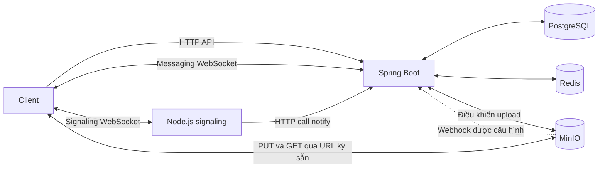
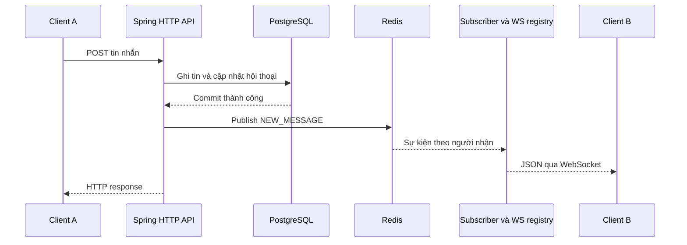

**VEILTALK — HỌC SÂU BACKEND THEO GHI CHÚ CỦA HUY**

Ngày đối chiếu source: 18/10/2026.

Tài liệu triển khai đúng 15 mục trong `review and learn/Huy review code và recomment học sâ.txt`: 6 nhóm công nghệ và 9 kỹ thuật. “Spring sercu” được hiểu là Spring Security. File này nằm ở thư mục gốc dự án, cùng cấp với thư mục chứa ghi chú.

Đây là tài liệu học từ source hiện tại: giải thích khái niệm, lần theo luồng thực thi, phân tích ví dụ và nêu giới hạn bằng chứng. Không chạy ứng dụng, không kiểm thử tải, không thay đổi source/config. Các con số cấu hình không phải kết quả đo hiệu năng. Ví dụ A/B, thời gian và dung lượng minh họa là tình huống để học, không phải dữ liệu quan sát trên hệ thống đang chạy.

Các liên kết ghi file và dòng code tại thời điểm khảo sát. Khi source thay đổi, số dòng có thể thay đổi theo. Phần “Tự ôn” có đáp án định hướng để bạn tự kiểm tra khả năng giải thích, không yêu cầu viết hoặc chạy thêm code.

**Bản đồ đọc tài liệu**

| Theo ghi chú | Phần trong tài liệu |
|---|---|
| Luồng Spring WebSocket | A1 |
| Redis / Spring Data Redis | A2 |
| MinIO / MinIO Java SDK | A3 |
| Actuator / Micrometer | A4 |
| Docker dự án | A5 |
| Spring Security | A6 |
| JWT stateless | B1 |
| BCrypt và hash refresh token | B2 |
| Thu hồi token bằng Redis TTL | B3 |
| Transaction | B4 |
| Heartbeat và vòng đời socket | B5 |
| Gửi WebSocket đồng thời | B6 |
| Multipart upload | B7 |
| Pessimistic database lock | B8 |
| Lua script trong Redis | B9 |

**Bức tranh chung trước khi đọc từng phần**

Backend Java là một ứng dụng Spring Boot chứa nhiều package nghiệp vụ, không phải mỗi package là một service triển khai riêng. Node.js signaling là ứng dụng riêng. PostgreSQL giữ dữ liệu nghiệp vụ lâu dài; Redis giữ một số trạng thái tạm và điều phối sự kiện; MinIO giữ nội dung file video. Không thấy bằng chứng triển khai nhiều replica từ các khai báo này.

Nguồn: [BackendApplication.java:6](/C:/project/veiltalk/backend/src/main/java/com/veiltalk/BackendApplication.java:6), [pom.xml:30](/C:/project/veiltalk/backend/pom.xml:30), [signaling/package.json:5](/C:/project/veiltalk/signaling/package.json:5), [docker-compose.yml:1](/C:/project/veiltalk/docker-compose.yml:1).



Sơ đồ này thể hiện đường giao tiếp theo code. Không dùng nó để khẳng định webhook của bucket, proxy Nginx hoặc media WebRTC đang hoạt động thực tế.

**A1. Công nghệ: luồng Spring WebSocket hiện tại**

**Khái niệm cần hiểu.** HTTP API thường xử lý một yêu cầu rồi trả một phản hồi. WebSocket giữ một kết nối để hai phía tiếp tục gửi thông điệp. Nó hữu ích khi server cần chủ động báo có tin nhắn mới mà không chờ trình duyệt hỏi lại liên tục. WebSocket là kênh vận chuyển; nó không tự lưu lịch sử tin nhắn, xác định người nhận hay bảo đảm người nhận đã đọc.

**Các lớp cần đọc theo thứ tự.**

| Lớp | Nhiệm vụ trong luồng |
|---|---|
| `MessagingWebSocketConfig` | Đăng ký `/ws/messaging`, interceptor xác thực, origin được phép và giới hạn text message. |
| `WebSocketAuthHandshakeInterceptor` | Kiểm tra token trước khi cho phép bắt tay WebSocket. |
| `MessagingWebSocketHandler` | Xử lý mở/đóng kết nối, lỗi truyền tải và các event do client gửi. |
| `WebSocketSessionRegistry` | Ghi nhớ người dùng đang có những socket nào trên instance này. |
| `WebSocketKeepAliveScheduler` | Theo dõi PING/PONG, thời hạn và thu hồi token. |
| `MessageRealtimePublisher` | Biến sự kiện nghiệp vụ thành JSON và publish vào Redis. |
| `MessagingRedisSubscriber` | Nhận sự kiện Redis và gửi tới socket cục bộ của người nhận. |

**Luồng mở kết nối.** Client yêu cầu `/ws/messaging?token=...`. Interceptor chỉ chấp nhận một token không rỗng; kiểm tra chữ ký/thời hạn qua `JwtService`, kiểm tra blacklist và dấu thu hồi theo người dùng, rồi truy vấn người dùng chưa bị xóa. Thông tin user ID, role, JWT ID, thời điểm cấp/hết hạn được gắn vào attributes của socket. Bắt tay thất bại trả HTTP 401. Khi kết nối thành công, handler đăng ký socket rồi bắt đầu heartbeat.

Nguồn: [MessagingWebSocketConfig.java:40](/C:/project/veiltalk/backend/src/main/java/com/veiltalk/messaging/MessagingWebSocketConfig.java:40), [WebSocketAuthHandshakeInterceptor.java:52](/C:/project/veiltalk/backend/src/main/java/com/veiltalk/messaging/WebSocketAuthHandshakeInterceptor.java:52), [MessagingWebSocketHandler.java:43](/C:/project/veiltalk/backend/src/main/java/com/veiltalk/messaging/MessagingWebSocketHandler.java:43).

**Luồng A gửi tin cho B.** A gửi HTTP POST tạo tin nhắn. Service kiểm tra quyền, ghi PostgreSQL, đăng ký callback sau commit. Khi DB commit thành công, callback publish `NEW_MESSAGE` vào `messaging:user:{B}`. Subscriber nhận JSON, tìm tất cả socket của B trong registry trên instance này và gửi sự kiện. B có nhiều tab/kết nối thì có thể nhận ở nhiều socket.



Thứ tự B nhận event và A nhận response trên mạng không được bảo đảm như một hàng đợi toàn cục. Sơ đồ diễn tả quan hệ “commit trước publish”, không cam kết thời điểm giao nhận ở hai trình duyệt.

Nguồn: [ConversationController.java:63](/C:/project/veiltalk/backend/src/main/java/com/veiltalk/messaging/ConversationController.java:63), [MessageService.java:65](/C:/project/veiltalk/backend/src/main/java/com/veiltalk/messaging/MessageService.java:65), [MessageService.java:212](/C:/project/veiltalk/backend/src/main/java/com/veiltalk/messaging/MessageService.java:212), [MessagingRedisSubscriber.java:107](/C:/project/veiltalk/backend/src/main/java/com/veiltalk/messaging/MessagingRedisSubscriber.java:107).

**Chiều client gửi trên WebSocket.** Handler xử lý `PONG`, `TYPING`, `TYPING_STOP`; không có nhánh tạo tin nhắn chat trong handler này. Typing service vẫn đọc hội thoại từ PostgreSQL để kiểm tra người gửi là thành viên rồi mới relay. Vì vậy “gửi qua WebSocket” không đồng nghĩa “không đụng database”. Đây là raw WebSocket với JSON do ứng dụng định nghĩa; cấu hình này không phải broker STOMP/SockJS.

Nguồn: [MessagingWebSocketHandler.java:74](/C:/project/veiltalk/backend/src/main/java/com/veiltalk/messaging/MessagingWebSocketHandler.java:74), [MessagingTypingService.java:21](/C:/project/veiltalk/backend/src/main/java/com/veiltalk/messaging/MessagingTypingService.java:21).

**Tự ôn.** Nếu B offline lúc A gửi tin, dữ liệu nằm ở đâu? Đáp án: tin đã commit nằm trong PostgreSQL; event Redis không trở thành hộp thư offline. Nếu một client gửi `NEW_MESSAGE` lên socket hiện tại, handler không coi đó là yêu cầu tạo tin hợp lệ.

**A2. Công nghệ: Redis và Spring Data Redis**

Redis là dịch vụ dữ liệu riêng. Spring Data Redis là lớp tích hợp trong ứng dụng Java; `StringRedisTemplate` là đối tượng code dùng để gửi lệnh như GET, SET, INCR, HGET và publish. Dữ liệu “nằm trong Redis” khác với `ConcurrentHashMap` nằm trong RAM của backend Java.

**Năm vai trò thực tế trong dự án.**

| Vai trò | Key/kênh và thao tác | Ý nghĩa |
|---|---|---|
| Thu hồi một token | `jwt:blacklist:{jti}`; ghi có TTL, đọc sự tồn tại | JWT có chữ ký đúng vẫn bị từ chối sau logout. |
| Thu hồi theo người dùng | `jwt:user-revoked-after:{userId}`; lưu mốc thời gian | Từ chối access token cấp không muộn hơn mốc thu hồi. |
| Rate limit | `rate:user-search:{userId}:{window}`, `rate:metrics-client:{userId}:{window}`; INCR và EXPIRE | Đếm request trong cửa sổ thời gian. |
| Phiên và khóa upload | `video:upload:{videoId}` dạng hash; `video:quota-lock:*`, `video:operation-lock:*` dạng key có TTL | Theo dõi thứ tự phần upload và phối hợp thao tác đồng thời. |
| Pub/Sub | `messaging:user:{userId}` | Đưa sự kiện tới subscriber để chuyển tiếp qua socket. |

Nguồn: [JwtBlacklistService.java:12](/C:/project/veiltalk/backend/src/main/java/com/veiltalk/auth/JwtBlacklistService.java:12), [UserTokenRevocationService.java:15](/C:/project/veiltalk/backend/src/main/java/com/veiltalk/auth/UserTokenRevocationService.java:15), [UserSearchRateLimiter.java:13](/C:/project/veiltalk/backend/src/main/java/com/veiltalk/user/UserSearchRateLimiter.java:13), [MetricsRateLimiter.java:13](/C:/project/veiltalk/backend/src/main/java/com/veiltalk/metrics/MetricsRateLimiter.java:13), [RedisVideoUploadSessionStore.java:67](/C:/project/veiltalk/backend/src/main/java/com/veiltalk/video/RedisVideoUploadSessionStore.java:67), [MessageRealtimePublisher.java:73](/C:/project/veiltalk/backend/src/main/java/com/veiltalk/messaging/MessageRealtimePublisher.java:73).

**Rate limit hoạt động thế nào?** Với tìm người dùng, code lấy số giây hiện tại chia cho độ dài cửa sổ 60 giây để tạo window ID. Mỗi user có một bộ đếm trong từng cửa sổ. Request đầu tăng lên 1 và đặt TTL; vượt 10 lần thì trả thời gian cần chờ. Metrics dùng cùng kiểu nhưng cửa sổ 3 giây, giới hạn 1 lần. Đây là fixed window — cửa sổ cố định — không phải sliding window. Hai request ở hai bên ranh giới cửa sổ có thể gần nhau mà vẫn thuộc hai bộ đếm khác nhau. INCR và EXPIRE hiện là hai lời gọi riêng; không nên gọi toàn bộ cặp thao tác này là một Lua transaction.

**Vì sao Pub/Sub đi cùng WebSocket?** WebSocket nối server với trình duyệt. Pub/Sub phân phối sự kiện trong phần server. Với một backend, có thể gửi thẳng qua socket, Pub/Sub không bắt buộc. Với hai backend, A có thể nối instance 1 còn B nối instance 2; Redis giúp instance 2 nhận sự kiện dù request tạo tin được xử lý ở instance 1. Listener hiện đăng ký pattern `messaging:user:*`, nhận event rồi chỉ gửi tới socket cục bộ. Đây là khả năng cấu trúc hiện tại hỗ trợ, không phải bằng chứng đã kiểm chứng scale nhiều instance.

Nguồn: [RedisMessagingListenerConfig.java:12](/C:/project/veiltalk/backend/src/main/java/com/veiltalk/messaging/RedisMessagingListenerConfig.java:12), [MessagingRedisSubscriber.java:61](/C:/project/veiltalk/backend/src/main/java/com/veiltalk/messaging/MessagingRedisSubscriber.java:61).

**Giới hạn cần hiểu.** Pub/Sub không phải hàng đợi lưu bền. Publish thành công không chứng minh người dùng đã nhận/đọc. Subscriber mất kết nối có thể bỏ lỡ event; code ghi lỗi và dựa vào lịch sử cho dữ liệu tin nhắn. Typing là sự kiện tạm thời nên không có lịch sử để khôi phục. Redis trong dự án còn nằm trên đường xác thực và upload; chỉ gọi nó là “cache tăng tốc” sẽ bỏ sót các vai trò chính.

**Tự ôn.** Nếu PostgreSQL vẫn tốt nhưng Redis mất kết nối, gửi tin có thể được lưu mà không đẩy realtime không? Có thể, khi lỗi xảy ra ở publish sau commit; publisher bắt lỗi và ghi counter/log. Nhưng lỗi Redis ở bước xác thực trước đó lại thuộc đường xử lý khác. Phải xét vị trí lỗi, không kết luận mọi request đều có cùng kết quả.

**A3. Công nghệ: MinIO và MinIO Java SDK**

MinIO cung cấp object storage: lưu một đối tượng file bằng bucket và object key. Bucket là vùng chứa; object key là tên định danh, ví dụ `videos/<uuid>/source.mp4`. Dấu `/` trong key giúp tổ chức tên, không có nghĩa backend đang dùng một thư mục trên ổ C. SDK là thư viện Java để gọi các thao tác của MinIO.

**Ba nơi giữ ba loại dữ liệu.** PostgreSQL giữ người sở hữu, tên, kích thước, trạng thái và storage path. Redis giữ phiên multipart, số phần tiếp theo và ETag. MinIO giữ byte của các phần/file. Không được đồng nhất bản ghi `videos` với chính file video.

Nguồn: [VideoService.java:52](/C:/project/veiltalk/backend/src/main/java/com/veiltalk/video/VideoService.java:52), [V1__initial_schema.sql:85](/C:/project/veiltalk/backend/src/main/resources/db/migration/V1__initial_schema.sql:85), [RedisVideoUploadSessionStore.java:72](/C:/project/veiltalk/backend/src/main/java/com/veiltalk/video/RedisVideoUploadSessionStore.java:72).

**Presigned URL là gì?** Backend tạo URL có chữ ký cho một thao tác cụ thể như PUT một part hoặc GET một object, có thời hạn. Client dùng URL này để nói chuyện trực tiếp với MinIO. Backend không phải nhận toàn bộ byte file trong các endpoint cấp chunk đã đọc. Client cũng không cần nhận MinIO secret key từ backend.

Với part PUT, URL gắn `uploadId` và `partNumber`; thời hạn đọc từ `video.presigned-url-expiry-seconds`, mặc định 3600 giây. Với GET phát video, implementation dùng hằng số 3600 giây riêng. Hai giá trị đang cùng là một giờ nhưng không dùng chung nguồn cấu hình. Chỉ video READY được cấp `view_url` trong API đọc chi tiết.

Nguồn: [MinioMultipartStorage.java:24](/C:/project/veiltalk/backend/src/main/java/com/veiltalk/video/MinioMultipartStorage.java:24), [MinioMultipartStorage.java:62](/C:/project/veiltalk/backend/src/main/java/com/veiltalk/video/MinioMultipartStorage.java:62), [VideoService.java:301](/C:/project/veiltalk/backend/src/main/java/com/veiltalk/video/VideoService.java:301).

**Các thao tác backend thực hiện.** Tạo multipart, liệt kê part, hoàn tất ghép file, abort multipart, đọc kích thước object, xóa object, ký PUT/GET URL. Endpoint và credential được đưa vào các bean MinIO trong `MinioConfig`. Không thấy cấu hình pool HTTP riêng trong lớp này.

Nguồn: [MinioConfig.java:14](/C:/project/veiltalk/backend/src/main/java/com/veiltalk/video/MinioConfig.java:14), [MinioMultipartStorage.java:41](/C:/project/veiltalk/backend/src/main/java/com/veiltalk/video/MinioMultipartStorage.java:41).

**Async dễ bị hiểu sai.** Dùng `MinioAsyncClient` chỉ cho thấy SDK trả kết quả bất đồng bộ ở một số API. Code gọi `.get()` để đợi kết quả tạo multipart, complete, stat… nên luồng gọi vẫn phải chờ. Không thể suy ra request video hoàn toàn non-blocking từ tên class.

**Điểm cần kiểm chứng khi đọc cấu hình.** Trong Compose, endpoint backend là `http://minio:9000`; đó là tên nội bộ mạng Docker. URL ký sẵn trả cho trình duyệt cũng phải dùng địa chỉ trình duyệt truy cập được. Source cấu hình này chưa chứng minh đường truy cập bên ngoài đã hoàn chỉnh. Đây là ranh giới mạng cần hiểu, chưa phải kết luận upload đang lỗi trên máy bạn.

**Tự ôn.** URL hết hạn có đồng nghĩa file bị xóa? Không. Thời hạn URL là quyền thực hiện request; vòng đời object là việc khác. Đăng xuất tài khoản cũng không tự chứng minh mọi URL MinIO đã cấp lập tức mất hiệu lực.

**A4. Công nghệ: Actuator và Micrometer**

Actuator cung cấp các điểm quan sát tình trạng ứng dụng. Micrometer là API ghi nhận số liệu như counter. Counter là số tích lũy số lần một sự kiện xảy ra trong vòng đời bộ đo. Health, metric và log trả lời ba câu hỏi khác nhau:

| Loại | Câu hỏi | Dấu vết trong dự án |
|---|---|---|
| Health | Thành phần đang báo tình trạng gì? | Actuator health; custom health cho subscriber. |
| Metric | Một sự kiện đã xảy ra bao nhiêu lần? | Các counter lỗi messaging. |
| Log | Lần lỗi cụ thể xảy ra ở đâu, có thông tin gì? | Logger ghi lỗi publish, delivery và client metrics. |

`application.yml` chỉ expose endpoint `health` qua web; `show-components: always` không đồng nghĩa mọi health detail đều công khai. Chưa thấy cấu hình expose `/actuator/metrics` hay `/actuator/prometheus` trong file này. Có dependency Actuator không tự chứng minh đã có dashboard, kho lưu số liệu hoặc Prometheus đang scrape.

Nguồn: [pom.xml:34](/C:/project/veiltalk/backend/pom.xml:34), [application.yml:24](/C:/project/veiltalk/backend/src/main/resources/application.yml:24).

**Các counter do code khai báo.**

| Tên | Khi nào tăng |
|---|---|
| `messaging.redis.publish.failures` | Publisher bắt lỗi trong bước serialize/publish. |
| `messaging.redis.subscribe.failures` | Subscriber/container ghi nhận lỗi nhận/xử lý sự kiện. |
| `messaging.websocket.delivery.failures` | Lỗi khi gửi sự kiện tới một socket. |
| `messaging.websocket.auth.recheck.failures` | Lỗi kiểm tra lại thu hồi token khi heartbeat. |

Nguồn: [MessageRealtimePublisher.java:73](/C:/project/veiltalk/backend/src/main/java/com/veiltalk/messaging/MessageRealtimePublisher.java:73), [MessagingRedisSubscriber.java:26](/C:/project/veiltalk/backend/src/main/java/com/veiltalk/messaging/MessagingRedisSubscriber.java:26), [WebSocketKeepAliveScheduler.java:130](/C:/project/veiltalk/backend/src/main/java/com/veiltalk/messaging/WebSocketKeepAliveScheduler.java:130).

**Custom health subscriber.** `MessagingRedisSubscriberHealthIndicator` giữ lỗi gần nhất trong `AtomicReference`. Không có lỗi đã ghi nhận thì báo UP; có lỗi thì báo trạng thái tự định nghĩa DEGRADED kèm reason/thời điểm. Khi xử lý event thành công hoặc có thông báo kết nối được khôi phục, trạng thái lỗi được xóa. `MessagingRedisConnectionMonitor` đăng ký theo dõi event nếu connection factory là Lettuce; nếu khác thì log rằng chỉ còn cơ chế theo dõi lỗi container.

Không suy ra DEGRADED luôn biến health tổng thành HTTP 503: thứ tự tổng hợp và ánh xạ HTTP cho trạng thái tùy biến chưa được cấu hình rõ trong phần source đã đọc. UP của chỉ báo này cũng không chứng minh mọi client nhận được tin: nó phản ánh trạng thái mà chỉ báo đang lưu.

Nguồn: [MessagingRedisSubscriberHealthIndicator.java:14](/C:/project/veiltalk/backend/src/main/java/com/veiltalk/messaging/MessagingRedisSubscriberHealthIndicator.java:14), [MessagingRedisConnectionMonitor.java:24](/C:/project/veiltalk/backend/src/main/java/com/veiltalk/messaging/MessagingRedisConnectionMonitor.java:24).

**Không nhầm `/metrics/client` với hiệu năng backend.** Service này nhận tracking latency, FPS, WebRTC RTT từ client, kiểm tra và ghi log. Đó là số liệu do client báo, không phải phép đo CPU JVM, DB pool hay latency của toàn bộ HTTP API.

Nguồn: [MetricsService.java:25](/C:/project/veiltalk/backend/src/main/java/com/veiltalk/metrics/MetricsService.java:25).

**Tự ôn.** Counter lỗi bằng 0 có chứng minh không mất thông báo? Không: có thể không có subscriber/người nhận tại lúc publish, hoặc dữ liệu chưa được thu thập đầy đủ. Health UP có chứng minh p95 API thấp? Không: kiểm tra tình trạng và đo phân bố độ trễ là hai việc khác nhau.

**A5. Công nghệ: Docker trong dự án**

Image là gói để tạo môi trường chạy; container là một instance chạy từ image; volume giữ dữ liệu độc lập với vòng đời container; network nối các container; Compose mô tả các thành phần đó trong một file. Docker không thay thế Spring Boot hoặc PostgreSQL: nó cung cấp môi trường để chạy chúng.

**Những gì Compose hiện khai báo.**

| Service | Image/build | Cổng host → container | Dữ liệu bền trong khai báo |
|---|---|---|---|
| postgres | `postgres:16-alpine` | 5432 → 5432 | `postgres_data:/var/lib/postgresql/data` |
| redis | `redis:7-alpine` | 6379 → 6379 | Không khai báo named volume cho Redis. |
| minio | `minio/minio:latest` | 9000 → 9000; 9001 → 9001 | `minio_data:/data` |
| backend | Image dự án; build context `./backend` | 8080 → 8080 | Dữ liệu nghiệp vụ ở các dịch vụ phụ thuộc. |
| signaling | Image dự án; build context `./signaling` | 3000 → 3000 | Map kết nối/phiên gọi trong tiến trình. |
| frontend | Image dự án; build context `./frontend` | 5173 → 5173 | Chưa kết luận cách phục vụ production. |
| nginx | `nginx:alpine` | 80 → 80; 443 → 443 | Không thấy mount cấu hình proxy/certificate trong Compose. |

Tất cả dùng network bridge `internal-net`. Cổng 9000 là API MinIO, 9001 là console theo command được khai báo.

Nguồn: [docker-compose.yml:1](/C:/project/veiltalk/docker-compose.yml:1), [docker-compose.yml:119](/C:/project/veiltalk/docker-compose.yml:119).

**Hai cách chạy cần phân biệt.** Nếu Java chạy bằng nút Run của IDE trên Windows còn PostgreSQL/Redis/MinIO chạy container, Java truy cập cổng đã publish qua localhost. Nếu Java cũng nằm trong Compose, cấu hình hiện dùng tên service `postgres`, `redis`, `minio`. Trong container, localhost chỉ chính container đó; nó không tự chỉ sang container PostgreSQL. Nút Run IDE có thể khởi động Java mà không cần gõ Maven, nhưng các dịch vụ Java cần vẫn phải sẵn sàng ở địa chỉ cấu hình.

**Biến môi trường có hai tầng.** Compose thay `${...}` trong YAML rồi truyền các mục `environment` cho container. Spring Boot còn tự đọc property/environment; dự án có import `.env` ở thư mục chạy hoặc thư mục cha. Việc Compose đọc `.env` không có nghĩa mọi biến trong file tự xuất hiện trong mọi container. Giá trị `VEILTALK_DB_PASSWORD` được ưu tiên hơn `DB_PASSWORD` ở cấu hình Spring hiện tại.

Nguồn: [docker-compose.yml:44](/C:/project/veiltalk/docker-compose.yml:44), [application.yml:1](/C:/project/veiltalk/backend/src/main/resources/application.yml:1).

**Giới hạn xác minh.** Có Dockerfile signaling dùng `node:24-alpine`, `npm ci --omit=dev`, copy `src`, chạy `node src/index.js`. Tại lúc đọc, không có `backend/Dockerfile` và `frontend/Dockerfile`, dù Compose khai báo build context cho chúng. Vì vậy chưa thể nói build toàn bộ stack từ source bằng Compose đã hoàn chỉnh. Không chạy build để kết luận thêm. `depends_on` trong file chỉ liệt kê phụ thuộc, không có healthcheck/readiness condition; không được hiểu là database đã sẵn sàng nhận query. Không có bằng chứng nhiều replica, TLS hay cân bằng tải đang hoạt động chỉ từ service Nginx.

Nguồn: [signaling/Dockerfile:1](/C:/project/veiltalk/signaling/Dockerfile:1), [docker-compose.yml:40](/C:/project/veiltalk/docker-compose.yml:40), [docker-compose.yml:95](/C:/project/veiltalk/docker-compose.yml:95).

**Tự ôn.** Restart backend có làm mất tin nhắn không? Dữ liệu đã commit ở PostgreSQL không nằm trong RAM backend. Nhưng socket cũ và các trạng thái cục bộ cần thiết lập lại. Đây là lý do phải tách “tiến trình ứng dụng” khỏi “nơi lưu dữ liệu”.

**A6. Công nghệ: Spring Security**

Spring Security là lớp xử lý bảo mật bao quanh HTTP API. Authentication trả lời “bạn là ai”; authorization trả lời “bạn có được thực hiện thao tác này không”. Token hợp lệ giải quyết danh tính; quyền đọc một hội thoại hay video còn phải kiểm tra bằng dữ liệu nghiệp vụ.

**Đường request hiện tại.** Request đi vào filter chain. Nếu có Bearer token, `JwtAuthenticationFilter` kiểm tra và tạo Authentication chứa user ID cùng authority `ROLE_...`, đặt vào `SecurityContextHolder`. Security áp rule đường dẫn. Controller lấy principal từ Authentication rồi gọi service. Service kiểm tra sở hữu/thành viên nếu chức năng yêu cầu.

Nguồn: [JwtAuthenticationFilter.java:43](/C:/project/veiltalk/backend/src/main/java/com/veiltalk/auth/JwtAuthenticationFilter.java:43), [SecurityConfig.java:63](/C:/project/veiltalk/backend/src/main/java/com/veiltalk/auth/SecurityConfig.java:63), [MessageService.java:70](/C:/project/veiltalk/backend/src/main/java/com/veiltalk/messaging/MessageService.java:70).

**Các rule đang có.** POST logout yêu cầu authenticated; GET danh mục avatar được phép công khai; `/auth/**`, health, `/internal/**`, `/ws/messaging` được permit ở tầng rule chung; OPTIONS được permit; đường khác phải authenticated. Rule logout nằm trước `/auth/**`, nên không thể chỉ nhìn wildcard rồi kết luận logout công khai.

`/ws/messaging` có handshake interceptor xác thực riêng. Hai POST nội bộ có filter riêng so sánh `Authorization: Bearer <shared secret>`. `permitAll` không có nghĩa bỏ toàn bộ filter/interceptor. Các filter nội bộ còn được tắt tự đăng ký ở servlet để không bị đăng ký thêm ngoài security chain.

Nguồn: [SecurityConfig.java:64](/C:/project/veiltalk/backend/src/main/java/com/veiltalk/auth/SecurityConfig.java:64), [SecurityConfig.java:91](/C:/project/veiltalk/backend/src/main/java/com/veiltalk/auth/SecurityConfig.java:91), [CallNotifyAuthenticationFilter.java:35](/C:/project/veiltalk/backend/src/main/java/com/veiltalk/call/CallNotifyAuthenticationFilter.java:35), [VideoWebhookAuthenticationFilter.java:35](/C:/project/veiltalk/backend/src/main/java/com/veiltalk/video/VideoWebhookAuthenticationFilter.java:35).

**CORS, CSRF và session.** CORS cho phép các origin được cấu hình dùng các method/header đã liệt kê. Nó là quy tắc cho trình duyệt, không thay JWT hay kiểm tra sở hữu. Code tắt CSRF, form login, HTTP Basic và dùng STATELESS. Đây là cấu hình hiện tại; không nên biến thành quy tắc “mọi ứng dụng JWT đều tắt CSRF an toàn”, vì cách trình duyệt mang credential cũng liên quan. Code còn đặt HSTS/frame/content-type headers; HSTS không tự cấp chứng chỉ HTTPS.

Nguồn: [SecurityConfig.java:51](/C:/project/veiltalk/backend/src/main/java/com/veiltalk/auth/SecurityConfig.java:51), [SecurityConfig.java:109](/C:/project/veiltalk/backend/src/main/java/com/veiltalk/auth/SecurityConfig.java:109).

**Phân biệt lỗi.** Token không hợp lệ có thể khiến request tới API cần đăng nhập nhận 401. Danh tính hợp lệ nhưng không thuộc hội thoại có thể nhận 403 từ nghiệp vụ. DTO sai ràng buộc thuộc validation. Không gộp mọi lỗi thành “JWT lỗi”; các tầng khác nhau có nguồn bằng chứng khác nhau.

**Tự ôn.** Có `ROLE_USER` có đủ để đọc video bất kỳ không? Không; `VideoService` còn đối chiếu user ID sở hữu. Có token hết hạn nhưng đường dẫn permitAll thì filter hiện có tự trả 401 cho mọi request không? Không: filter JWT bỏ qua authentication khi token không hợp lệ; rule/handler của đường cụ thể quyết định kết quả tiếp theo.

Nguồn: [VideoService.java:341](/C:/project/veiltalk/backend/src/main/java/com/veiltalk/video/VideoService.java:341), [JwtAuthenticationFilter.java:66](/C:/project/veiltalk/backend/src/main/java/com/veiltalk/auth/JwtAuthenticationFilter.java:66).

**B1. Kỹ thuật: xác thực JWT stateless**

**JWT mang những gì?** Một JWT ở đây gồm header, payload và signature, nối bằng dấu chấm. Header/payload được mã hóa biểu diễn Base64URL, không phải mã hóa để giữ bí mật. Signature giúp server kiểm tra dữ liệu có được bên giữ secret ký hay bị thay đổi. Không phải cứ decode được payload thì token đáng tin.

Backend tự triển khai HS256 bằng `Mac` của Java, dùng `HmacSHA256`; chưa thấy thư viện JWT Java riêng trong luồng này. `JwtService` yêu cầu secret ít nhất 32 byte, kiểm tra header, chữ ký, claims, `exp` và `iat`. Signaling Node có implementation kiểm tra JWT riêng qua `jsonwebtoken`; không nên suy ra hai bên có toàn bộ chính sách thu hồi giống nhau.

Nguồn: [JwtService.java:27](/C:/project/veiltalk/backend/src/main/java/com/veiltalk/auth/JwtService.java:27), [JwtService.java:108](/C:/project/veiltalk/backend/src/main/java/com/veiltalk/auth/JwtService.java:108), [JwtService.java:227](/C:/project/veiltalk/backend/src/main/java/com/veiltalk/auth/JwtService.java:227), [signaling/src/auth.js:5](/C:/project/veiltalk/signaling/src/auth.js:5).

| Claim | Ý nghĩa trong source |
|---|---|
| `sub` | ID người dùng, có ở access token. |
| `role` | Vai trò người dùng, có ở access token. |
| `type` | Phân biệt `access` và `refresh`. |
| `jti` | UUID của token để định danh, ví dụ khi blacklist. |
| `iat` | Thời điểm phát hành, theo epoch giây. |
| `exp` | Thời điểm hết hạn. |

Refresh JWT do code hiện tại sinh không chứa `sub`/`role`. Quan hệ refresh token thuộc người nào được lấy từ bản ghi database sau khi tra hash. Đây là chi tiết của dự án, không được áp suy nghĩ “mọi JWT đều chứa user ID” vào đây.

Nguồn: [JwtService.java:73](/C:/project/veiltalk/backend/src/main/java/com/veiltalk/auth/JwtService.java:73), [JwtService.java:141](/C:/project/veiltalk/backend/src/main/java/com/veiltalk/auth/JwtService.java:141), [JwtService.java:159](/C:/project/veiltalk/backend/src/main/java/com/veiltalk/auth/JwtService.java:159).

**Stateless nghĩa chính xác là gì ở đây?** Spring Security không dùng HTTP session để nhớ lần đăng nhập. Request tiếp theo phải mang token và được xác thực lại. Nó không có nghĩa hệ thống không lưu trạng thái: refresh token vẫn ở PostgreSQL, blacklist vẫn ở Redis, socket vẫn ở RAM backend. Nếu dùng JWT mà không có dấu thu hồi, token đã ký có thể tiếp tục hợp lệ đến `exp`; vì vậy dự án thêm Redis để hỗ trợ vô hiệu hóa sớm.

**Vòng đời đăng nhập.** Login đọc user chưa xóa, so mật khẩu; tạo access JWT và refresh JWT; lưu hash refresh vào DB; trả hai token. Access token được dùng gọi API. Khi cần refresh, backend xác minh refresh JWT, tra hash, kiểm tra chưa revoked/chưa hết hạn, kiểm tra user rồi cấp access token mới. Method refresh hiện không tạo refresh token mới và không thu hồi refresh token cũ: không nên mô tả nó là refresh-token rotation.

Nguồn: [AuthService.java:87](/C:/project/veiltalk/backend/src/main/java/com/veiltalk/auth/AuthService.java:87), [AuthService.java:109](/C:/project/veiltalk/backend/src/main/java/com/veiltalk/auth/AuthService.java:109).

**Ví dụ tư duy.** Access token của A hết hạn 10:15. A gửi request lúc 10:16 thì không thể chỉ sửa payload `exp` thành 11:00: chữ ký không còn khớp. A phải dùng refresh token còn hợp lệ để nhận access token do server ký. Nếu refresh token đã bị revoked trong DB thì chữ ký đúng vẫn không đủ để refresh.

**Liên hệ hiệu năng.** Xác thực có công việc tính chữ ký và gọi Redis; một số nghiệp vụ còn đọc user trong DB. Vì vậy chi phí request không chỉ có query chính của API. Chưa có dữ liệu đo để định lượng từng phần. Cấu hình JWT mặc định 900 giây access và 604800 giây refresh; `AuthService` lại có hằng `ACCESS_TOKEN_EXPIRY_SECONDS = 900` dùng trong response. Khi học cần phân biệt `exp` thật do `JwtService` tạo với trường thời hạn trả về; chúng có thể không còn đồng nhất nếu cấu hình access expiry bị thay đổi.

Nguồn: [application.yml:37](/C:/project/veiltalk/backend/src/main/resources/application.yml:37), [AuthService.java:23](/C:/project/veiltalk/backend/src/main/java/com/veiltalk/auth/AuthService.java:23).

**Tự ôn.** “JWT không cần database” đúng hoàn toàn với dự án không? Không. Kiểm chữ ký không bắt buộc đọc DB, nhưng refresh và nhiều nghiệp vụ có đọc DB; xác thực access còn phụ thuộc Redis. Có thể dùng refresh JWT thay access JWT trên API thường không? Filter yêu cầu `type=access`, nên không.

**B2. Kỹ thuật: BCrypt và hash refresh token**

**Ba việc khác nhau.** Băm mật khẩu tạo giá trị dùng kiểm tra về sau mà không lưu mật khẩu gốc. Băm refresh token tạo khóa tra cứu cho một credential dài đã được phát hành. Ký JWT tạo bằng chứng tính toàn vẹn của header/payload bằng secret. Cả ba đều dùng kỹ thuật mật mã nhưng mục đích khác nhau; không gọi chung là “mã hóa mật khẩu/token”.

**Mật khẩu dùng BCrypt.** `SecurityConfig` khai báo `new BCryptPasswordEncoder()`. Register gọi `encode(password)` rồi lưu `passwordHash`. Login gọi `matches(passwordNhap, hashDaLuu)`. BCrypt có salt để việc dùng cùng mật khẩu không bắt buộc tạo cùng chuỗi hash, và có chi phí tính toán để việc thử nhiều mật khẩu tốn công hơn. Vì vậy không so chuỗi bằng cách encode lại rồi dùng `equals`; code đã dùng API `matches` đúng mục đích.

Nguồn: [SecurityConfig.java:38](/C:/project/veiltalk/backend/src/main/java/com/veiltalk/auth/SecurityConfig.java:38), [AuthService.java:59](/C:/project/veiltalk/backend/src/main/java/com/veiltalk/auth/AuthService.java:59), [AuthService.java:87](/C:/project/veiltalk/backend/src/main/java/com/veiltalk/auth/AuthService.java:87).

**Refresh token dùng SHA-256.** Khi cấp token, code lấy toàn bộ chuỗi refresh JWT, chuyển sang UTF-8, tính SHA-256 rồi lưu chuỗi hex. Khi refresh/logout, tính lại hash từ token client gửi rồi truy vấn `findByTokenHash`. Cùng một token cần cho ra cùng hash để tra cứu; đây là lý do cấu trúc này khác cách kiểm mật khẩu BCrypt. Token do hệ thống sinh có thành phần ngẫu nhiên `jti`, khác mật khẩu dễ đoán do người dùng chọn. SHA-256 dùng ở đây không phải lý do để thay BCrypt cho mật khẩu.

Nguồn: [AuthService.java:148](/C:/project/veiltalk/backend/src/main/java/com/veiltalk/auth/AuthService.java:148), [AuthService.java:160](/C:/project/veiltalk/backend/src/main/java/com/veiltalk/auth/AuthService.java:160), [AuthService.java:172](/C:/project/veiltalk/backend/src/main/java/com/veiltalk/auth/AuthService.java:172).

Database còn lưu user ID, thời hạn và `revoked_at`; có unique index trên `token_hash`. Tra được hash chỉ là một điều kiện: method còn xác minh refresh JWT và kiểm tra revoked/expiry. Hash trong DB không phải chuỗi JWT hợp lệ để gửi thay token gốc. Tuy nhiên băm tại DB không bảo vệ token gốc nếu token bị lộ ở một nơi khác.

Nguồn: [V1__initial_schema.sql:107](/C:/project/veiltalk/backend/src/main/resources/db/migration/V1__initial_schema.sql:107).

**Liên hệ hiệu năng.** Login vừa đọc database vừa tính BCrypt và ghi refresh token. Nó có loại công việc khác API chỉ đọc hồ sơ. Source không đặt tham số strength rõ trong constructor, nên tài liệu không gán một giá trị chi phí runtime cụ thể hoặc thời gian xử lý. Chưa đo thì không thể nói BCrypt là nút thắt hiện tại.

**Tự ôn.** Vì sao lưu hash refresh token vẫn cần `revoked_at`? Hash giúp nhận diện token mà không lưu nguyên credential; `revoked_at` thể hiện quyết định vô hiệu hóa. Vì sao password không dùng SHA-256 giống refresh? Vì mật khẩu thường có không gian đoán nhỏ hơn và cần cơ chế băm dành cho mật khẩu với chi phí tính toán thích hợp.

**B3. Kỹ thuật: thu hồi token bằng Redis TTL**

TTL là thời gian một key còn tồn tại. Thu hồi bằng TTL không sửa chữ ký JWT đang nằm ở client; nó bổ sung một điều kiện để server từ chối token trước `exp`.

**Thu hồi một access token khi logout.** `AuthService.logout` kiểm tra refresh token hoạt động và thuộc đúng user, kiểm tra access token, tính `remainingLifetime = expiresAt - now`. Nó đánh dấu refresh token bị revoked trong PostgreSQL và ghi `jwt:blacklist:{jti}` vào Redis với TTL bằng thời gian access token còn sống. Request sau đó bị filter từ chối xác thực nếu key blacklist còn tồn tại.

Ví dụ token hết hạn 10:15, logout lúc 10:05: blacklist cần giữ khoảng 10 phút. Sau 10:15, kiểm tra `exp` tự loại token; không cần giữ key ấy mãi. Đây là ví dụ về quan hệ thời gian, không phải thời điểm thực tế trên máy bạn.

Nguồn: [AuthService.java:118](/C:/project/veiltalk/backend/src/main/java/com/veiltalk/auth/AuthService.java:118), [JwtBlacklistService.java:20](/C:/project/veiltalk/backend/src/main/java/com/veiltalk/auth/JwtBlacklistService.java:20).

**Thu hồi theo user.** `UserTokenRevocationService` lưu mốc thời gian theo user ID. Khi xác thực, token có `issuedAt` không muộn hơn mốc này bị coi là revoked. Mốc được làm tròn xuống giây, phù hợp độ phân giải claim `iat`. TTL dùng thời lượng access token cấu hình. Trong luồng xóa tài khoản, code gọi cơ chế này cùng với revoke refresh token trong DB. Nó không được gọi ở logout thông thường trong `AuthService`.

Nguồn: [UserTokenRevocationService.java:30](/C:/project/veiltalk/backend/src/main/java/com/veiltalk/auth/UserTokenRevocationService.java:30), [UserTokenRevocationService.java:41](/C:/project/veiltalk/backend/src/main/java/com/veiltalk/auth/UserTokenRevocationService.java:41), [UserAccountService.java:42](/C:/project/veiltalk/backend/src/main/java/com/veiltalk/user/UserAccountService.java:42).

**HTTP và WebSocket có nhịp kiểm tra khác nhau.** Request HTTP có Bearer token đi qua filter để kiểm tra blacklist. Messaging WebSocket kiểm tra lúc handshake rồi kiểm tra lại theo heartbeat. Vì vậy logout không có nghĩa mọi socket đang mở sẽ đóng ngay cùng một thời điểm: code phát hiện thu hồi ở lượt kiểm tra tiếp theo; task expiry là cơ chế khác.

Ở heartbeat, nếu Redis check ném runtime exception, code tăng counter/log và giữ session đến lần kiểm tra sau. Lúc handshake, interceptor bắt runtime exception và từ chối kết nối. HTTP filter chỉ bắt `IllegalArgumentException` trong nhánh authenticate; không nên suy ra nó cũng có chính sách giữ phiên giống heartbeat khi Redis gặp lỗi.

Nguồn: [WebSocketKeepAliveScheduler.java:130](/C:/project/veiltalk/backend/src/main/java/com/veiltalk/messaging/WebSocketKeepAliveScheduler.java:130), [WebSocketAuthHandshakeInterceptor.java:62](/C:/project/veiltalk/backend/src/main/java/com/veiltalk/messaging/WebSocketAuthHandshakeInterceptor.java:62), [JwtAuthenticationFilter.java:66](/C:/project/veiltalk/backend/src/main/java/com/veiltalk/auth/JwtAuthenticationFilter.java:66).

**Giới hạn kiến trúc.** Redis mất dữ liệu khác Redis tạm không truy cập được. Nếu mất key blacklist, bản thân JWT chưa hết hạn vẫn có thể qua điều kiện “không nằm trong blacklist”; kết quả cuối còn tùy các kiểm tra khác. Compose không cho đủ bằng chứng về chính sách durability/HA Redis để cam kết thu hồi sống sót qua mọi sự cố. Signaling có luồng JWT riêng và không đọc blacklist trong code xác thực đã khảo sát.

**Tự ôn.** Xóa refresh token có tự vô hiệu access token không? Không: hai credential được kiểm tra theo hai cơ chế. Vì vậy logout hiện xử lý cả DB refresh token lẫn Redis access blacklist. TTL hết có tự làm client biến mất khỏi registry không? Không: registry và lịch kiểm tra socket là phần riêng.

**B4. Kỹ thuật: transaction và thời điểm commit**

Transaction là ranh giới thực hiện một nhóm thay đổi trong database. Commit xác nhận thay đổi; rollback hủy các thay đổi thuộc giao dịch đó. `@Transactional` không phải một khóa bao phủ mọi thứ trong toàn hệ thống và không tự biến nhiều dịch vụ dữ liệu thành một giao dịch chung.

**Ví dụ tạo tin nhắn.** Method `MessageService.create` chạy trong transaction: đọc user/hội thoại, kiểm tra thành viên, xử lý ID đã tồn tại hoặc INSERT mới, cập nhật thời gian hội thoại, đăng ký callback. Khi transaction commit, callback mới publish event. Nếu dữ liệu chưa commit mà đã thông báo, client có thể nhận sự kiện về một tin sau đó bị rollback; thứ tự hiện tại nhằm tránh trường hợp đó.

Nguồn: [MessageService.java:65](/C:/project/veiltalk/backend/src/main/java/com/veiltalk/messaging/MessageService.java:65), [MessageService.java:212](/C:/project/veiltalk/backend/src/main/java/com/veiltalk/messaging/MessageService.java:212).

**`saveAndFlush` không đồng nghĩa commit.** Flush đẩy các thay đổi cần thiết xuống database trong giao dịch đang mở. Nếu giao dịch sau đó rollback, dữ liệu đã flush vẫn có thể bị hủy. Điều này quan trọng khi đọc comment “đã ghi nhận” trong source: phải nhìn annotation và ranh giới gọi để biết đã commit chưa. `entityManager.refresh` đọc lại trạng thái entity từ DB, không có nghĩa tạo một transaction mới.

**`readOnly = true` không đồng nghĩa method không có tác dụng phụ ngoài DB.** Ví dụ `requestNextChunk` đánh dấu transaction đọc, nhưng bên trong vẫn gọi Redis để cập nhật phiên và ký URL MinIO. `readOnly` thuộc ngữ cảnh transaction dữ liệu, không phải lệnh cấm gọi Redis, ghi log hoặc gửi sự kiện.

Nguồn: [VideoService.java:113](/C:/project/veiltalk/backend/src/main/java/com/veiltalk/video/VideoService.java:113).

**`afterCommit` không đồng nghĩa async.** Đoạn callback hiện gọi trực tiếp `realtimePublisher.publishNewMessage`. Không có enqueue executor hoặc `@Async` trong callback đó. “Sau commit” mô tả thời điểm so với database; “async” mô tả cách tách thực thi. Đây là hai khái niệm độc lập. Publisher bắt lỗi và tăng counter, nên lỗi publish sau commit không tự xóa tin đã lưu.

**PostgreSQL, Redis và MinIO không rollback cùng nhau.** Ví dụ logout ghi PostgreSQL và Redis trong cùng method có `@Transactional`; không thấy distributed transaction gắn Redis vào giao dịch JPA. Ví dụ initiate video gọi MinIO rồi mới lưu DB/Redis; nếu bước sau thất bại, transaction database không tự abort multipart ở MinIO. Không được kết luận “method có annotation thì mọi thao tác đều hoàn tác”.

Nguồn: [AuthService.java:118](/C:/project/veiltalk/backend/src/main/java/com/veiltalk/auth/AuthService.java:118), [VideoService.java:63](/C:/project/veiltalk/backend/src/main/java/com/veiltalk/video/VideoService.java:63).

**Vì sao finalize không bọc toàn bộ bằng một transaction service?** `finalizeUpload` không mang annotation transaction cho toàn method. Nó gọi `videoRepository.markProcessing` có `@Transactional`, rồi mới gọi MinIO complete. Từ đường gọi controller đã đọc, điều này cho phép ghi PROCESSING hoàn tất trước khi webhook do MinIO phát sinh quay lại. Nếu giữ thay đổi chưa commit đến sau lời gọi MinIO, webhook đến sớm có thể chưa thấy trạng thái mong đợi. Phải phân biệt transaction trên service với transaction trên từng method repository.

Nguồn: [VideoService.java:164](/C:/project/veiltalk/backend/src/main/java/com/veiltalk/video/VideoService.java:164), [VideoRepository.java:33](/C:/project/veiltalk/backend/src/main/java/com/veiltalk/video/VideoRepository.java:33).

**`REQUIRES_NEW` trong cleanup.** `VideoCleanupTransactionSupport` là bean riêng, có method tạo transaction mới để cập nhật recording hoặc lưu job retry. Tách bean giúp lời gọi đi qua cơ chế proxy của Spring; không chỉ gắn annotation vào một method rồi tự gọi trong cùng object và mặc định hiệu lực như gọi qua proxy. Transaction mới có ranh giới commit riêng, nhưng “riêng” không có nghĩa không thể chờ khóa hoặc tài nguyên mà transaction khác đang giữ.

Nguồn: [VideoCleanupTransactionSupport.java:10](/C:/project/veiltalk/backend/src/main/java/com/veiltalk/video/VideoCleanupTransactionSupport.java:10), [VideoCleanupTransactionSupport.java:31](/C:/project/veiltalk/backend/src/main/java/com/veiltalk/video/VideoCleanupTransactionSupport.java:31).

**Tình huống tự ôn.** Database commit thành công, tiến trình chết trước publish: có thể có tin trong lịch sử nhưng không có event realtime. `afterCommit` giải quyết thứ tự DB trước event, không bảo đảm phát event bền vững qua mọi sự cố. Đây là hệ quả của ranh giới đang có, không phải kết quả thử nghiệm sự cố. Tương tự, phương thức trả lỗi do mạng ngoài không tự chứng minh dịch vụ ngoài chưa thực hiện thao tác; phần B7 giải thích việc đối chiếu lại trạng thái.

**B5. Kỹ thuật: heartbeat và quản lý vòng đời socket**

Heartbeat giúp phát hiện một kết nối có vẻ đang mở nhưng phía bên kia không còn phản hồi. Nó cần thiết vì một số sự cố mạng không lập tức tạo sự kiện đóng kết nối ở server. Trong VeilTalk, heartbeat còn là thời điểm kiểm tra access token có bị thu hồi không.

**Đây là heartbeat tầng ứng dụng.** Server gửi text JSON `{"type":"PING"}`; client trả event `PONG` để handler gọi `pongReceived`. Đây không phải WebSocket control frame ping/pong mà thư viện/trình duyệt có thể tự xử lý. Code client phải hiểu hợp đồng JSON này thì bộ đếm của ứng dụng mới được reset.

Nguồn: [WebSocketKeepAliveScheduler.java:35](/C:/project/veiltalk/backend/src/main/java/com/veiltalk/messaging/WebSocketKeepAliveScheduler.java:35), [MessagingWebSocketHandler.java:74](/C:/project/veiltalk/backend/src/main/java/com/veiltalk/messaging/MessagingWebSocketHandler.java:74).

**Mỗi kết nối được gắn hai tác vụ.** Khi `start` chạy, scheduler đặt một tác vụ heartbeat định kỳ và một tác vụ đóng lúc JWT hết hạn; sau đó gửi PING ngay. Chu kỳ cấu hình là 30 giây. Pool của scheduler có 2 thread dùng chung, không phải mỗi socket tạo hai thread riêng. `ScheduledFuture` lưu tay cầm của tác vụ để hủy khi socket không còn hoạt động.

Nguồn: [WebSocketKeepAliveScheduler.java:68](/C:/project/veiltalk/backend/src/main/java/com/veiltalk/messaging/WebSocketKeepAliveScheduler.java:68), [MessagingWebSocketLifecycleConfig.java:12](/C:/project/veiltalk/backend/src/main/java/com/veiltalk/messaging/MessagingWebSocketLifecycleConfig.java:12).

**Timeline khi không có PONG, minh họa theo lịch lý tưởng.**

| Thời điểm | Xử lý |
|---|---|
| t = 0 | Gửi PING đầu; bộ đếm chưa trả lời thành 1. |
| t ≈ 30 giây | Kiểm tra thu hồi token; bộ đếm 1 chưa đạt 2 nên gửi PING tiếp, thành 2. |
| t ≈ 60 giây | Nếu vẫn chưa PONG, thấy bộ đếm >= 2 và đóng với code 4003. |
| Bất kỳ lúc PONG được xử lý | Bộ đếm đặt lại 0. |

Đây không phải cam kết đóng chính xác ở giây 60: lịch thread, thời gian gọi Redis và các tác vụ khác có thể làm lệch thời điểm chạy. Nếu token hết hạn/thu hồi trước, socket có thể đóng với code 4002 theo đường khác.

Nguồn: [WebSocketKeepAliveScheduler.java:115](/C:/project/veiltalk/backend/src/main/java/com/veiltalk/messaging/WebSocketKeepAliveScheduler.java:115), [WebSocketSessionRegistry.java:158](/C:/project/veiltalk/backend/src/main/java/com/veiltalk/messaging/WebSocketSessionRegistry.java:158).

**Đóng socket phải dọn những gì?** `terminate` yêu cầu registry remove state, state chuyển inactive, hủy task heartbeat/expiry rồi đóng socket nếu còn mở. Handler cũng có đường dọn khi client đóng hoặc xảy ra transport error. Khi ứng dụng shutdown, registry duyệt các session, remove và đóng với trạng thái GOING_AWAY. Các biến atomic giúp tránh nhiều luồng cùng thực hiện một bước deactivate như thể mỗi luồng là lần đầu.

Nguồn: [WebSocketKeepAliveScheduler.java:97](/C:/project/veiltalk/backend/src/main/java/com/veiltalk/messaging/WebSocketKeepAliveScheduler.java:97), [WebSocketSessionRegistry.java:111](/C:/project/veiltalk/backend/src/main/java/com/veiltalk/messaging/WebSocketSessionRegistry.java:111), [WebSocketSessionRegistry.java:182](/C:/project/veiltalk/backend/src/main/java/com/veiltalk/messaging/WebSocketSessionRegistry.java:182).

**Ranh giới với reconnect.** Code backend đóng và dọn session; nó không tự tạo lại kết nối trên trình duyệt. Từ những lớp backend này chưa xác định chiến lược reconnect/backoff của frontend. PONG chứng minh ứng dụng phía kia vừa phản hồi heartbeat, không chứng minh đã hiển thị hoặc đọc mọi tin nhắn.

**Tự ôn.** 10.000 socket có phải 20.000 thread scheduler? Không; mỗi socket có các task, còn pool được cấu hình 2 thread dùng chung. Redis chậm có thể ảnh hưởng thời điểm heartbeat không? Có cơ sở vì callback gọi kiểm tra Redis đồng bộ; mức ảnh hưởng thực tế chưa đo.

**B6. Kỹ thuật: quản lý gửi WebSocket đồng thời**

Một socket có thể được nhiều nguồn sử dụng: subscriber gửi tin mới, scheduler gửi PING, handler gửi ERROR, hoặc đường đóng kết nối đang chạy. Đồng thời ở đây là các công việc có thể xen kẽ/đụng cùng đối tượng; không cần có nhiều người dùng mới xuất hiện vấn đề này.

**Lớp 1 — registry có cấu trúc an toàn cho truy cập đồng thời.** Map ngoài theo user ID; map trong theo session ID. `ConcurrentHashMap` hỗ trợ các thao tác map khi nhiều thread truy cập. Một user có thể có nhiều session. `sessionsForUser` trả bản sao danh sách hiện tại, không giữ nguyên một iterator sống trên map cho bên gửi. Registry chỉ chứa socket của instance Java đó, không chứa kết nối TCP thật của instance khác.

Nguồn: [WebSocketSessionRegistry.java:27](/C:/project/veiltalk/backend/src/main/java/com/veiltalk/messaging/WebSocketSessionRegistry.java:27), [WebSocketSessionRegistry.java:95](/C:/project/veiltalk/backend/src/main/java/com/veiltalk/messaging/WebSocketSessionRegistry.java:95).

**Lớp 2 — bọc socket để quản lý các lời gọi gửi.** Lúc đăng ký, raw session được bọc bằng `ConcurrentWebSocketSessionDecorator`. Subscriber và heartbeat lấy session đã bọc để gọi `sendMessage`. Lớp bọc được truyền giới hạn thời gian gửi 10.000 ms và bộ đệm 262.144 byte. Giới hạn input text 32.768 byte được đặt ở cấu hình container WebSocket riêng.

Không gộp ba số này: input limit giới hạn kích thước thông điệp text nhận; send buffer liên quan dữ liệu đầu ra chờ gửi; send time limit là tham số của decorator. Không được diễn giải send time limit thành bảo đảm mọi lời gọi mạng bị ngắt chính xác sau 10 giây trong mọi hoàn cảnh nếu chưa xét implementation thư viện.

Nguồn: [WebSocketSessionRegistry.java:42](/C:/project/veiltalk/backend/src/main/java/com/veiltalk/messaging/WebSocketSessionRegistry.java:42), [application.yml:42](/C:/project/veiltalk/backend/src/main/resources/application.yml:42), [MessagingWebSocketConfig.java:46](/C:/project/veiltalk/backend/src/main/java/com/veiltalk/messaging/MessagingWebSocketConfig.java:46).

**Lớp 3 — trạng thái nhỏ dùng atomic.** `AtomicInteger` giữ số PING chưa trả lời và số vi phạm hợp đồng. `AtomicBoolean` giữ active. `AtomicReference` giữ task đã gắn. `compareAndSet(true, false)` trong deactivate có nghĩa chỉ một bên thắng chuyển trạng thái lần đầu; các bên sau không lặp cùng việc dọn. Atomic ở từng biến không tự chứng minh mọi chuỗi thao tác trên nhiều map/biến là nguyên tử; cần đọc đầy đủ trình tự khi phân tích race condition.

Nguồn: [WebSocketSessionRegistry.java:131](/C:/project/veiltalk/backend/src/main/java/com/veiltalk/messaging/WebSocketSessionRegistry.java:131).

**Client chậm.** Subscriber gọi gửi cho từng session trong vòng lặp. Khi gửi ném IOException hoặc runtime exception, nó tăng delivery-failure counter và terminate session. Giới hạn buffer giúp kiểm soát lượng dữ liệu chờ ở lớp bọc; nó không biến hệ thống thành vô hạn dung lượng. Nhiều socket cùng có dữ liệu chờ vẫn có chi phí bộ nhớ tổng. Không có số đo để kết luận số kết nối tối đa từ kích thước buffer.

Nguồn: [MessagingRedisSubscriber.java:107](/C:/project/veiltalk/backend/src/main/java/com/veiltalk/messaging/MessagingRedisSubscriber.java:107).

**Phân biệt các loại bảo đảm.** Thread-safe là tránh một số xung đột khi nhiều thread dùng chung đối tượng. Nó không đồng nghĩa tin được giao đúng một lần, toàn hệ thống có thứ tự duy nhất, hay client đã xử lý xong. Ghi DB, phát Redis, gửi socket và xử lý ở trình duyệt là những ranh giới khác nhau.

**Tự ôn.** Vì sao `ConcurrentHashMap` chưa đủ mà còn có decorator? Map bảo vệ cấu trúc tra cứu, còn decorator quản lý việc gửi trên một session. Thêm nhiều thread có bảo đảm gửi nhanh hơn cho một client có mạng chậm không? Không; năng lực nhận ở phía kia và tài nguyên chờ gửi vẫn là giới hạn cần phân biệt.

**B7. Kỹ thuật: multipart upload từ đầu đến cuối**

Multipart upload chia một file thành các phần được upload riêng rồi hoàn tất thành object. Trong luồng này, `chunk` là phần ứng dụng xin URL để gửi, `partNumber` là số thứ tự phần trong multipart, `uploadId` định danh phiên phía MinIO, ETag là giá trị định danh phần do storage trả về. Không mặc định ETag luôn là MD5 của toàn file.

**Bước 1 — khởi tạo qua POST `/videos`.** Service kiểm tra dung lượng ước tính so với quota, tạo object key, gọi MinIO tạo multipart và ký URL part 1. Sau đó ghi video RECORDING với upload ID vào DB, tạo Redis session có `nextPartNumber = 2`, trả thông tin cho client. Part 1 đã được cấp ngay nên `/chunks` dùng cho part tiếp theo.

Nguồn: [VideoController.java:63](/C:/project/veiltalk/backend/src/main/java/com/veiltalk/video/VideoController.java:63), [VideoService.java:52](/C:/project/veiltalk/backend/src/main/java/com/veiltalk/video/VideoService.java:52), [RedisVideoUploadSessionStore.java:18](/C:/project/veiltalk/backend/src/main/java/com/veiltalk/video/RedisVideoUploadSessionStore.java:18).

**Bước 2 — client PUT part 1 trực tiếp lên MinIO.** Backend không nhận nội dung part tại endpoint tạo URL. Client lấy ETag của part vừa gửi để cung cấp ở bước kế tiếp. Điều này tách lượng byte video đi qua storage khỏi request điều khiển ngắn tới backend.

**Bước 3 — POST `/videos/{id}/chunks`.** Để xin URL part K, client gửi `upload_id`, `part_number = K`, `etag_previous` của part K-1. Backend kiểm tra video tồn tại/chưa xóa/thuộc user/đang RECORDING, lấy dung lượng READY từ DB rồi gọi Lua Redis. Lua ghi ETag trước đó, điều chỉnh số phần tiếp theo và gia hạn phiên nếu hợp lệ. Sau đó SDK ký URL part K. Xin lại phần đã cấp với ETag phù hợp có thể trả RETRY và cấp lại URL, không tiến bộ đếm lần nữa.

Nguồn: [VideoService.java:113](/C:/project/veiltalk/backend/src/main/java/com/veiltalk/video/VideoService.java:113), [RedisVideoUploadSessionStore.java:24](/C:/project/veiltalk/backend/src/main/java/com/veiltalk/video/RedisVideoUploadSessionStore.java:24).

**Bước 4 — POST `/videos/{id}/finalize`.** Backend lấy khóa quota theo user rồi khóa thao tác theo video; kiểm tra danh sách part client báo, phiên Redis và upload ID; gọi MinIO list parts để đối chiếu các phần thực có. Dung lượng được tính từ parts thực. Ở bước này, truy vấn quota tính cả READY và PROCESSING chưa xóa, khác bước kiểm tra ước tính ban đầu chỉ cộng READY. Mục đích thể hiện trong luồng là dành dung lượng cho video đang hoàn tất, chưa chỉ dựa vào số client ước tính.

Sau đó backend ghi PROCESSING trước khi gọi complete multipart. Khi complete trả về thành công, session Redis được xóa và response báo PROCESSING. Không suy ra response finalize luôn phải là READY.

Nguồn: [VideoService.java:164](/C:/project/veiltalk/backend/src/main/java/com/veiltalk/video/VideoService.java:164), [VideoRepository.java:19](/C:/project/veiltalk/backend/src/main/java/com/veiltalk/video/VideoRepository.java:19).

**Bước 5 — webhook.** MinIO có đích webhook được khai báo trong Compose. Backend kiểm tra secret ở filter, xác nhận payload, loại event và bucket; cập nhật bản ghi phù hợp sang READY. Query yêu cầu trạng thái PROCESSING, chưa xóa và kích thước khớp. Việc nhận lại cùng webhook không được hiểu là phải tạo một video mới. Chưa xác minh cấu hình đăng ký event của bucket đang chạy thực tế.

Nguồn: [VideoWebhookService.java:31](/C:/project/veiltalk/backend/src/main/java/com/veiltalk/video/VideoWebhookService.java:31), [VideoWebhookService.java:75](/C:/project/veiltalk/backend/src/main/java/com/veiltalk/video/VideoWebhookService.java:75), [VideoRepository.java:49](/C:/project/veiltalk/backend/src/main/java/com/veiltalk/video/VideoRepository.java:49), [docker-compose.yml:28](/C:/project/veiltalk/docker-compose.yml:28).

**Trạng thái video.**

```text
RECORDING --finalize ghi trạng thái--> PROCESSING --webhook hợp lệ--> READY
                                         |
                                         +--xử lý timeout/lỗi--> FAILED

PROCESSING --đối chiếu sau lỗi complete, multipart còn phù hợp--> RECORDING
```

PROCESSING ở luồng này chủ yếu gắn với hoàn tất upload và xác nhận storage. Chưa thấy worker chuyển mã video trong các lớp đã đọc; không gọi trạng thái này là bằng chứng có transcoding hoặc xử lý AI video.

**Tại sao cần đối chiếu sau lỗi complete?** Một lời gọi mạng có thể thất bại ở phía client SDK trong khi storage đã thực hiện xong. Code có nhánh stat object: nếu object tồn tại và kích thước đúng thì thử cập nhật READY; nếu object chưa có, list parts và chỉ khôi phục RECORDING khi danh sách còn phù hợp. Các nhánh này thể hiện nỗ lực xác định trạng thái thực tế; không có kiểm thử ở lần khảo sát này để khẳng định mọi nhánh phục hồi đều thành công.

Nguồn: [VideoService.java:219](/C:/project/veiltalk/backend/src/main/java/com/veiltalk/video/VideoService.java:219).

**Timeout và cleanup.** `VideoTimeoutCleanupJob` tìm video PROCESSING quá hạn, lấy khóa video, kiểm tra object; tùy kết quả thử xác nhận READY hoặc đánh dấu FAILED và dọn object sai kích thước. Nếu xóa object lỗi, nó ghi job retry. `VideoCleanupRetryJob` đọc job đến hạn, thực hiện abort multipart hoặc xóa object và cập nhật số lần thử/backoff.

Không nên suy ra mọi multipart bỏ dở đều được dọn chỉ vì Redis có TTL. Job timeout đã đọc truy vấn PROCESSING; Redis session hết hạn không tự phát lệnh abort tới MinIO, cũng không chứng minh mọi RECORDING bỏ dở được quét. Comment nói “sẽ có job dọn” phải được đối chiếu điều kiện query thật.

Nguồn: [VideoTimeoutCleanupJob.java:72](/C:/project/veiltalk/backend/src/main/java/com/veiltalk/video/VideoTimeoutCleanupJob.java:72), [VideoCleanupRetryJob.java:73](/C:/project/veiltalk/backend/src/main/java/com/veiltalk/video/VideoCleanupRetryJob.java:73).

**Tự ôn.** Finalize báo timeout có chứng minh chưa có file không? Không; phải phân biệt lỗi lời gọi với kết quả bên storage. Redis mất phiên thì MinIO có chắc mất các part không? Không; chúng là hai dịch vụ giữ hai loại dữ liệu khác nhau. Xóa mềm metadata có đồng nghĩa object đã bị xóa ngay không? Không; `deleteVideo` hiện cập nhật DB, không gọi xóa MinIO trực tiếp.

Nguồn: [VideoService.java:332](/C:/project/veiltalk/backend/src/main/java/com/veiltalk/video/VideoService.java:332).

**B8. Kỹ thuật: pessimistic database lock**

Pessimistic lock là cơ chế khóa dữ liệu trước khi đọc-sửa theo một giao dịch. “Pessimistic” thể hiện việc chủ động xử lý khả năng có thao tác cạnh tranh thay vì cứ ghi rồi mới phát hiện phiên bản đã đổi. Khóa ở database khác `synchronized` trong một tiến trình Java và khác key lock do ứng dụng tạo trong Redis.

**Nơi đang dùng.** `MessageRepository.findActiveForUpdate` có `@Lock(LockModeType.PESSIMISTIC_WRITE)`, lọc theo message ID, conversation ID và chưa xóa. `MessageService.updateStatus` gọi method này bên trong `@Transactional`, kiểm tra người gọi là người nhận, so thứ tự trạng thái, cập nhật và đăng ký publish sau commit. Đó là khóa phục vụ thay đổi trạng thái tin nhắn, không phải bằng chứng mọi query trong backend đều bị khóa theo cách này.

Nguồn: [MessageRepository.java:35](/C:/project/veiltalk/backend/src/main/java/com/veiltalk/messaging/MessageRepository.java:35), [MessageService.java:146](/C:/project/veiltalk/backend/src/main/java/com/veiltalk/messaging/MessageService.java:146).

**Vấn đề đọc rồi ghi đè.** Giả sử trạng thái ban đầu SENT. Thiết bị 1 muốn chuyển READ; thiết bị 2 gửi DELIVERED muộn hơn. Nếu cả hai cùng đọc SENT rồi tự ghi, thao tác DELIVERED có thể ghi sau và làm trạng thái lùi. Khóa giúp các thao tác cạnh tranh phải phối hợp ở bản ghi. Khi giao dịch tiếp theo được xử lý, logic so trạng thái hiện tại và trạng thái yêu cầu có cơ hội từ chối hạ cấp.

| Trường hợp minh họa | Xử lý nghiệp vụ |
|---|---|
| DELIVERED được cập nhật trước, sau đó READ | Trạng thái tiến lên. |
| READ đã commit, sau đó yêu cầu DELIVERED | Service từ chối hạ cấp trạng thái. |
| Yêu cầu đúng trạng thái hiện tại | Trả lại trạng thái, không tiếp tục đổi trạng thái/phát sự kiện mới ở nhánh đó. |

Không dùng ví dụ này để khẳng định SQL cụ thể hay lịch chờ cụ thể khi chưa xem SQL/runtime. Source xác nhận ý định khóa JPA và ranh giới transaction; kết quả cạnh tranh còn phụ thuộc thực thi database, timeout và isolation đang áp dụng.

**Khóa giữ đến đâu?** Với khóa giao dịch, ranh giới quan trọng là kết thúc transaction chứ không chỉ kết thúc câu SELECT. Nếu còn việc phải làm trong transaction, giao dịch cạnh tranh có thể tiếp tục chờ. Khóa chỉ có tác dụng nếu các đường ghi và database cùng tuân thủ cơ chế liên quan; không bảo vệ file MinIO hay một số dư đang lưu trong Redis.

**Liên hệ hiệu năng.** Nhiều request đụng cùng một message tạo mức cạnh tranh khác nhiều request đụng các message khác nhau. Thời gian chờ khóa là một loại thời gian riêng với CPU xử lý. Source hiện chưa cho số đo lock wait hoặc cấu hình lock timeout riêng ở method này. Không kết luận “khóa luôn nhanh” hay “khóa làm chậm toàn database” chỉ từ annotation.

**So sánh ba cơ chế trong dự án.**

| Cơ chế | Bảo vệ ở đâu | Ví dụ |
|---|---|---|
| Atomic/ConcurrentHashMap | Trong RAM của một tiến trình | Trạng thái và registry socket. |
| Pessimistic DB lock | Database, trong transaction | Đọc tin nhắn để cập nhật status. |
| Redis distributed lock | Qua key dùng chung giữa các caller | Finalize quota/video. |

**Tự ôn.** Tại sao vừa có lock vừa phải kiểm tra trạng thái không lùi? Lock phối hợp truy cập; quy tắc “READ không trở lại DELIVERED” vẫn do code nghiệp vụ quyết định. Tại sao không chỉ dùng khóa Java? Khóa Java trong instance 1 không tự phối hợp với instance 2 cùng sửa một bản ghi.

**B9. Kỹ thuật: Lua script trong Redis và khóa phân tán**

Lua ở đây là một đoạn logic chạy trong Redis qua `redisTemplate.execute`, thay vì Java lần lượt gửi nhiều lệnh rồi tự ghép kết quả. Các lệnh khác không chen giữa các bước của một lần thực thi script. Đây là tính nguyên tử về thực thi; không có nghĩa script tạo giao dịch chung với PostgreSQL/MinIO, và không nên hiểu như cơ chế rollback mọi lệnh đã chạy nếu một script bất kỳ gặp lỗi giữa chừng.

**Vấn đề nếu chỉ đọc rồi ghi từ Java.** Hai request xin part 2 cùng đọc `nextPartNumber = 2`. Nếu mỗi request tự kiểm tra và cập nhật qua nhiều lượt mạng, chúng có thể cùng coi mình là người cấp mới. Script hiện đặt kiểm tra và thay đổi trạng thái vào cùng một lần thực thi nên request đến sau quan sát được kết quả request trước.

**Các đầu vào script reserve.**

| Giá trị | Nguồn |
|---|---|
| `KEYS[1]` | `video:upload:{videoId}` |
| `ARGV[1]` | Upload ID client gửi |
| `ARGV[2]` | Part number đang xin URL |
| `ARGV[3]` | ETag của part trước đó |
| `ARGV[4]` | Dung lượng READY Java đã đọc từ PostgreSQL |
| `ARGV[5]` | Quota dung lượng cấu hình |
| `ARGV[6]` | TTL phiên tính bằng millisecond |

Nguồn: [RedisVideoUploadSessionStore.java:83](/C:/project/veiltalk/backend/src/main/java/com/veiltalk/video/RedisVideoUploadSessionStore.java:83).

**Đi từng nhánh script hiện tại.**

1. Không có session: trả `ERR_NO_SESSION`.
2. Upload ID không khớp session: trả `ERR_UPLOAD`.
3. Đọc part tiếp theo và chunk size; đổi chuỗi số thành số bằng `tonumber`.
4. Nếu `readyBytes + k * chunkSize > limit`: trả `ERR_QUOTA`.
5. Nếu K bằng part tiếp theo: ghi ETag part K-1, tăng `nextPartNumber` thành K+1, gia hạn TTL, trả `OK`.
6. Nếu K nhỏ hơn part tiếp theo: so ETag đã lưu; khớp thì gia hạn TTL và trả `RETRY`, không khớp thì `ERR_ETAG`.
7. Nếu K lớn hơn part tiếp theo: trả `ERR_ORDER`.

Nguồn: [RedisVideoUploadSessionStore.java:24](/C:/project/veiltalk/backend/src/main/java/com/veiltalk/video/RedisVideoUploadSessionStore.java:24).

**Ví dụ với part 2.** Ban đầu `nextPartNumber = 2`. Request xin part 2 với ETag part 1 hợp lệ được OK, lưu `etag:1` và chuyển next thành 3. Request xin lại part 2 với cùng ETag đi vào nhánh RETRY. Request xin part 4 khi next đang 3 bị ERR_ORDER. Nếu hai request chạy sát nhau, script vẫn xử lý từng lần, nên request sau thấy trạng thái đã cập nhật.

**Giới hạn của phép tính quota.** `readyBytes` là số được Java đọc từ PostgreSQL trước khi gọi Lua; script không khóa hay đọc trực tiếp PostgreSQL. Tính nguyên tử trong Redis không khiến số đó tự cập nhật theo mọi transaction DB đang chạy. Đây còn là phép ước tính theo K nhân chunk size. Finalize đối chiếu parts thực và dùng khóa quota theo user ở một bước khác. Không gọi script reserve là “bảo đảm quota toàn hệ thống trong mọi tình huống”.

**Lua còn được dùng để giải phóng/gia hạn khóa.** `RedisDistributedLock.acquire` tạo token UUID, dùng `setIfAbsent` kèm TTL. Thành công thì lập lịch gia hạn, chu kỳ `max(100 ms, TTL/3)`. Chưa lấy được thì ngủ 25 ms và thử đến hạn chờ; mặc định cấu hình TTL 30 giây, hạn chờ lấy khóa 5 giây. Method gọi bị chặn khi đang vòng lặp chờ khóa. Một daemon thread `video-lock-renewer` phụ trách các task gia hạn.

Khi giải phóng, script chỉ DEL nếu giá trị key còn bằng token của caller. Khi gia hạn, chỉ PEXPIRE nếu token còn khớp. LockHandle dùng `AutoCloseable`, nên các khối try-with-resources trong finalize/abort gọi close khi ra khỏi khối.

Nguồn: [RedisDistributedLock.java:24](/C:/project/veiltalk/backend/src/main/java/com/veiltalk/video/RedisDistributedLock.java:24), [RedisDistributedLock.java:46](/C:/project/veiltalk/backend/src/main/java/com/veiltalk/video/RedisDistributedLock.java:46), [RedisDistributedLock.java:85](/C:/project/veiltalk/backend/src/main/java/com/veiltalk/video/RedisDistributedLock.java:85), [application.yml:70](/C:/project/veiltalk/backend/src/main/resources/application.yml:70).

**Tại sao so token trước DEL?** Minh họa: A lấy khóa rồi bị dừng lâu; khóa hết TTL; B lấy cùng key với token mới. A chạy lại và giải phóng. Nếu A DEL vô điều kiện, A xóa nhầm khóa của B. So token trong một script tránh tách GET và DEL thành hai bước có thể bị xen vào.

**Giới hạn khóa cần hiểu rõ.** Token chủ sở hữu chống xóa nhầm khóa; nó không tự ngăn tác vụ cũ tiếp tục ghi storage nếu lease đã hết hạn. Trong lớp đã đọc, renew bắt lỗi và log; chưa thấy fencing token được database/storage dùng để từ chối một chủ khóa cũ. Vì vậy có gia hạn không đủ để cam kết loại bỏ mọi race khi tiến trình bị pause hoặc mạng lỗi. Đây là giới hạn phân tích từ source, không phải báo cáo đã tái hiện lỗi.

**Tự ôn.** Lua khóa được PostgreSQL không? Không. TTL hết có chắc thread cũ ngừng làm việc không? Không. Nhánh RETRY có đảm bảo part đã được PUT lên MinIO không? Không; nó chứng minh request cấp URL tương thích với state Redis. Finalize vẫn phải list parts để kiểm tra storage thật.

**C. Ghép 15 mục thành ba luồng để tự kể lại**

**Luồng 1 — đăng nhập, gọi API, đăng xuất.** Spring Security cung cấp filter chain và BCrypt bean. AuthService kiểm tra BCrypt, tạo JWT và lưu hash refresh token. Request tiếp theo mang access JWT; filter kiểm chữ ký và các dấu thu hồi Redis. Logout thu hồi refresh token trong PostgreSQL và blacklist access token có TTL. Socket messaging đã mở phát hiện thu hồi trong nhịp heartbeat. Đừng bỏ qua khác biệt giữa token hết hạn, token bị thu hồi và user bị xóa.

**Luồng 2 — một tin nhắn tới nhiều kết nối.** HTTP controller nhận yêu cầu → service transaction ghi PostgreSQL → commit → publisher gửi Redis → subscriber nhận event → registry tìm socket cục bộ → decorator quản lý gửi → client nhận JSON. Cập nhật trạng thái có DB lock và publish sau commit. Heartbeat và event delivery có thể cùng dùng một socket. Counter/log/health cung cấp các dấu vết khác nhau khi một bước thất bại.

**Luồng 3 — một video đi qua ba hệ thống dữ liệu.** HTTP tạo phiên → MinIO tạo multipart → DB lưu metadata → Redis giữ tiến độ → client PUT trực tiếp → Lua quản lý cấp part tiếp → finalize lấy khóa và đối chiếu parts → ghi PROCESSING → complete MinIO → webhook cập nhật READY → GET API cấp URL phát. Không có một transaction bao trùm tất cả; vì thế có các nhánh đối chiếu và cleanup/retry.

**D. Bảng tự kiểm tra hiểu đúng — kèm đáp án ngắn**

| Câu hỏi | Đáp án định hướng |
|---|---|
| Redis Pub/Sub có thay WebSocket không? | Không. Một cái phân phối sự kiện ở server, một cái nối tới client. |
| Chỉ một backend có bắt buộc dùng Pub/Sub? | Không. Đây là cấu trúc hiện tại, có thêm bước trung gian và khả năng phân phối giữa instance. |
| Stateless có nghĩa không lưu trạng thái? | Không. Ở đây là không dùng HTTP session đăng nhập; vẫn có DB/Redis/socket state. |
| Decode được JWT thì có tin payload được không? | Không. Phải kiểm chữ ký, thời hạn, loại token và điều kiện nghiệp vụ. |
| Refresh hiện có rotation? | Method refresh đã đọc chỉ cấp access token mới. |
| BCrypt và SHA-256 refresh phục vụ cùng một mục đích? | Không. Một bên kiểm mật khẩu, một bên tạo hash tra cứu credential. |
| Flush là commit? | Không. Flush vẫn nằm trong transaction có thể rollback. |
| AfterCommit là thread nền? | Không. Callback hiện gọi publisher trực tiếp. |
| Transaction JPA rollback được MinIO? | Không thấy cơ chế đó trong source. |
| Redis TTL xóa luôn file video? | Không. Redis key và object storage có vòng đời riêng. |
| Hai task mỗi socket là hai thread mỗi socket? | Không. Scheduler pool 2 thread dùng chung. |
| JSON PING tự có PONG từ trình duyệt? | Không được mặc định như control frame của giao thức. |
| Map concurrent bảo đảm gửi tin đúng một lần? | Không. Nó giải quyết truy cập cấu trúc dữ liệu, không bảo đảm giao nhận. |
| Lua nguyên tử nghĩa dữ liệu DB cũng được khóa? | Không. Phạm vi script là Redis. |
| Pessimistic lock thay kiểm tra quyền sở hữu? | Không. Khóa và phân quyền giải quyết hai việc khác nhau. |
| AsyncClient nghĩa caller không chờ? | Không. `.get()` hiện đợi kết quả. |
| PROCESSING chứng minh có chuyển mã video? | Không có bằng chứng từ luồng này. |
| Health UP chứng minh đáp ứng nhanh? | Không. Tình trạng và phân bố latency là hai thông tin khác nhau. |
| Compose có Nginx nghĩa đã có load balancing/HTTPS? | Chưa có bằng chứng cấu hình định tuyến/certificate tương ứng. |

**E. Giới hạn của lần khảo sát này**

Chưa xác định từ source/config đã đọc: số thread HTTP thực tế, số connection trong pool database/Redis/MinIO, giới hạn CPU/RAM runtime, số instance đang chạy, tải tối đa, p95/p99, độ trễ giao tin đầu cuối và cấu hình event trên bucket MinIO thực tế. Không lấy các giá trị mặc định nhớ từ framework để điền vào những chỗ này.

Các phân tích race, mất sự kiện sau commit, TTL và lease ở trên là giải thích ranh giới bảo đảm của cơ chế; không phải kết luận đã chạy và tìm thấy lỗi runtime. Việc có pattern như khóa, retry hoặc Pub/Sub chứng minh code có cơ chế đó, không tự chứng minh toàn bộ hệ thống đã đúng trong mọi trường hợp hoặc sẵn sàng chịu tải lớn.

Khi tự học, với mỗi luồng hãy chỉ được bốn thứ ngay trong source: dữ liệu nằm ở đâu; lời gọi nào phải chờ; transaction/khóa bắt đầu và kết thúc ở đâu; khi lỗi thì phần nào đã được ghi nhận. Đó là cách nối kiến thức từng công nghệ với hành vi thật của VeilTalk mà chưa cần thay đổi hệ thống.
